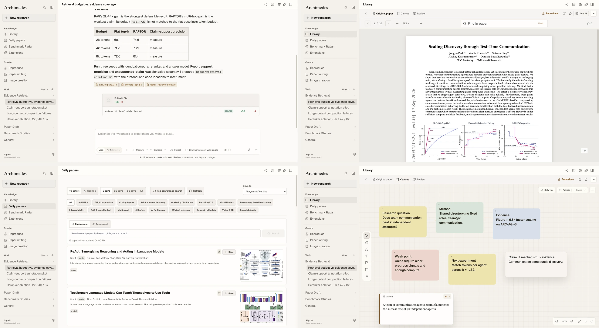
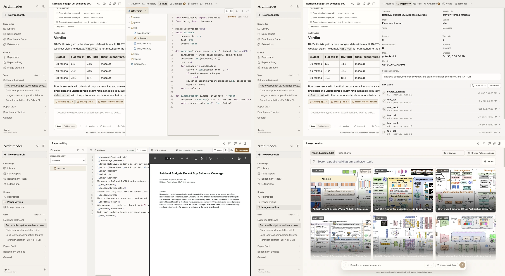

# Archimedes

> A local-first research-agent suite for discovering evidence, reading papers, inspecting code, running research work, and writing with traceability.

<p align="center">
  
</p>

<p align="center">
  
</p>

Archimedes is not a generic chat shell with a paper list attached. Its center of gravity is the research loop: question → sources → evidence → implementation → experiment → writing. It runs as an Electron desktop application, keeps workspace data local by default, and leaves model and search providers configurable rather than locked to one vendor.

## Install and Run

**Start here.** The recommended path is to let a coding agent handle the install and first launch.

### Recommended: let your coding agent install it

**Copy to agent.** Paste the block below into Claude Code, Codex, Cursor, or another coding agent that can work with files and a terminal.

```text
Install Archimedes on this machine from https://github.com/Johanson-colab/Archimedes.
The goal is a working local Electron desktop install, not just the web preview.

1. Verify that Git and Node.js 20+ are available.
2. Clone the repository into a sensible local folder and cd into it.
3. Run `npm install` and let the native terminal-module rebuild finish.
4. Create `.env.local` from `.env.example` using the platform-appropriate command.
   Do not ask me to paste API keys into chat. Pause and let me fill in the model configuration directly, then continue.
5. Start the app with `npm run dev`. Confirm that the Electron window opens.
   The renderer at 127.0.0.1:5173 alone is not sufficient.
6. If the terminal native module fails, run `npm run rebuild:native` and retry.
7. Report the commands you ran, the app location, and any exact remaining error.
```

This is the fastest path for non-developers: the agent can check prerequisites, run the install, diagnose native-module errors, and confirm the Electron window opens.

### Manual install

Prerequisites: [Git](https://git-scm.com/downloads) and a current Node.js LTS release (Node 20 or newer recommended). `npm` ships with Node. No Python service, database server, or global Electron installation is required.

```bash
git clone https://github.com/Johanson-colab/Archimedes.git
cd Archimedes
npm install
cp .env.example .env.local    # macOS / Linux
npm run dev
```

On Windows PowerShell, copy the environment template with:

```powershell
Copy-Item .env.example .env.local
```

Fill `.env.local` with an OpenAI-compatible endpoint before starting, or configure it later in **Settings → Models**:

```bash
ARCHIMEDES_LLM_API_KEY=your-api-key
ARCHIMEDES_LLM_BASE_URL=https://api.openai.com/v1
ARCHIMEDES_LLM_MODEL=gpt-6.1 Terra
```

The app opens without a model key, but chat and agent actions will not run. Web search is optional and uses a separate key.

| First-run issue | Fix |
| --- | --- |
| Native terminal module error after `npm install` | Run `npm run rebuild:native`, then `npm run dev` again. |
| Electron does not open after Vite starts | Check the terminal output for a port or Electron error, stop with `Ctrl+C`, then retry. |
| Chat cannot answer | Verify the three model values in `.env.local` or Settings → Models, then restart. |

## What It Does

- **Research Apps** — bring focused tools into a shared workspace for literature discovery, paper reading, reproduction, data analysis, and writing. The vision is to let researchers customize these workflows by combining Skills, MCP tools, models, and agent backends.
- **Literature discovery and reading** — explore Daily papers and conference catalogs, organize papers in project libraries, and read PDFs with search, notes, highlights, translation, and source-grounded discussion.
- **Paper and implementation** — open linked repositories and project sites alongside papers, and use reproduction workflows to investigate how research connects to code and data.
- **Analysis and writing** — work with research data, prepare LaTeX projects, compile and preview papers, and use the integrated terminal and workspace tools.
- **Extensions and backends** — discover Skills, plugins, and MCP servers through the marketplace, install supported Skill packages, and configure models and agent backends for research tasks. Support and attachment behavior vary by backend.
- **Research context and provenance** — preserve project conversations, papers, and source references so researchers can return to the context behind their work. Experiment lineage and broader evidence provenance are in development.
- **Research memory and collaboration** — long-term experience retention and shared research projects are areas of ongoing exploration.

Research App customization and automatic composition of Skills, MCP tools, models, and backends are part of the product direction; not every combination is supported today. Image generation is not wired up yet: Image creation currently provides a conference-figure gallery and a scaffolded compose dock.

## The Research Loop

1. **Define** — start with a research question and gather context in a project.
2. **Discover and read** — find related work, inspect papers and figures, and keep notes and source references.
3. **Connect and reproduce** — examine linked code and data, then prepare a reproduction or experiment in the workspace.
4. **Analyze and write** — investigate results and develop a paper using the analysis and writing tools.
5. **Review and revisit** — discuss findings, review drafts, and return to saved papers and conversations.

The longer-term goal is to connect questions, code, data, experiments, results, and conclusions through experiment lineage and evidence provenance, while retaining research experience and supporting collaboration across a shared project.

### Principles

- **Evidence before fluency.** Search leads, read pages, attached files, and repository contents remain distinguishable.
- **Paper, code, and data belong together.** Implementation evidence sits beside the paper claim it supports.
- **Local-first by default.** Workspace state is local; credentials stay in the Electron main process.
- **Human approval for consequential actions.** Agent-proposed file writes and shell commands pause for approval.
- **No fake completeness.** Missing proceedings, restricted sources, and unavailable metadata are surfaced rather than invented.


## Configuration and Privacy

Model providers and search providers are independent. Configure models in the in-app dialog or `.env.local`; configure web search in **Web data** with Brave, Tavily, Exa, or Firecrawl.

- Workspace records live in `.archimedes/archimedes.db`, ignored by Git.
- Model credentials are kept in the Electron main process and not exposed to the renderer.
- Agent writes and shell commands require explicit approve/reject decisions.
- Sandboxed browser windows handle dynamic or authenticated pages; the user signs in directly.
- The app does not bypass paywalls, private repositories, or source permissions.

## Validate

```bash
npm run lint
npm run build
npm test
```

## More

- [Authentication](docs/auth.md)
- [Artifacts](docs/artifacts.md)
- [Reproduction](docs/reproduce.md)
- [Workbench split panes](docs/workbench-split-panes.md)
- [Project, workspace and session model](docs/workspace-session-model.md)
- [Collaboration](docs/collaboration-api.md)
- [Theme tokens](docs/theme-tokens.md)

## Roadmap

Archimedes already covers the core research loop, but it is not finished. Next layers include durable project-level research memory, semantic retrieval across larger paper collections, richer reproducible experiment harnesses, more robust source adapters, and expanded plugin/MCP discovery with explicit permission boundaries.

The aim is not research theater. It is a reliable research companion that makes the chain from question to evidence to implementation easier to inspect, challenge, and extend.

## Community 

Feel free to join Archimedes wechat group for more information.


## Welcome to cite

If Archimedes supports your research, please cite it:

```bibtex
@software{archimedes2026,
  title   = {Archimedes: A Local-First Research-Agent Suite},
  author  = {Weijiang Lv and Jiayu Wang and Archimedes Contributors},
  year    = {2026},
  url     = {https://github.com/Johanson-colab/Archimedes}
}
```

In LaTeX, add `\cite{archimedes2026}` after including the BibTeX entry in your bibliography.
