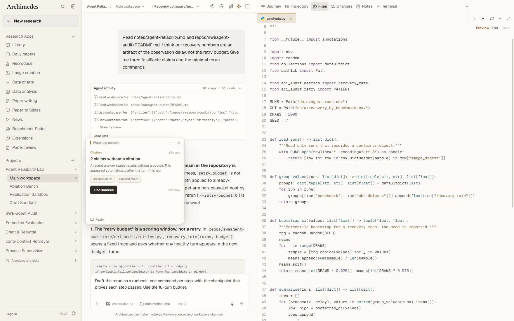

# Archimedes

<p align="center">
  <a href="README.md"></a>
  <a href="README.zh-CN.md"></a>
</p>

> A local-first research-agent suite for discovering evidence, reading papers, inspecting code, running research work, and writing with traceability.

**Website:** [archimedes-research.com](https://archimedes-research.com)

<p align="center">
  
</p>

Archimedes is not a generic chat shell with a paper list attached. Its center of gravity is the research loop: question → sources → evidence → implementation → experiment → writing. It runs as an Electron desktop application, keeps workspace data local by default, and leaves model and search providers configurable rather than locked to one vendor.

## Install and Run

### Desktop installers (recommended)

Download the Windows x64 or matching macOS Apple Silicon/Intel installer from the [published releases](https://github.com/Johanson-colab/Archimedes/releases). A desktop installer does not require Git, Node.js, npm, or a global Electron installation. Follow the selected release's first-launch instructions; the v0.1.0 builds are unsigned.

A release and the development branch can expose different features even when both show version 0.1.0. The v0.1.0 release hides account/cloud entry points; `main` continues their development. In source builds, **Settings → About → Build diagnostics** shows the commit, channel, source fingerprint, platform/architecture and feature policy. These fields identify a build; they do not claim a scientific result was verified.

### Develop from source

Use [Git](https://git-scm.com/downloads), Node.js **22.18+ within 22.x, or 24+**, and npm **10.9+ within 10.x, or 11.x**. The reproduction toolchain is pinned in `.node-version` and `packageManager`: **Node 26.13.0 / npm 11.20.0**. The declared compatibility range is broader than that tested combination. The Node floor also covers the repository's native TypeScript tests. Native terminal rebuilding may require the platform's C++ build tools.

```bash
git clone https://github.com/Johanson-colab/Archimedes.git
cd Archimedes
node scripts/check-toolchain.cjs
npm ci
npm run prepare:desktop
cp .env.example .env.local    # macOS / Linux
npm run dev
```

On Windows PowerShell, copy the template with `Copy-Item .env.example .env.local`.

`npm ci` uses the lockfile and rebuilds the native terminal module. `prepare:desktop` explicitly prepares the Electron binary, with a three-minute timeout; set `ARCHIMEDES_DESKTOP_PREPARE_TIMEOUT_MS` up to 600000 for a slow connection. Tests and startup checks report a missing binary without silently starting a download. `npm run dev` must open an Electron window; the renderer at 127.0.0.1:5173 alone is a preview.

The app opens without a model key. Configure an OpenAI-compatible provider later in **Settings → Models**, or edit `.env.local` directly:

```bash
ARCHIMEDES_LLM_API_KEY=your-api-key
ARCHIMEDES_LLM_BASE_URL=https://api.openai.com/v1
ARCHIMEDES_LLM_MODEL=your-provider-model-id
```

Do not paste credentials into an agent conversation. Local files, PDF reading and statistics remain available without a model; model and web-search actions need their respective configuration.

| First-run issue | Next step |
| --- | --- |
| Unsupported Node/npm | Run `npm run check:env`; use a compatible version or the pinned reproduction toolchain. |
| Missing Electron binary | Run `npm run prepare:desktop`, then `npm run check:desktop`. Check network/proxy access if preparation times out. |
| Native terminal module error | Run `npm run rebuild:native`, then retry. |
| Chat cannot answer | Check the provider's endpoint, exact model ID and key in Settings → Models. |

For a coding agent, ask it to follow these source-install commands, leave credentials for you to enter directly, and verify the actual Electron window and exact remaining errors. Prefer the released installer when you want to use Archimedes rather than develop it.

## What It Does

- **Research Apps** — bring focused tools into a shared workspace for literature discovery, paper reading, reproduction, data analysis, and writing. The vision is to let researchers customize these workflows by combining Skills, MCP tools, models, and agent backends.
- **Literature discovery and reading** — explore Daily papers and conference catalogs, organize papers in project libraries, and read PDFs with search, notes, highlights, translation, and source-grounded discussion.
- **Paper and implementation** — open linked repositories and project sites alongside papers, and use reproduction workflows to investigate how research connects to code and data.
- **Analysis and writing** — work with research data, prepare LaTeX projects, compile and preview papers, and use the integrated terminal and workspace tools.
- **Extensions and backends** — discover Skills, plugins, and MCP servers through the marketplace, install supported Skill packages, and configure models and agent backends for research tasks. Support and attachment behavior vary by backend.
- **Research context and provenance** — preserve project conversations, papers, and source references so researchers can return to the context behind their work. Experiment lineage and broader evidence provenance are in development.
- **Research memory and collaboration** — long-term experience retention and shared research projects are areas of ongoing exploration.

Research App customization and automatic composition of Skills, MCP tools, models, and backends are part of the product direction; not every combination is supported today. Image creation includes the FigureForge reference gallery, design/reconstruction workflow, editable SVG generation, and bitmap generation through a configured image-capable endpoint. It is a beta app, off by default. Reference semantic search runs locally in a browser/WASM worker after downloading its index and model weights; keyword search remains available if semantic loading fails. Model generation requires a compatible provider and may incur its charges.

## The Research Loop

1. **Define** — start with a research question and gather context in a project.
2. **Discover and read** — find related work, inspect papers and figures, and keep notes and source references.
3. **Connect and reproduce** — examine linked code and data, then prepare a reproduction or experiment in the workspace.
4. **Analyze and write** — investigate results and develop a paper using the analysis and writing tools.
5. **Review and revisit** — discuss findings, review drafts, and return to saved papers and conversations.

The longer-term goal is to connect questions, code, data, experiments, results, and conclusions through experiment lineage and evidence provenance, while retaining research experience and supporting collaboration across a shared project.

### Principles

- **Evidence before fluency.** Search leads, read pages, attached files, and repository contents remain distinguishable.
- **Paper, code, and data belong together.** Implementation evidence sits beside the paper claim it supports.
- **Local-first by default.** Workspace state is local; credentials stay in the Electron main process.
- **Human approval for consequential actions.** Agent-proposed file writes and shell commands pause for approval.
- **No fake completeness.** Missing proceedings, restricted sources, and unavailable metadata are surfaced rather than invented.


## Configuration and Privacy

Model providers and search providers are independent. Configure models in the in-app dialog or `.env.local`; configure web search in **Web data** with Brave, Tavily, Exa, or Firecrawl.

- Workspace records live in `.archimedes/archimedes.db`, ignored by Git.
- Model credentials are kept in the Electron main process and not exposed to the renderer.
- Agent writes and shell commands require explicit approve/reject decisions.
- Sandboxed browser windows handle dynamic or authenticated pages; the user signs in directly.
- The app does not bypass paywalls, private repositories, or source permissions.

## Validate

```bash
npm run check:env
npm run prepare:desktop
npm run lint
npm test
npm run build
npm run check:theme
```

`npm test` includes both real Electron layout regressions and requires a desktop display (use `xvfb-run npm test` on headless Linux). `npm run test:core` is a separate non-desktop iteration command, not a replacement for the full PR gate. Conditional external-service/fixture tests report their requirements rather than claiming a pass; see [development and release validation](docs/development-validation.md).

## More

- [Authentication](docs/auth.md)
- [Artifacts](docs/artifacts.md)
- [Reproduction](docs/reproduce.md)
- [Workbench split panes](docs/workbench-split-panes.md)
- [Project, workspace and session model](docs/workspace-session-model.md)
- [Collaboration](docs/collaboration-api.md)
- [Theme tokens](docs/theme-tokens.md)

## Roadmap

Archimedes already covers the core research loop, but it is not finished. Next layers include durable project-level research memory, semantic retrieval across larger paper collections, richer reproducible experiment harnesses, more robust source adapters, and expanded plugin/MCP discovery with explicit permission boundaries.

The aim is not research theater. It is a reliable research companion that makes the chain from question to evidence to implementation easier to inspect, challenge, and extend.

## Community 

Feel free to join Archimedes wechat group for more information.


## Welcome to cite

If Archimedes supports your research, please cite it:

```bibtex
@software{archimedes2026,
  title   = {Archimedes: A Local-First Research-Agent Suite},
  author  = {Weijiang Lv and Jiayu Wang and Archimedes Contributors},
  year    = {2026},
  url     = {https://github.com/Johanson-colab/Archimedes}
}
```

In LaTeX, add `\cite{archimedes2026}` after including the BibTeX entry in your bibliography.
