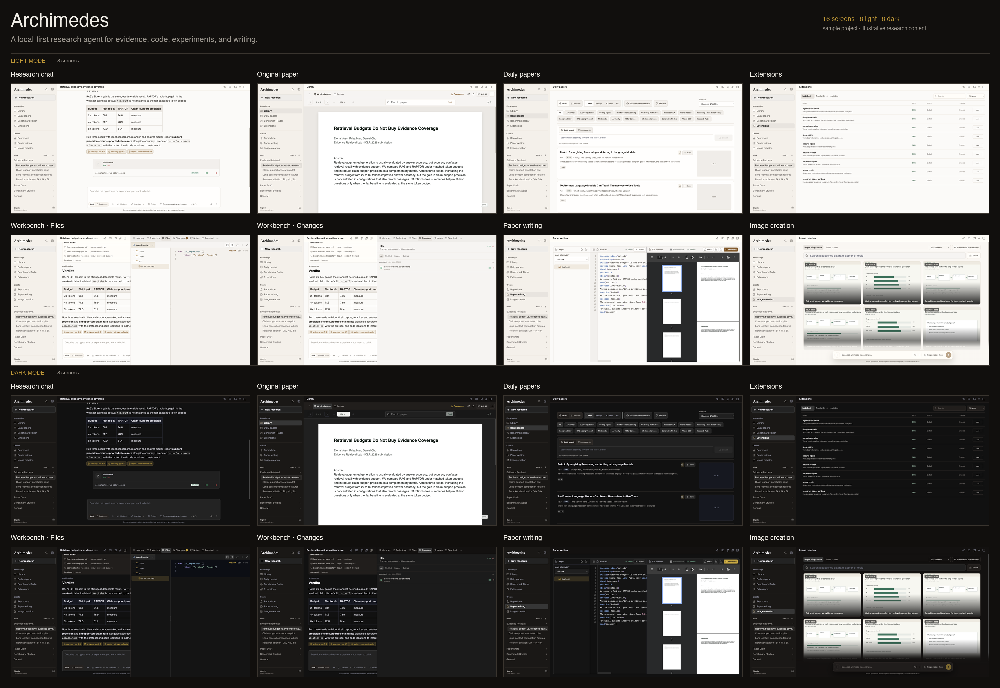

# Archimedes

> A local-first research-agent suite for discovering evidence, reading papers, inspecting code, running research work, and writing with traceability.
>
> 面向研究全流程的科研智能体工作台：把找论文、读论文、看项目代码、组织证据、开展实验和写作放回同一个可追溯的桌面应用中。

<p align="center">
  
</p>

<p align="center"><em>Eight light-mode screens: research chat, original paper reader, Daily papers, Extensions, Workbench Files and Trajectory, paper writing, and image creation. Sample project shown; research content is illustrative.</em></p>

Archimedes is not a generic chat shell with a paper list attached. Its center of gravity is the research loop: question → sources → evidence → implementation → experiment → writing. It runs as an Electron desktop application, keeps workspace data local by default, and leaves model and search providers configurable rather than locked to one vendor.

## Install and Run

**Start here.** The recommended path is to let a coding agent handle the install and first launch.

### Recommended: let your coding agent install it

**Copy to agent.** Paste the block below into Claude Code, Codex, Cursor, or another coding agent that can work with files and a terminal.

```text
Install Archimedes on this machine from https://github.com/Johanson-colab/Archimedes.
The goal is a working local Electron desktop install, not just the web preview.

1. Verify that Git and Node.js 20+ are available.
2. Clone the repository into a sensible local folder and cd into it.
3. Run `npm install` and let the native terminal-module rebuild finish.
4. Create `.env.local` from `.env.example` using the platform-appropriate command.
   Do not ask me to paste API keys into chat. Pause and let me fill in the model configuration directly, then continue.
5. Start the app with `npm run dev`. Confirm that the Electron window opens.
   The renderer at 127.0.0.1:5173 alone is not sufficient.
6. If the terminal native module fails, run `npm run rebuild:native` and retry.
7. Report the commands you ran, the app location, and any exact remaining error.
```

This is the fastest path for non-developers: the agent can check prerequisites, run the install, diagnose native-module errors, and confirm the Electron window opens.

### Manual install

Prerequisites: [Git](https://git-scm.com/downloads) and a current Node.js LTS release (Node 20 or newer recommended). `npm` ships with Node. No Python service, database server, or global Electron installation is required.

```bash
git clone https://github.com/Johanson-colab/Archimedes.git
cd Archimedes
npm install
cp .env.example .env.local    # macOS / Linux
npm run dev
```

On Windows PowerShell, copy the environment template with:

```powershell
Copy-Item .env.example .env.local
```

Fill `.env.local` with an OpenAI-compatible endpoint before starting, or configure it later in **Settings → Models**:

```bash
ARCHIMEDES_LLM_API_KEY=your-api-key
ARCHIMEDES_LLM_BASE_URL=https://api.openai.com/v1
ARCHIMEDES_LLM_MODEL=gpt-4.1-mini
```

The app opens without a model key, but chat and agent actions will not run. Web search is optional and uses a separate key.

| First-run issue | Fix |
| --- | --- |
| Native terminal module error after `npm install` | Run `npm run rebuild:native`, then `npm run dev` again. |
| Electron does not open after Vite starts | Check the terminal output for a port or Electron error, stop with `Ctrl+C`, then retry. |
| Chat cannot answer | Verify the three model values in `.env.local` or Settings → Models, then restart. |

## What It Does

- **Research chat** — persistent, project-scoped conversations with streamed answers, visible tool activity, resumable threads, and research modes for free chat, idea generation, experiment setup, paper writing, and paper review.
- **Evidence-aware context** — attach files, folders, papers, repositories, skills, plugins, and images. The composer supports drag-and-drop, prompt history, follow-up queues, slash commands, and a visible context-usage breakdown.
- **Discovery** — Daily papers with latest/trending views, date ranges, topic filters, keyword search, and official conference catalog search for ICML, ICLR, NeurIPS, CVPR, ICCV, ECCV, ACL, EMNLP, and AAAI.
- **Literature workspace** — project-scoped libraries, paper import, reading state, notes, highlights, full-paper PDF reading, page search, translation, and source-grounded discussion.
- **Paper plus code** — linked GitHub repositories and project sites open beside the paper so claims can be checked against visible implementation and data assets.
- **Extensions** — a multi-source marketplace for skills, plugins, MCP servers, and custom indexes. Skill packages can install into workspace or global `.agents/skills`; other types are discoverable and link to their source.
- **Writing and execution** — LaTeX paper projects with templates, compilation, PDF preview, an interactive terminal, auditable tool calls, and approval gates before writes or commands.
- **Research radar** — Benchmark Radar for emerging benchmarks, plus a conference figure gallery for visual inspiration and evidence gathering.
- **Paper presentations** — macOS-only: generate a 15-page lab-meeting deck after a saved review. Requires Kimi Desktop, LibreOffice, and a configured model provider.

Image generation is not wired up yet. The Image creation page is currently a conference-figure gallery and a scaffolded compose dock.

## The Research Loop

1. **Discover** — arXiv, official conference catalogs, the web, libraries, and paper figures.
2. **Read and ground** — open PDFs, search text, inspect pages and figures, highlight evidence, and keep page references.
3. **Connect paper and implementation** — open the linked repository or project page next to the paper.
4. **Think with context** — ask the agent in a project-scoped conversation using selected papers, files, folders, images, skills, and code.
5. **Build and validate** — use the workspace, LaTeX projects, and terminal for plans, experiments, drafts, and controlled actions.
6. **Organize and return** — save papers into libraries, preserve thread history, and revisit the evidence behind conclusions.

### Principles

- **Evidence before fluency.** Search leads, read pages, attached files, and repository contents remain distinguishable.
- **Paper, code, and data belong together.** Implementation evidence sits beside the paper claim it supports.
- **Local-first by default.** Workspace state is local; credentials stay in the Electron main process.
- **Human approval for consequential actions.** Agent-proposed file writes and shell commands pause for approval.
- **No fake completeness.** Missing proceedings, restricted sources, and unavailable metadata are surfaced rather than invented.

## Architecture

```text
React + Vite renderer
        |
Electron preload boundary
        |
Electron main process
  |        |        |
SQLite   Agent     Workspace / terminal / PDF / repository adapters
```

- Renderer: chat, library, paper reader, Daily papers, gallery, and project views.
- Main process: provider credentials, agent calls, filesystem and terminal control, and approval boundaries.
- Workspace database: `.archimedes/archimedes.db` for projects, threads, turns, libraries, approvals, and command history.
- Source adapters retain provenance for papers, conference catalogs, repository snapshots, and web evidence.

## Configuration and Privacy

Model providers and search providers are independent. Configure models in the in-app dialog or `.env.local`; configure web search in **Web data** with Brave, Tavily, Exa, or Firecrawl.

- Workspace records live in `.archimedes/archimedes.db`, ignored by Git.
- Model credentials are kept in the Electron main process and not exposed to the renderer.
- Agent writes and shell commands require explicit approve/reject decisions.
- Sandboxed browser windows handle dynamic or authenticated pages; the user signs in directly.
- The app does not bypass paywalls, private repositories, or source permissions.

## Validate

```bash
npm run lint
npm run build
npm test
```

## More

- [Authentication](docs/auth.md)
- [Artifacts](docs/artifacts.md)
- [Reproduction](docs/reproduce.md)
- [Collaboration](docs/collaboration-api.md)
- [Theme tokens](docs/theme-tokens.md)

## Roadmap

Archimedes already covers the core research loop, but it is not finished. Next layers include durable project-level research memory, semantic retrieval across larger paper collections, richer reproducible experiment harnesses, more robust source adapters, and expanded plugin/MCP discovery with explicit permission boundaries.

The aim is not research theater. It is a reliable research companion that makes the chain from question to evidence to implementation easier to inspect, challenge, and extend.

## Welcome to cite

If Archimedes supports your research, please cite it:

```bibtex
@software{archimedes2026,
  title   = {Archimedes: A Local-First Research-Agent Suite},
  author  = {Weijiang Lv and Jiayu Wang and {Archimedes Contributors}},
  year    = {2026},
  url     = {https://github.com/Johanson-colab/Archimedes}
}
```

In LaTeX, add `\cite{archimedes2026}` after including the BibTeX entry in your bibliography.
