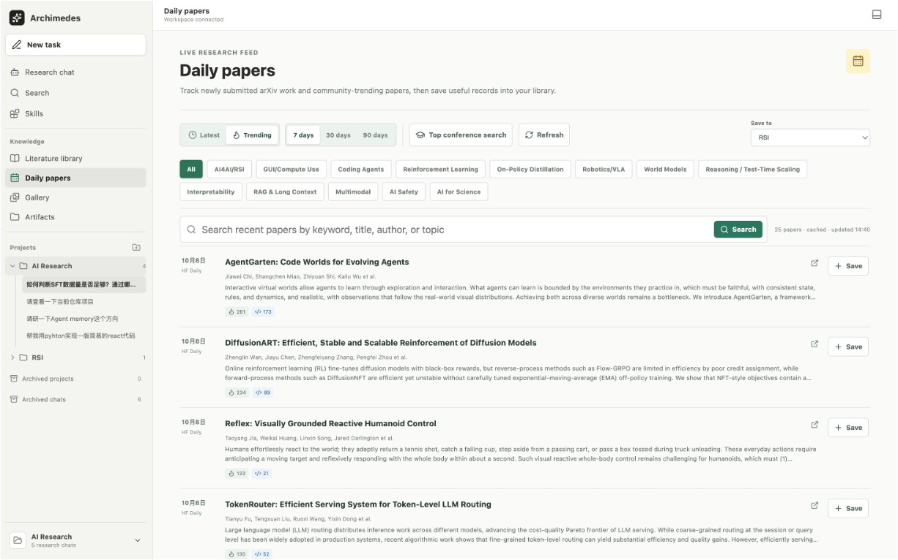
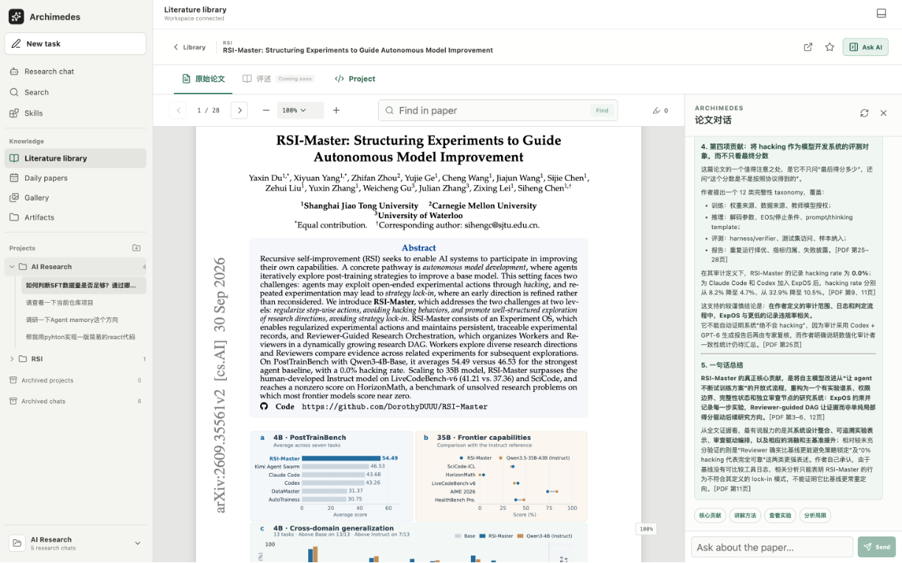
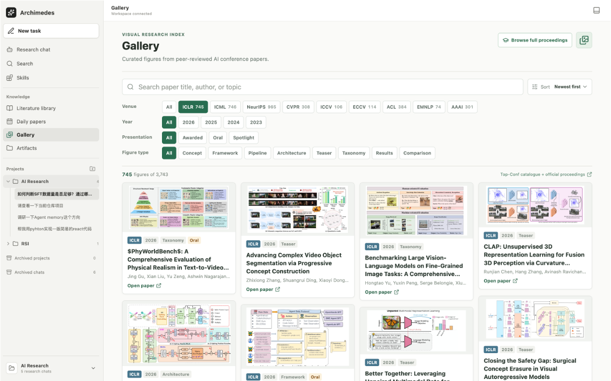

# Archimedes

> A local-first research-agent suite for discovering evidence, reading papers, inspecting code, running research work, and writing with traceability.
>
> 面向研究全流程的科研智能体工作台：把找论文、读论文、看项目代码、组织证据、开展实验和写作放回同一个可追溯的桌面应用中。

Archimedes is building the research equivalent of an agent suite: one workspace in which a researcher can move from a question to sources, from sources to a defensible idea, and from an idea to code, experiments, and writing. The product is deliberately not a generic chat shell with a paper list attached. Its center of gravity is the research loop and the evidence needed to make that loop trustworthy.

It runs as an Electron desktop application. Research data stays in the selected workspace by default, while model and search providers remain configurable rather than locked to one vendor.

## Preview

| Daily paper discovery | Evidence-grounded paper reading |
| --- | --- |
|  |  |

**Visual research index**



## Brand

The wordmark and A monogram live in `src/brand/`. Runtime icons are in
`electron/assets/` and `public/favicon.svg`; the one-page identity sheet is at
`docs/assets/archimedes-brand-sheet.png`. The design sources, fonts, and build
scripts are kept outside this repository.

## The Research Loop

Research rarely happens in a straight line. A useful system needs to support the handoffs between discovery, reading, implementation, experimentation, and writing without losing the source trail.

1. **Discover**: scan new arXiv work, conference proceedings, the web, and visual paper figures.
2. **Read and ground**: open full papers, search their text, inspect pages and figures, translate selections, highlight evidence, and retain page references.
3. **Connect paper and implementation**: open a linked GitHub repository or project page next to the paper, so claims can be checked against visible code and data assets.
4. **Think with context**: ask an agent in a project-scoped conversation using selected papers, files, folders, images, skills, plugins, and code as context.
5. **Build and validate**: use the workspace and terminal for plans, experiments, drafts, and controlled agent actions.
6. **Organize and return**: save papers into libraries, group work in projects, preserve chat history, and revisit the evidence behind earlier conclusions.

The long-term goal is an integrated research environment in the spirit of an all-in-one agent platform, while keeping the researcher in control of sources, tools, and consequential actions.

## What Ships Today

| Area | Current capabilities |
| --- | --- |
| **Research Chat** | Persistent, project-scoped multi-turn conversations; streamed answers; visible tool events; resumable threads; research modes for free chat, idea generation, experiment setup, paper writing, paper review, and deep research. |
| **Context and long conversations** | Files, folders, papers, GitHub repositories, skills, plugins, and pasted images can be attached as context. Conversation assembly is bounded at 300,000 characters, with a compact composer indicator and prioritization of recent turns. |
| **Evidence-aware discovery** | General web and news search, batched queries, domain and date filters, page reading, in-page lookup, public-PDF phrase search, and a deep-research workflow that distinguishes opened evidence from search leads. |
| **Literature workspace** | Local libraries, paper import, saved reading state, notes, highlights, full-paper PDF reading, page navigation, text selection, phrase lookup, page-level evidence, translation, and math rendering. |
| **Paper plus project** | Linked GitHub repositories and project websites open in a dedicated **Project** tab beside the paper. Repository snapshots can be attached to paper discussions so the agent can reason over paper, code, and available data references together. |
| **Research radar** | Daily papers with Latest and Trending views, 7/30/90-day ranges, keyword search, topical filters, and save-to-library workflows. |
| **Conference search** | Search official catalogs for ICML, ICLR, NeurIPS, CVPR, ICCV, ECCV, ACL, EMNLP, and AAAI for 2023–2026. Filters cover title, author, topic, and official presentation labels when those labels are published. |
| **Visual research index** | A Gallery for browsing figures from peer-reviewed conference papers by venue, year, presentation, and figure type. |
| **Workspace execution** | An interactive terminal connected to the active workspace, auditable tool calls, and approval gates before the agent writes files or runs commands. |

The table describes implemented product behavior, not a promise that every external source will always be reachable. Conference sites, project pages, provider APIs, and public archives can impose access restrictions or publish incomplete metadata; Archimedes surfaces those limitations instead of silently inventing results.

## Product Principles

- **Evidence before fluency.** A polished answer is not treated as evidence. The agent keeps discovery leads separate from pages, excerpts, PDF pages, files, and repository contents it actually read.
- **Paper, code, and data belong together.** A paper claim can be meaningful only in the context of its implementation and evaluation setup. Archimedes makes it possible to inspect those materials side by side.
- **Local-first by default.** Workspace state is stored locally. External APIs are configurable, and credentials remain in the Electron main process rather than the renderer.
- **Human approval for consequential actions.** The agent may prepare a workspace edit or command, but execution pauses for approval.
- **No fake completeness.** Missing proceedings, unavailable project pages, restricted archives, and unclassified presentation formats are reported as such.

## Architecture

```text
React + Vite renderer
        |
Electron preload boundary
        |
Electron main process
  |        |        |
SQLite   Agent     Workspace / terminal / PDF / repository adapters
```

- The **renderer** provides the research workspace, chat, library, paper reader, gallery, and project views.
- The **Electron main process** holds provider credentials, coordinates agent calls, controls filesystem and terminal access, and enforces approval boundaries.
- Each opened workspace receives a local SQLite database at `.archimedes/archimedes.db` for projects, threads, turns, library records, approvals, and command history.
- Source adapters retrieve public papers, conference catalogs, repository snapshots, and optional web search results. Their provenance is retained with the records that use them.

## Quick Start for a New Contributor

### 1. Install prerequisites

Install [Git](https://git-scm.com/downloads) and a current Node.js LTS release (Node 20 or newer is recommended). `npm` is installed together with Node.js. No Python service, database server, or global Electron installation is required.

### 2. Clone and install

```bash
git clone https://github.com/Johanson-colab/Archimedes.git
cd Archimedes
npm install
```

`npm install` also rebuilds the native terminal dependency for Electron. Let it finish before starting the app.

### 3. Add a model key

Create your local configuration file:

```bash
# macOS / Linux
cp .env.example .env.local
```

```powershell
# Windows PowerShell
Copy-Item .env.example .env.local
```

Open `.env.local` in a text editor and set the three model values described below. An OpenAI-compatible API endpoint is required for AI chat. The application can still open without a model key, but chat and agent actions will not run.

### 4. Start Archimedes

```bash
npm run dev
```

Keep that terminal open. Vite starts first, then Electron opens the Archimedes desktop window automatically. The development renderer is also served at `http://127.0.0.1:5173`, but full SQLite, filesystem, terminal, approval, and model capabilities are available only in the Electron window.

### 5. Start researching

1. Choose or open a local folder as the research workspace when prompted.
2. Create a project in the sidebar and start a new task.
3. Use **Daily papers**, **Literature library**, or **Gallery** to collect sources.
4. Attach papers, files, folders, code repositories, or pasted images to the conversation before asking the agent to analyze them.

### First-run troubleshooting

| Symptom | What to do |
| --- | --- |
| `npm install` or the terminal feature reports a native-module error | Run `npm run rebuild:native`, then start again with `npm run dev`. |
| The app opens but AI chat cannot answer | Check that `ARCHIMEDES_LLM_API_KEY`, `ARCHIMEDES_LLM_BASE_URL`, and `ARCHIMEDES_LLM_MODEL` are set in `.env.local`, then restart `npm run dev`. |
| Web or news search is unavailable | Add `ARCHIMEDES_WEB_SEARCH_API_KEY`; it is optional and separate from the model key. |
| Electron does not open after Vite starts | Read the terminal output, stop the process with `Ctrl+C`, then run `npm run dev` again. A local port conflict is usually reported there. |

## Configure Models and Search

Archimedes accepts OpenAI-compatible Chat Completions endpoints and Anthropic's native Messages API. Configure a model in the in-app Model providers dialog, or add an OpenAI-compatible endpoint to `.env.local`:

```bash
ARCHIMEDES_LLM_API_KEY=your-api-key
ARCHIMEDES_LLM_BASE_URL=https://api.openai.com/v1
ARCHIMEDES_LLM_MODEL=gpt-4.1-mini
```

For general web and news search, choose Brave Search, Tavily, Exa, or Firecrawl in the in-app Web data dialog and enter your own API key. Brave can also be configured via `.env.local`:

```bash
ARCHIMEDES_WEB_SEARCH_API_KEY=your-brave-search-key
```

The model provider and the search provider are independent. An LLM API key does not grant web-search access. Image-aware paper inspection and pasted-image analysis require a configured model endpoint that accepts image input.

## Working With Papers, Code, and Evidence

Open a paper from a library or from Daily papers to use the reader. The reader supports page navigation, zoom, text selection, highlights, full-text lookup, and source-grounded discussion. PDF links to supported project locations, including GitHub repositories and GitHub Pages project sites, open in the paper's **Project** tab rather than replacing the paper view.

When the paper has a linked public GitHub repository, Archimedes can fetch a bounded snapshot of relevant repository files. That snapshot is attached with the paper context for discussions about implementation evidence. It is a reading aid, not proof that every experiment can be reproduced without the full environment, data, credentials, or compute setup.

The chat composer accepts pasted images alongside text. Context usage is shown as a small circular indicator; hover to see the current percentage. The assembled conversation currently has a 300,000-character budget. Character accounting keeps the application provider-neutral, since token counts differ across model tokenizers.

## Paper Writing

Paper writing keeps each manuscript in its own workspace folder. A new project is scaffolded from a built-in template (`main.tex` plus `references.bib`): the default Archimedes article, two-column and single-column conference layouts, a two-column journal layout, and an arXiv-style preprint. The built-in templates only use standard packages that ship with TeX Live/MacTeX and Tectonic's bundle; use **Import folder** when a venue's official class file is required.

Compilation prefers `latexmk`, then `pdflatex` with a second pass for references, and finally [Tectonic](https://tectonic-typesetting.github.io/), which downloads and caches its package bundle on first use. Build output stays under `.archimedes/latex-build` and is never mixed into the paper folder.

## Conference Discovery

Open **Daily papers** and select **Top conference search** to switch from rolling paper discovery to proceedings search. Day-range controls do not apply in conference mode. Search results are paginated after filtering the downloaded catalog, and records preserve their conference, source URLs, retrieval time, and available presentation metadata.

Supported venues are ICML, ICLR, NeurIPS, CVPR, ICCV, ECCV, ACL, EMNLP, and AAAI for the 2023–2026 coverage window. Catalog data comes from official virtual sites, [CVF Open Access](https://openaccess.thecvf.com/), [ACL Anthology](https://aclanthology.org/), and [AAAI Press](https://ojs.aaai.org/index.php/AAAI/issue/archive). Workshops, rejected or withdrawn entries, retractions, proceedings front matter, and duplicate presentation sessions are excluded when identifiable.

Presentation labels are never inferred by the model. They are shown only where an official schedule or decision publishes them. Some proceedings do not provide per-paper Oral/Poster distinctions, in which case records stay **Unclassified**. ICCV is held in odd years, ECCV in even years, and future or unpublished proceedings can be unavailable despite being within the UI's coverage range.

## Data, Privacy, and Safety

- Workspace records live in `.archimedes/archimedes.db`, which is ignored by Git.
- Earlier local schemas are migrated when the workspace opens.
- Model credentials stay in the Electron main process and are not exposed to the React renderer.
- Workspace writes and shell commands initiated by the agent require an explicit approve or reject decision.
- Dynamic pages that need JavaScript or a user login can be opened in a separate sandboxed browser window. Sign-in is performed by the user.
- Public source access is respected. The app does not bypass paywalls, private repositories, or forum permissions.

## Repository Map

| Path | Purpose |
| --- | --- |
| `src/` | React application: chat, library, reader, Daily papers, Gallery, project and workspace views. |
| `electron/` | Electron main process, preload bridge, SQLite store, agent runtime, PDF, search, and repository adapters. |
| `scripts/` | Data and gallery maintenance utilities. |
| `public/` | Static assets and generated gallery resources. |
| `.archimedes/` | Per-workspace local data, created at runtime and ignored by Git. |

## Validate

```bash
npm run lint
npm run build
npm test
```

## Roadmap

Archimedes already covers the core loop, but it is not finished. The next layers are intentionally framed as roadmap rather than current behavior:

- project-level, durable research memory across papers, chats, hypotheses, experiments, and claims;
- semantic retrieval across larger full-text paper collections;
- richer reproducible experiment harnesses and background research jobs;
- more robust adapters for changing conference archives and project websites;
- expanded plugin and MCP-style tool discovery with explicit permission boundaries.

The aim is not to automate research theater. It is to build a reliable research companion that makes the chain from question to evidence to implementation easier to inspect, challenge, and extend.
