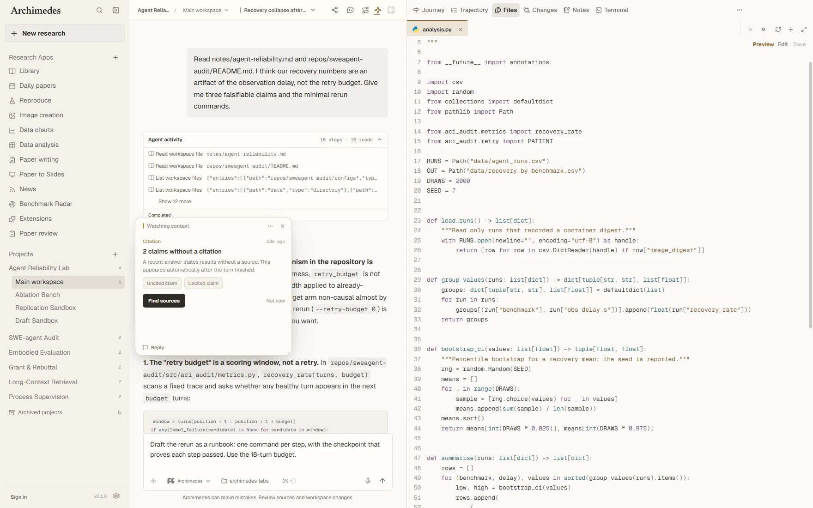

# Archimedes

<p align="center">
  <a href="README.md"></a>
  <a href="README.zh-CN.md"></a>
</p>

> 本地优先的研究智能体套件：发现证据、阅读论文、检查代码、运行研究工作，并在可追溯的前提下完成写作。

**网站：** [archimedes-research.com](https://archimedes-research.com)

<p align="center">
  
</p>

Archimedes 不是套着论文列表的通用聊天壳。它的重心是研究闭环：问题 → 来源 → 证据 → 实现 → 实验 → 写作。它以 Electron 桌面应用运行，默认将工作区数据保存在本地，并让模型与搜索提供方可配置，而不是绑定到单一厂商。

## 安装与运行

### 桌面安装包（推荐）

从[发布页](https://github.com/Johanson-colab/Archimedes/releases)下载 Windows x64 或对应的 macOS Apple Silicon/Intel 安装包。使用安装包不需要 Git、Node.js、npm 或全局 Electron。首次启动请按所选版本的发布说明操作；v0.1.0 安装包尚未签名。

发布版和开发主线可能同显 0.1.0，却开放不同功能。v0.1.0 隐藏账户和云端入口，`main` 继续开发这些能力。源码构建可在 **设置 → 关于 → 构建诊断** 查看 commit、通道、源码指纹、运行平台/架构和功能范围；这些信息用于识别构建，不表示科研结果已经验证。

### 从源码开发

需要 [Git](https://git-scm.com/downloads)、**Node.js 22.18+（22.x）或 24+**，以及 **npm 10.9+（10.x）或 11.x**。`.node-version` 和 `packageManager` 固定复现组合为 **Node 26.13.0 / npm 11.20.0**；声明的兼容范围比该实测组合更宽。Node 下限也满足仓库直接运行 TypeScript 测试的需要。原生终端模块重建可能需要本平台的 C++ 构建工具。

```bash
git clone https://github.com/Johanson-colab/Archimedes.git
cd Archimedes
node scripts/check-toolchain.cjs
npm ci
npm run prepare:desktop
cp .env.example .env.local    # macOS / Linux
npm run dev
```

Windows PowerShell 用 `Copy-Item .env.example .env.local` 复制模板。

`npm ci` 使用锁文件并重建原生终端模块。`prepare:desktop` 显式准备 Electron 二进制，三分钟超时；慢网络可将 `ARCHIMEDES_DESKTOP_PREPARE_TIMEOUT_MS` 设置到最多 600000。测试和启动预检发现二进制缺失会立即提示，不再隐式开始下载。`npm run dev` 必须打开 Electron 桌面窗口，仅有 127.0.0.1:5173 网页预览不算完成。

没有模型 key 也能打开应用。稍后在 **设置 → 模型** 配置 OpenAI 兼容提供商，或直接编辑 `.env.local`：

```bash
ARCHIMEDES_LLM_API_KEY=your-api-key
ARCHIMEDES_LLM_BASE_URL=https://api.openai.com/v1
ARCHIMEDES_LLM_MODEL=your-provider-model-id
```

不要将凭据粘贴进智能体对话。本地文件、PDF 阅读和统计在无模型时仍可用；模型和网页搜索操作需要各自的配置。

| 首次运行问题 | 下一步 |
| --- | --- |
| Node/npm 版本不支持 | 运行 `npm run check:env`，使用兼容版本或固定的复现组合。 |
| Electron 二进制缺失 | 运行 `npm run prepare:desktop`，再运行 `npm run check:desktop`；准备超时时检查网络/代理。 |
| 原生终端模块报错 | 运行 `npm run rebuild:native` 后重试。 |
| 聊天无法回答 | 在设置 → 模型中核对提供商端点、准确模型 ID 和 key。 |

让编码智能体安装时，请它遵循上面的源码安装命令，凭据由你直接输入，并核实真正的 Electron 窗口与准确错误。只想使用 Archimedes 时优先选发布安装包。

## 功能

- **Research Apps** —— 将文献发现、论文阅读、复现、数据分析和写作等聚焦工具放入共享工作区。目标是让研究者通过组合 Skills、MCP 工具、模型和智能体后端来自定义这些工作流。
- **文献发现与阅读** —— 浏览 Daily papers 和会议目录，在项目 library 中整理论文，并通过搜索、笔记、高亮、翻译和基于来源的讨论来阅读 PDF。
- **论文与实现** —— 在论文旁打开关联仓库和项目网站，使用复现工作流研究研究与代码、数据之间的联系。
- **分析与写作** —— 处理研究数据、准备 LaTeX 项目、编译和预览论文，并使用集成终端与工作区工具。
- **扩展与后端** —— 通过 marketplace 发现 Skills、插件和 MCP 服务器，安装受支持的 Skill 包，并为研究任务配置模型与智能体后端。支持范围和附件行为因后端而异。
- **研究上下文与来源** —— 保留项目对话、论文和来源引用，让研究者回到工作背后的上下文。实验谱系和更广泛的证据溯源仍在开发中。
- **研究记忆与协作** —— 长期经验保留和共享研究项目是持续探索的方向。

Research App 自定义，以及 Skills、MCP 工具、模型和后端的自动组合，属于产品方向；并非所有组合目前都受支持。Image creation 已包含 FigureForge 参考图库、设计/重建工作流、可编辑 SVG 生成，以及通过已配置图像端点生成位图；该 beta 应用默认关闭。语义检索下载索引和模型权重后在浏览器 WASM worker 中本地运行，加载失败仍可用关键词检索。模型生成需要兼容提供商，并可能产生其服务费用。

## 研究闭环

1. **定义** —— 从研究问题开始，在项目中收集上下文。
2. **发现与阅读** —— 查找相关工作，检查论文和图表，并记录笔记和来源引用。
3. **连接与复现** —— 检查关联代码和数据，然后在工作区中准备复现或实验。
4. **分析与写作** —— 使用分析和写作工具研究结果并撰写论文。
5. **评审与回访** —— 讨论发现、评审草稿，并回到保存的论文和对话。

长期目标是通过实验谱系和证据溯源，将问题、代码、数据、实验、结果和结论连接起来，同时保留研究经验并支持共享项目中的协作。

### 原则

- **证据优先于流畅表达。** 搜索命中、已读页面、附件文件和仓库内容始终可区分。
- **论文、代码和数据应当放在一起。** 实现证据与它所支撑的论文主张并列呈现。
- **默认本地优先。** 工作区状态保存在本地；凭据保留在 Electron 主进程。
- **重要操作需要人类批准。** 智能体提出的文件写入和 shell 命令会暂停以等待批准。
- **不伪造完整性。** 缺失的 proceedings、受限来源和不可用元数据会被明确暴露，而不是编造。

## 配置与隐私

模型提供方和搜索提供方相互独立。在应用内对话框或 `.env.local` 中配置模型；在 **Web data** 中使用 Brave、Tavily、Exa 或 Firecrawl 配置网页搜索。

- 工作区记录保存在 `.archimedes/archimedes.db`，由 Git 忽略。
- 模型凭据保存在 Electron 主进程，不会暴露给渲染进程。
- 智能体写入和 shell 命令需要明确的批准/拒绝。
- 沙箱浏览器窗口处理动态或需要登录的页面；用户直接登录。
- 应用不会绕过付费墙、私有仓库或来源权限。

## 验证

```bash
npm run check:env
npm run prepare:desktop
npm run lint
npm test
npm run build
npm run check:theme
```

`npm test` 包含两个真实 Electron 布局回归，需要桌面显示环境（无头 Linux 可用 `xvfb-run npm test`）。`npm run test:core` 是单独的非桌面迭代命令，不能替代 PR 的完整检查。依赖外部服务或指定 fixture 的测试会明确报告条件，不冒充通过；见[开发与发布验收](docs/development-validation.md)。

## 更多

- [Authentication](docs/auth.md)
- [Artifacts](docs/artifacts.md)
- [Reproduction](docs/reproduce.md)
- [Workbench split panes](docs/workbench-split-panes.md)
- [Project, workspace and session model](docs/workspace-session-model.md)
- [Collaboration](docs/collaboration-api.md)
- [Theme tokens](docs/theme-tokens.md)

## 路线图

Archimedes 已覆盖核心研究闭环，但尚未完成。下一阶段包括持久的项目级研究记忆、更大论文集合上的语义检索、更丰富的可复现实验工具、更稳健的来源适配器，以及带有明确权限边界的插件/MCP 发现。

目标不是研究表演，而是可靠的科研伴侣：让从问题到证据再到实现的链条更容易检查、质疑和扩展。

## 社区

欢迎加入 Archimedes 微信群了解更多信息。


## 欢迎引用

如果 Archimedes 对你的研究有帮助，请引用：

```bibtex
@software{archimedes2026,
  title   = {Archimedes: A Local-First Research-Agent Suite},
  author  = {Weijiang Lv and Jiayu Wang and Archimedes Contributors},
  year    = {2026},
  url     = {https://github.com/Johanson-colab/Archimedes}
}
```

在 LaTeX 中，将 BibTeX 条目加入参考文献后，使用 `\cite{archimedes2026}` 引用。
