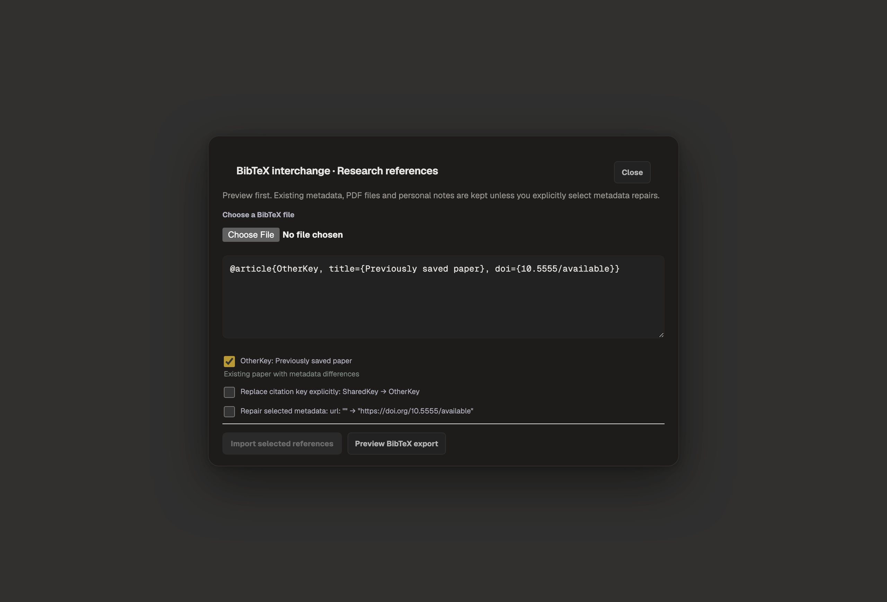
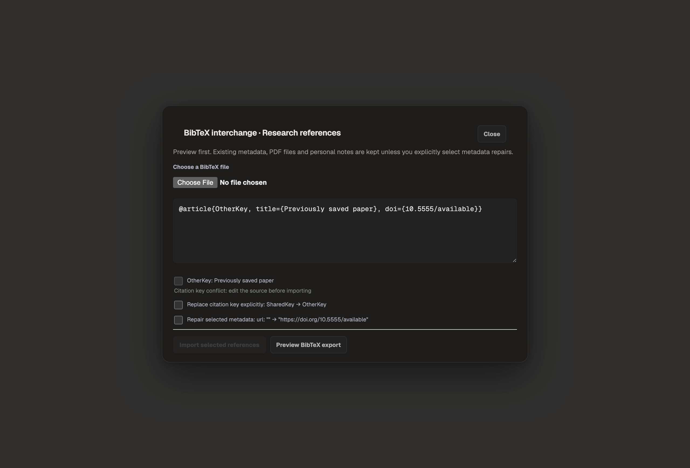

# BibTeX citation key comparison

Both images use the application’s BibTeX dialog in Electron at 1280 × 870 CSS pixels, in English and charcoal. The before image uses upstream `ae8c18d`, and the after image uses `3c61e96`. A disposable SQLite fixture starts with two papers that use the same key in separate collections. Both previews import the same DOI into the target collection, with “Replace citation key explicitly” unchecked.

| Before | After |
| --- | --- |
|  |  |

The import would keep `SharedKey`, which the target collection already uses. The fixed preview displays the conflict. An explicit unused replacement is accepted. A replacement that conflicts in another collection rolls back the attempted attachment.
