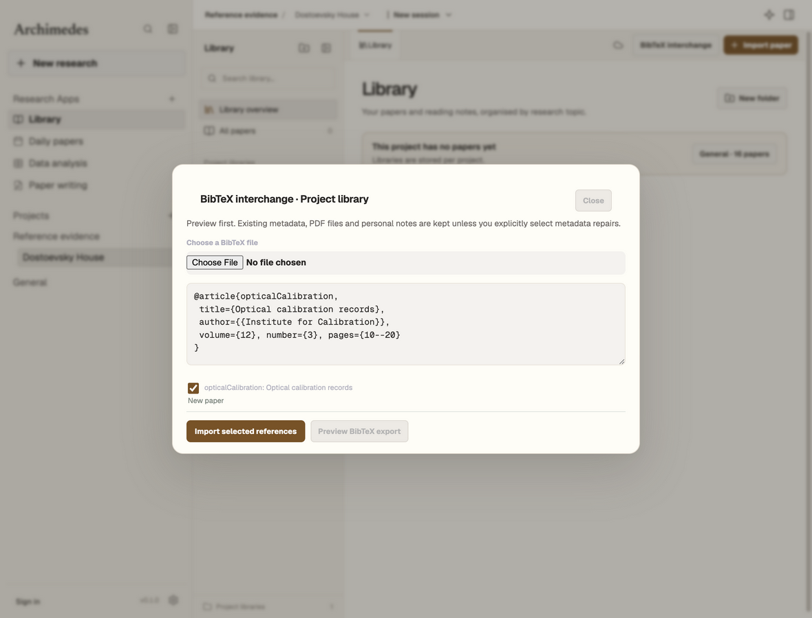
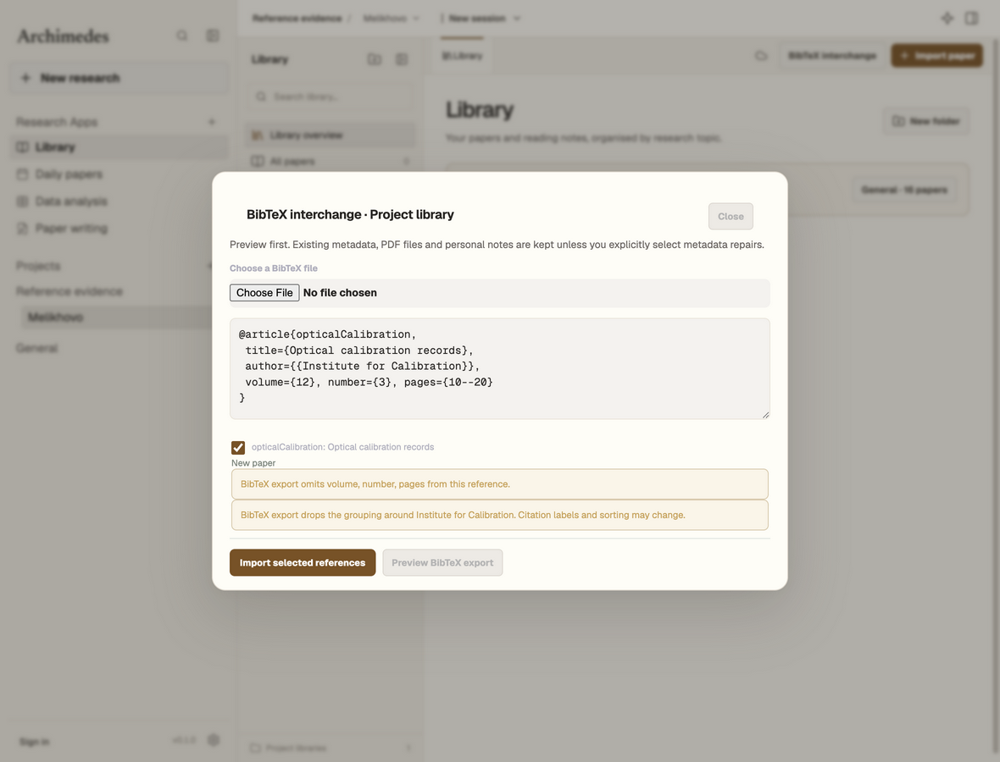

# BibTeX export-loss preview

Both English screenshots show the same `opticalCalibration` fixture in the Paper theme at 1180 × 900 in macOS Electron. The baseline at `ae8c18d` previews an article with `volume`, `number`, `pages` and an explicitly grouped author. The updated preview identifies both export losses on the affected reference before import.

| Before | After |
| --- | --- |
|  |  |

The [Chinese after capture](paper-zh-after.png) shows the same warnings in Chinese. In both builds, a local import saved the selected reference and the export preview confirmed the four omissions described by the fixture.
