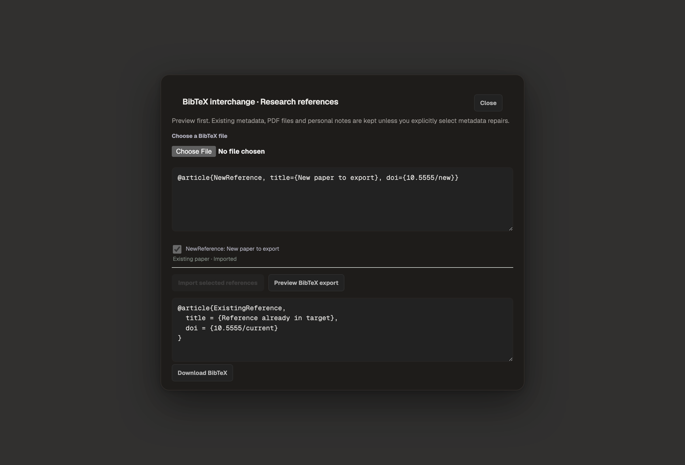
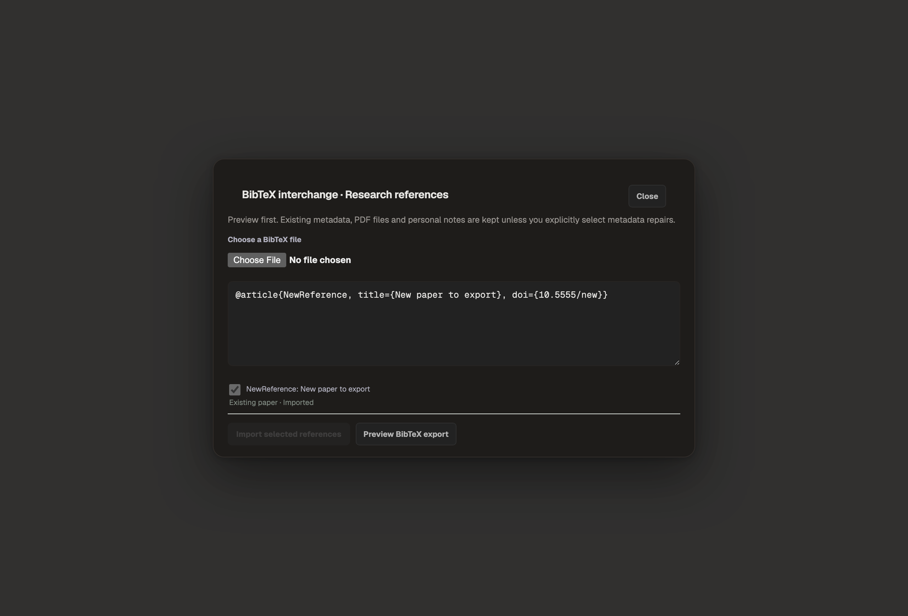

# BibTeX export preview comparison

Both images use the application’s BibTeX dialog in Electron at 1280 × 870 CSS pixels, in English and charcoal. The before image uses upstream `ae8c18d`, and the after image uses `a7741cf`. With an export preview already open, the same disposable SQLite collection imports `NewReference`. The screenshots show the state immediately after the import.

| Before | After |
| --- | --- |
|  |  |

Opening the export preview again shows both references.
