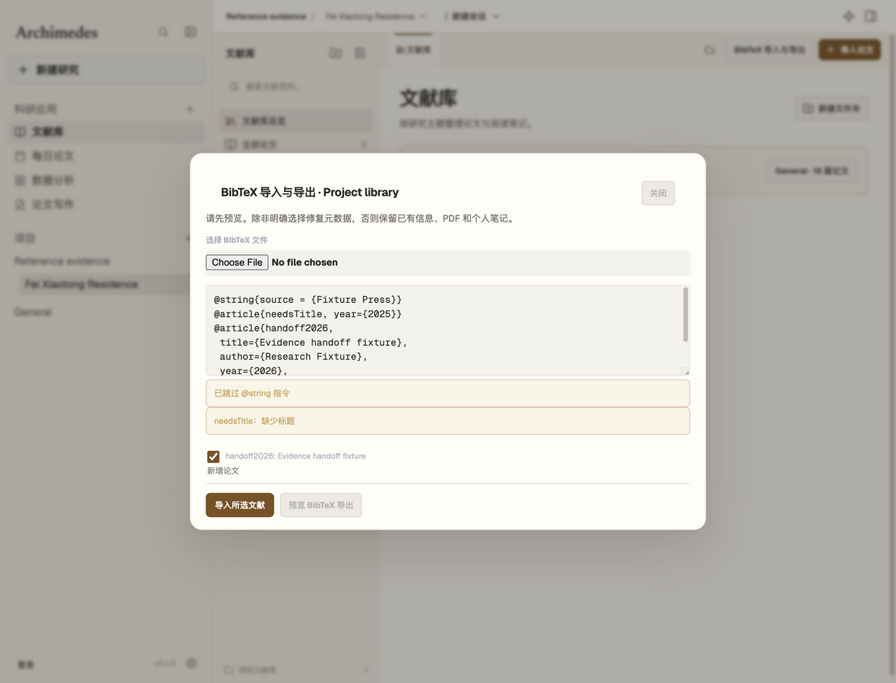

# BibTeX import warning localization

These screenshots use macOS Electron, the Paper theme and a 1180 × 900 content viewport. The Chinese comparison uses the same fixture and library in both builds, with `ae8c18d` as the baseline. The source includes a skipped `@string` directive, an entry with a missing title, and one valid reference.

| Chinese before | Chinese after |
| --- | --- |
|  |  |

The [English after capture](paper-en-after.png) shows the same two warnings in English. After each capture, **Import selected references** saved only the valid `handoff2026` entry to the fixture's local library.
