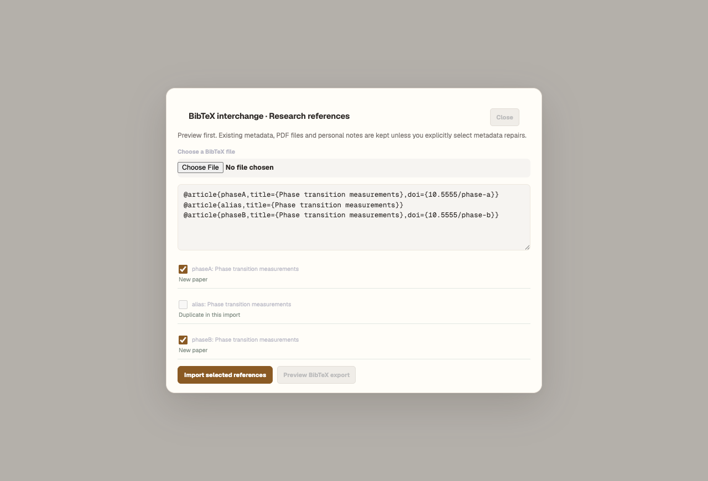

# Two papers with the same title in a BibTeX batch

The first and third entries report different DOIs. The middle entry repeats the title without a DOI. Previously it suppressed the distinct third paper. The revised preview keeps both identified papers available for import and marks only the middle entry as a duplicate.

| Before | After |
| --- | --- |
|  |  |

Actual Library dialog rendered in Electron at 1280 × 870, Paper theme, English, using the same BibTeX and a disposable SQLite collection. No provider calls were made.
