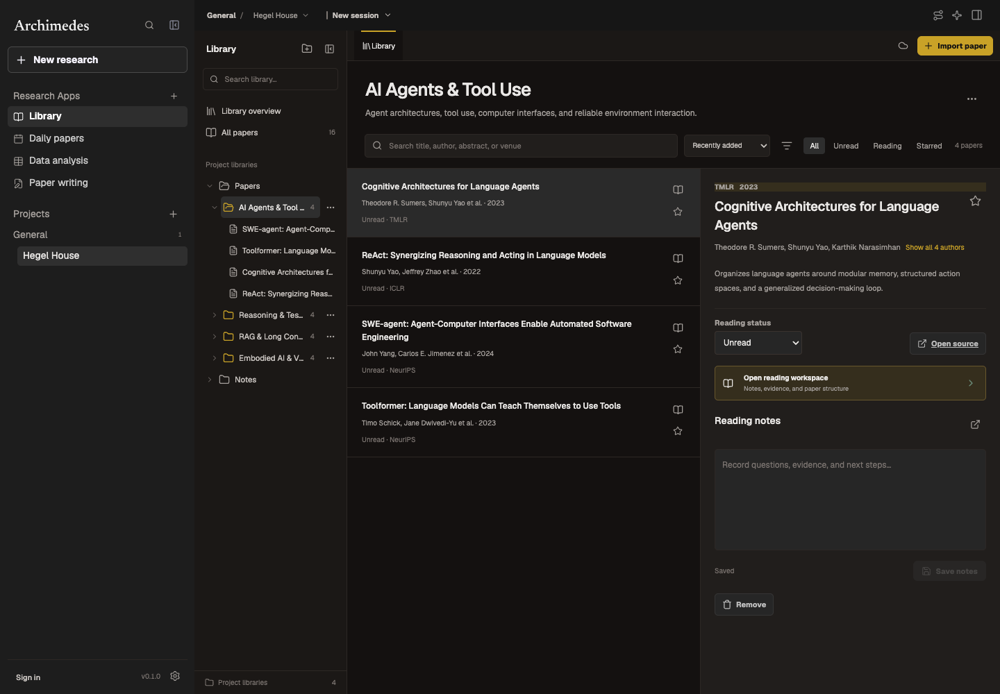
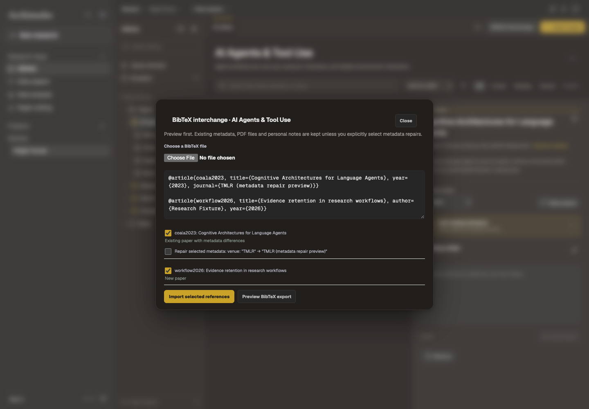

# BibTeX interchange comparison

Both images use the actual renderer at 1440 × 1000 CSS pixels, charcoal, English,
default text size and the same bundled preview project/collection
(`AI Agents & Tool Use`). Before is upstream `1f4b375`; after is this branch's
code at `4931448` (the following commit adds only these images and this note).

| Before | After |
| --- | --- |
|  |  |

The baseline has no BibTeX dialog, so the before image shows its existing
collection entry. The after image opens the new interchange action for that same
collection and previews two explicit fixture references: one existing paper with
an unselected venue repair, and one new example paper. The example is fixture
data, not a retrieved publication. No metadata repair has been applied in this
image. Import, selective repair, export round trips and persistence are covered
by real component/SQLite/IPC tests.
