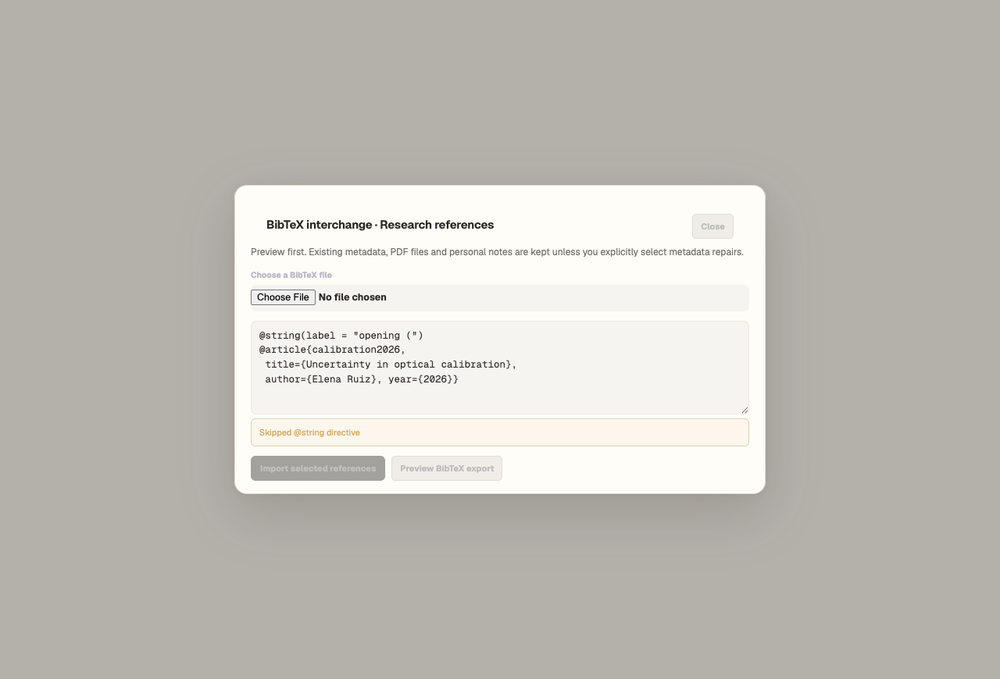
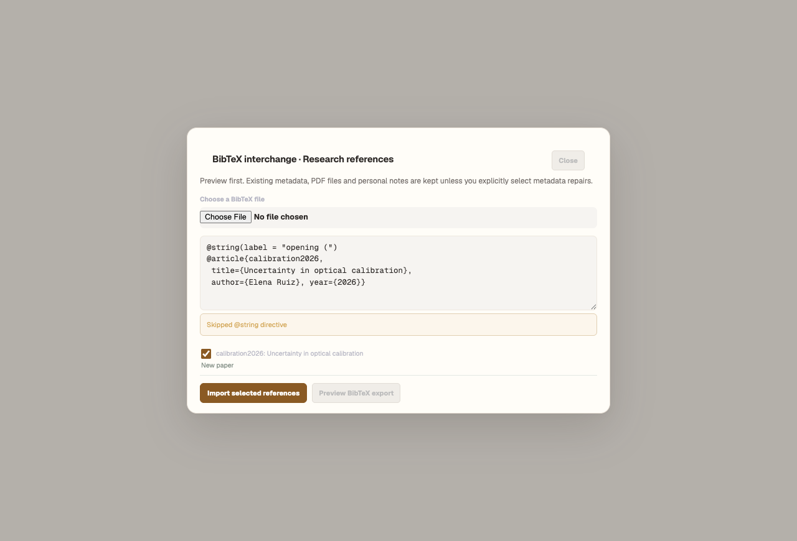

# References following a quoted BibTeX directive

A quoted opening parenthesis in a valid string directive used to consume the rest of the file. The same pasted source now produces one importable article. The string directive itself is skipped in both runs.

| Before | After |
| --- | --- |
|  |  |

Actual Library dialog rendered in Electron at 1280 × 870, Paper theme, English, using the same BibTeX and a disposable SQLite collection. No provider calls were made.
