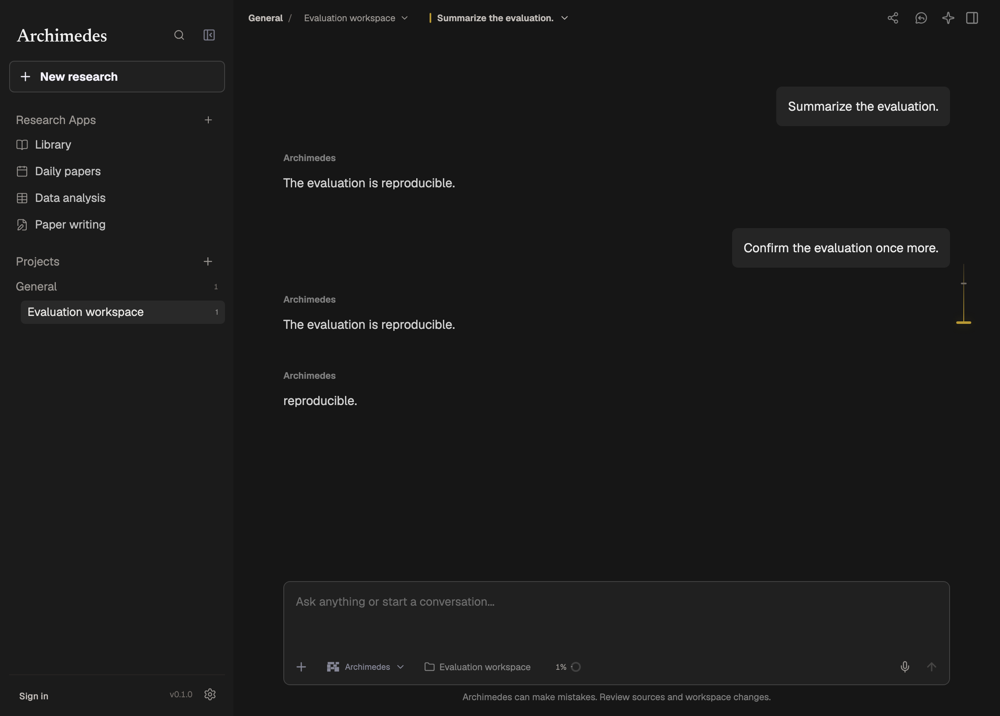
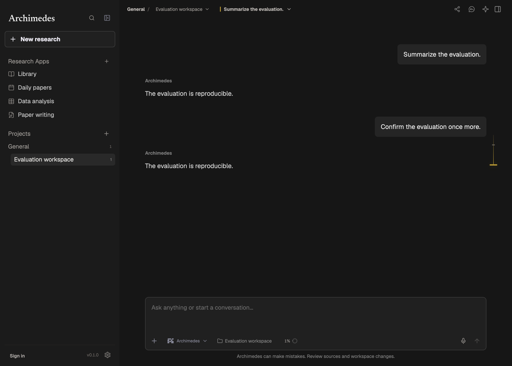

# Chat stream completion comparison

Both captures use the full application in Electron at 1200 × 860, Charcoal and English. A loopback model sends the same response to two prompts. The first chunk is displayed while each answer streams. The fixture delays the last renderer event until the complete answer has been saved and displayed.

| Before (`ae8c18d`) | After (`c3d7000`) |
| --- | --- |
|  |  |

Both runs saved exactly two turns with identical assistant text. The fixed renderer suppresses the late event for its already-saved turn.
