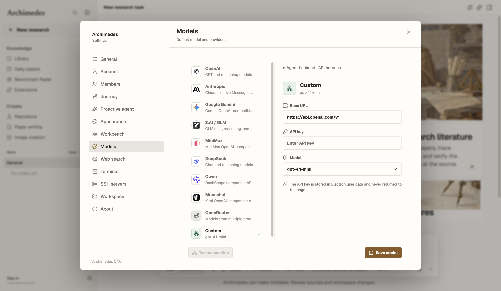
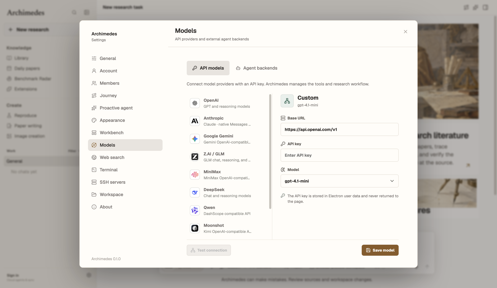
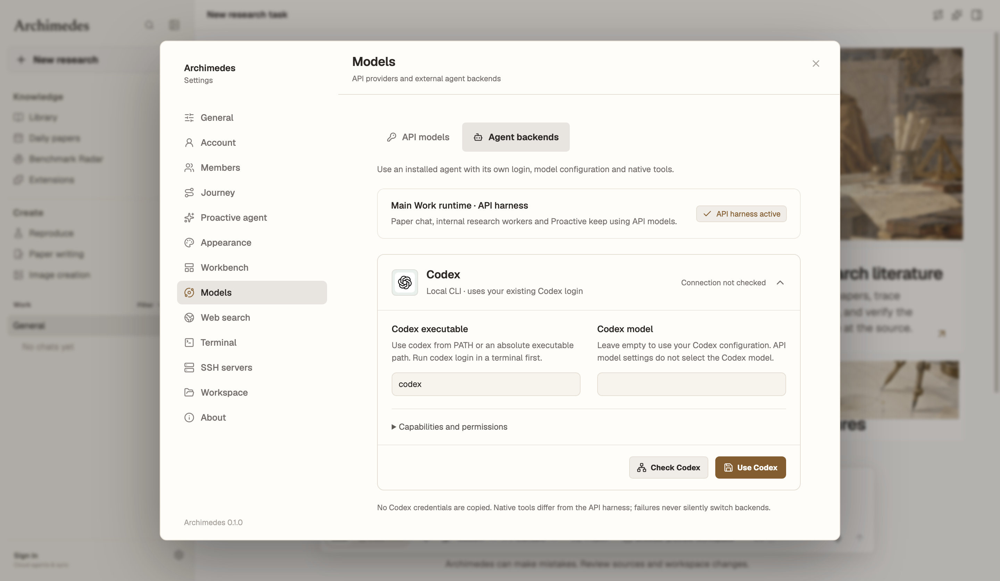
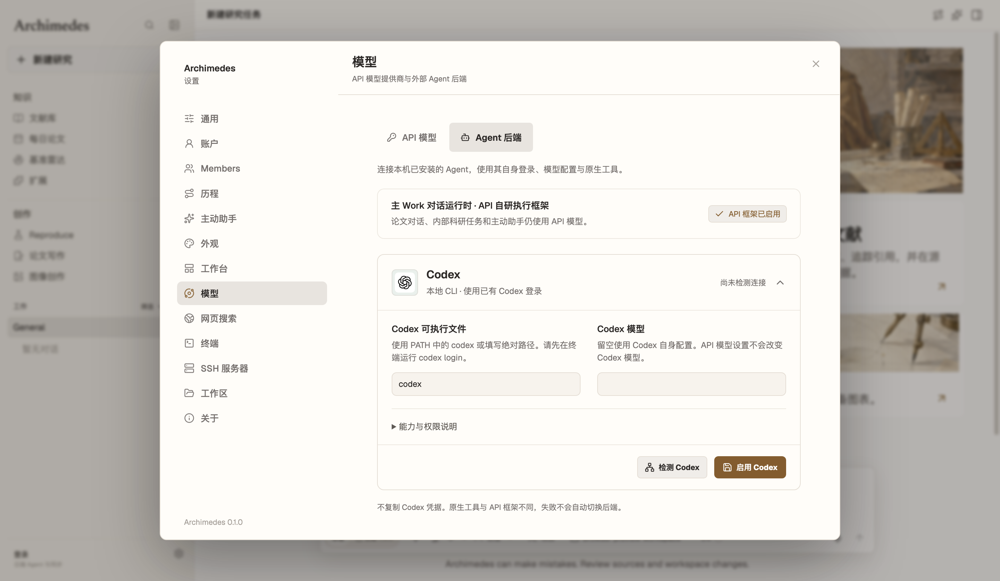
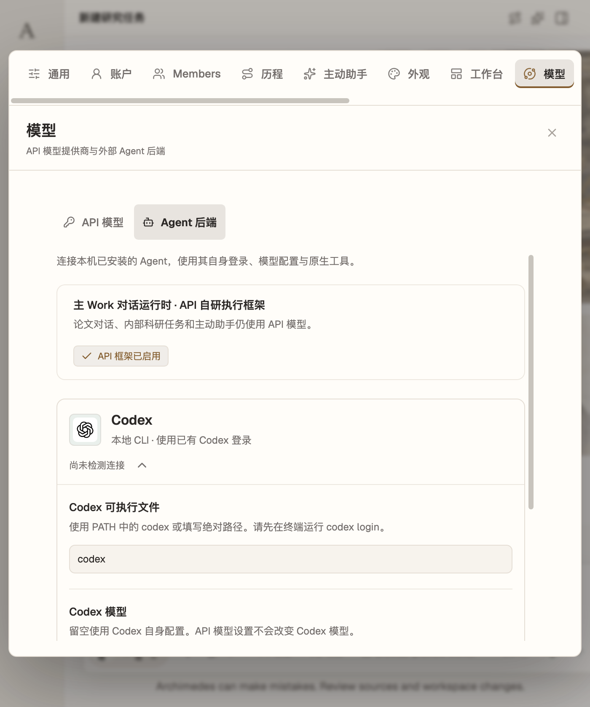
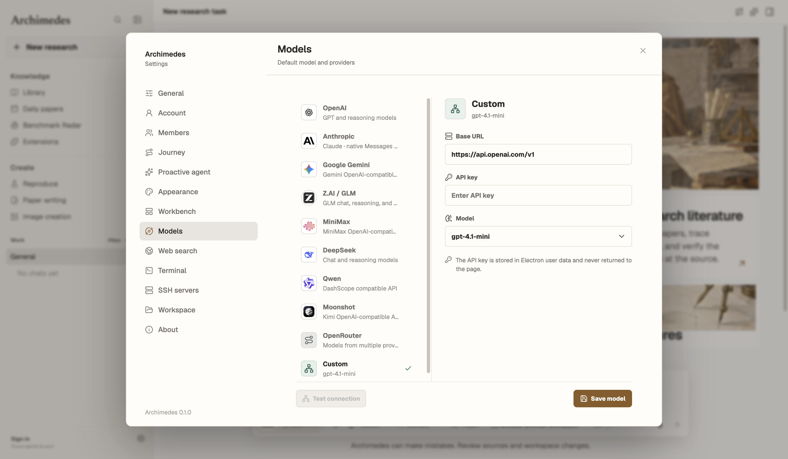
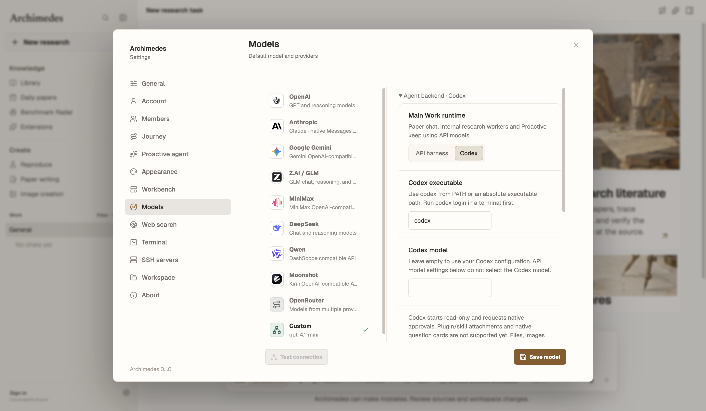
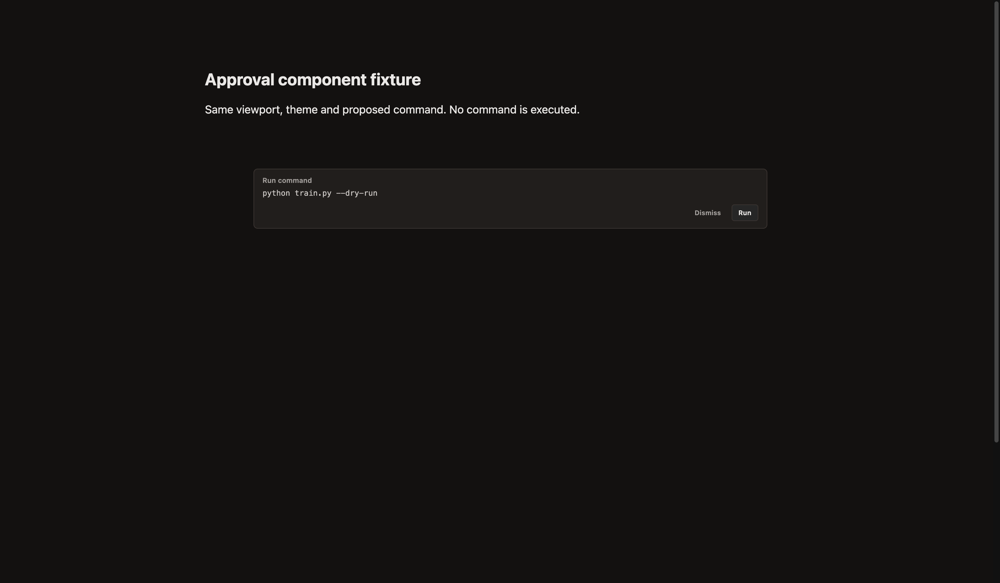

# Codex backend verification

Environment: macOS, Node 25.8.1, Codex CLI 0.161.0. Base: `f78b030`.

## Models layout update

Settings now has separate **API models** and **Agent backends** tabs. The native
card, activation and connection status are independent of API provider controls.
Opening or switching tabs never launches Codex or changes the saved runtime.
The Codex card is expanded by default and can be collapsed manually.

Fresh targeted checks: **25 passed, 0 failed**, including protocol/integration,
translations, UI interactions, bounded configuration loads, ordinary and
development StrictMode mount/unmount cycles, and safe DOM assertion failures.
The serial, heap-limited diagnostic process tree peaked at approximately 327 MiB.

Before/after, same viewport, Paper theme and API state (preview renderer, no
credentials or native login claims):




Agent tab and language/narrow-window checks:





The owner's reported high Electron/Codex memory usage is **not fully explained
or declared fixed**. See the [memory investigation](memory-investigation.md)
for the confirmed test-side issue, bounded measurements, and remaining limits.

## Initial backend implementation evidence

## Automated checks

```text
node --test electron/agent/codex-backend.test.cjs electron/codex-agent-integration.test.cjs
tests 11, pass 11, fail 0

npm test
tests 771, pass 764, fail 3, skipped 4

npm run lint       PASS
npm run build      PASS (large-chunk advisory remains)
npm run check:theme PASS
git diff --check   PASS
```

Full-suite failures, also reproduced on unchanged main:

```text
Windows prefers PowerShell 7 when it is installed
Windows falls back to Windows PowerShell before cmd
explicit shell profiles do not fall through to a different shell
```

The new regression tests cover JSON-RPC correlation, timeout without replay,
invalid messages, process exit, history continuity, native approvals, denial of
unsupported requests, cancellation, secret-free configuration, no API-key
dependency and prevention of duplicate renderer execution.

## Real Codex smoke results

```json
{"ready":true,"modelCount":8}
{"firstReply":"ARCHIMEDES_CODEX_SMOKE_OK","successfulBinding":true}
{"secondReply":"ARCHIMEDES_CODEX_SMOKE_OK","resumeVerified":true}
{"approvalCount":1,"fileCreated":false,"replyReceived":true}
```

The two conversation turns used separate app-server processes with the same
persisted thread. The mutation probe was in a disposable empty directory;
approval was denied. No project files or credentials were modified by the probes.

## UI evidence

Settings (same API selection, theme, viewport):




Expanded Codex controls (separate state):



Actual conversation approval component, controlled fixture (same command,
viewport and effective dark styling). The after state marks native ownership;
the terminal does not execute a native approval. These are component audits,
not a screenshot of a live training job:



