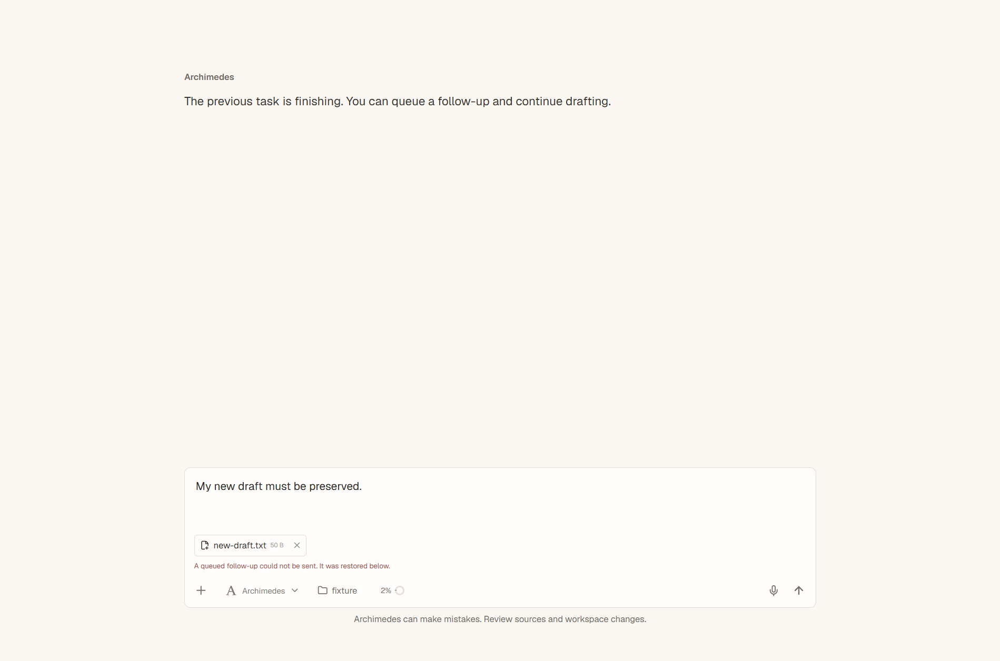
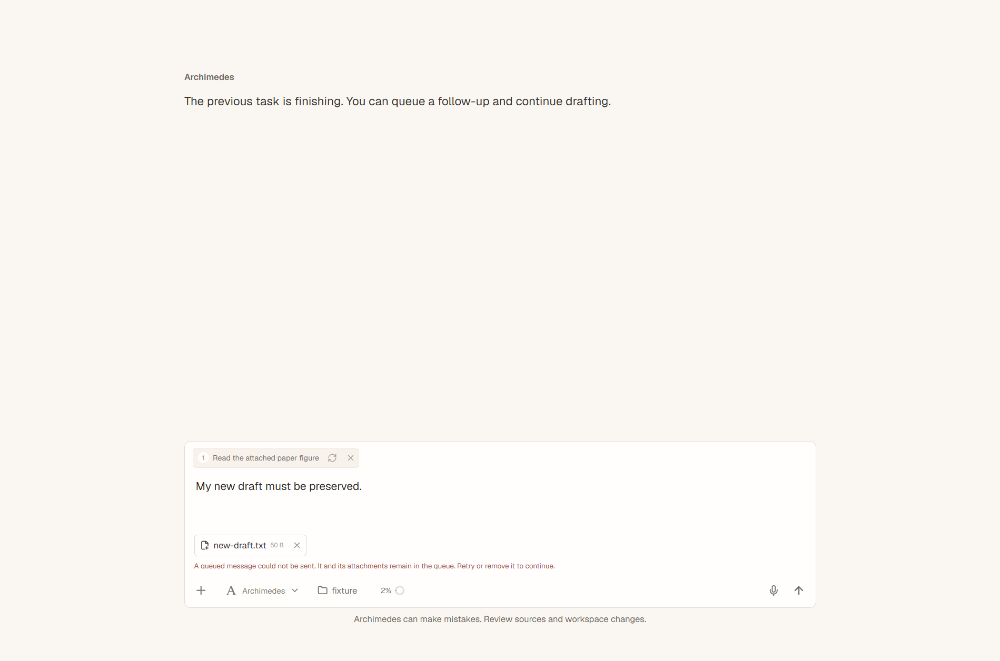
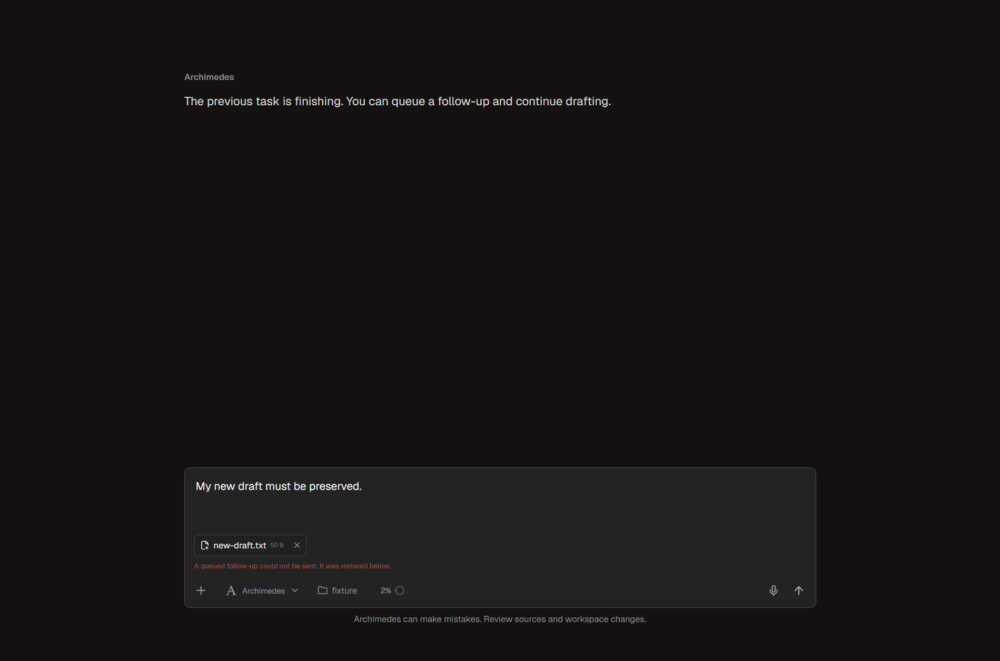
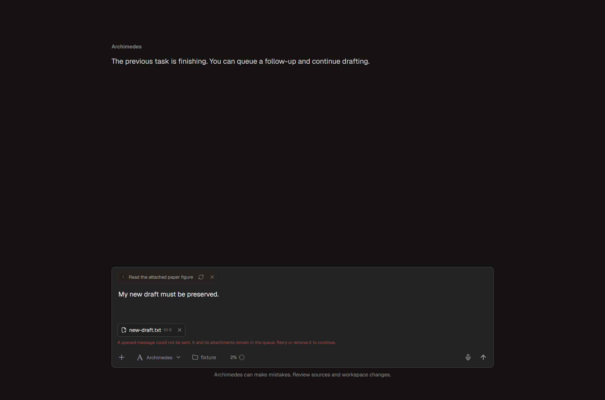

# Queued follow-up failure recovery

Refs [#209](https://github.com/Johanson-colab/Archimedes/issues/209).
Baseline: `822b182a8c29295145b6e5d2ae8b3bd39b1d0c6c` (main).
Validation date: 2026-11-12, Windows x64, Node 24.14.0.

## Reproduction and expected behavior

1. While a turn is running, queue a follow-up with an image attached.
2. Enter a different, unsent draft and change its attachments.
3. Finish the running turn and make the queued submission return `false`.
4. Keep the failed follow-up and its original attachment payload in the queue.
   Leave the new draft and its attachments unchanged; pause further automatic
   delivery until the failed item is retried or explicitly removed.
5. Retry successfully. Send the original queued payload exactly once, remove
   that queue entry, and clear the error without overwriting the new draft.

Before the fix, step 3 removed the follow-up from the queue and displayed
"It was restored below" even though the nonempty input prevented restoration.

## UI evidence

These are real Electron captures of `ConversationView` and the application CSS
using a synthetic submission callback, rather than a live model provider.
The before view uses the baseline component. Both use the same 1280 x 900 DIP
viewport and identical inputs. Windows display scaling determines PNG size.
HTTP(S) requests are blocked and no credentials or research data are used.

| Theme | Before | After |
| --- | --- | --- |
| Paper |  |  |
| Charcoal |  |  |

The fixture checks queue length (before: 0; after: 1), unchanged draft text,
the original image attachment on both initial submission and retry, successful
retry removal, and disappearance of the error after retry.

## Automated validation

- `node --test electron/composer-queue.test.cjs electron/ui-audit-composer.test.cjs`:
  22 passed, including 6 new behavior tests using real React effects in StrictMode.
- The new tests cover false/rejected submissions, preserved payloads and draft,
  double-click retry, busy transitions, ordered continuation, explicit removal,
  clearing an in-flight item, repeated failures, and late completion after unmount.
- `npm run lint`, `npm run build`, `npm run check:theme`, and
  `git diff --check`: passed. Build retains the existing large-chunk warning.
- Full suite on the unmodified baseline: 1160 tests, 1057 passed, 86 failed,
  17 skipped. With the fix: 1166 tests, 1063 passed, the same 86 failed and
  17 skipped. Failed test names match exactly; no new failures were introduced.
  The full suite is **not green** on this Windows machine.

Electron checks reused the already installed Electron 43.4.1 distribution via
`ELECTRON_OVERRIDE_DIST_PATH`; no model services were exercised. This change
does not add durable queue storage across application restarts or conversation
unmounts.
