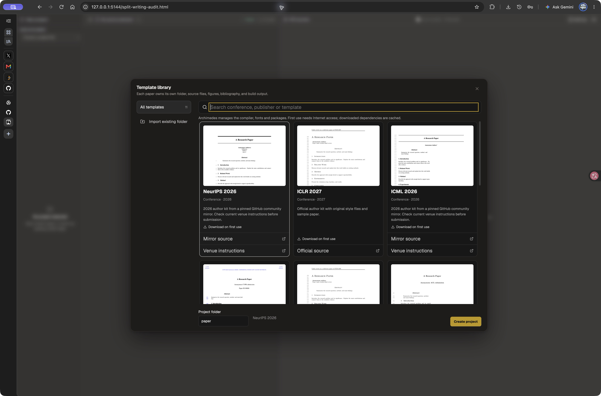

# Existing manuscript entry

The two captures use the same 1,440 × 1,000 renderer viewport and Charcoal theme.
They are direct browser content screenshots without browser chrome. Both point at the same synthetic execution
folder containing `paper/main.tex`, a section file and `references.bib`.
The renderer mounts the branch's actual `PaperWritingView`; its local desktop
bridge reads the fixture through the existing filesystem helpers.

- **Before:** upstream main `1f4b375` initially opens the template library.
- **After:** this branch initially offers the existing manuscript in place,
  with the template workflow available through **New manuscript**.

The entry state is deliberately shown before selecting a manuscript. Opening
the listed row was also checked and loaded the main file with its section
folder and bibliography. No compiler is needed for opening the manuscript.

## LaTeX suggestions across projects

The desktop captures use the real Electron renderer and preload at 1,180 × 900
with the Charcoal theme. Two disposable projects contained a `paper/main.tex`.
A controlled compiler failure went through the normal LaTeX build IPC in the
Optics project. After switching to the Materials chat, both runs clicked
**Ask AI to fix** on the Optics suggestion.

- **Before (`8b88f64`)** places the Optics repair draft in the Materials chat.
- **After (`abf11c4`)** leaves the Materials composer empty and prompts the user
  to return to the source conversation. The suggestion remains available.

A second run held the compiler result until Materials was active. Before the
fix, Materials received one LaTeX suggestion. After the fix, it received zero.
Returning to Optics displayed the original diagnostics in both runs.

