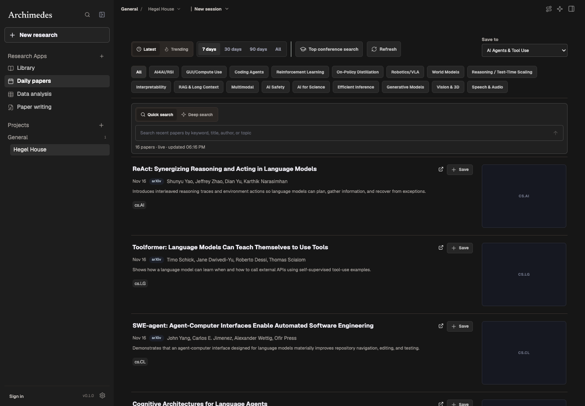
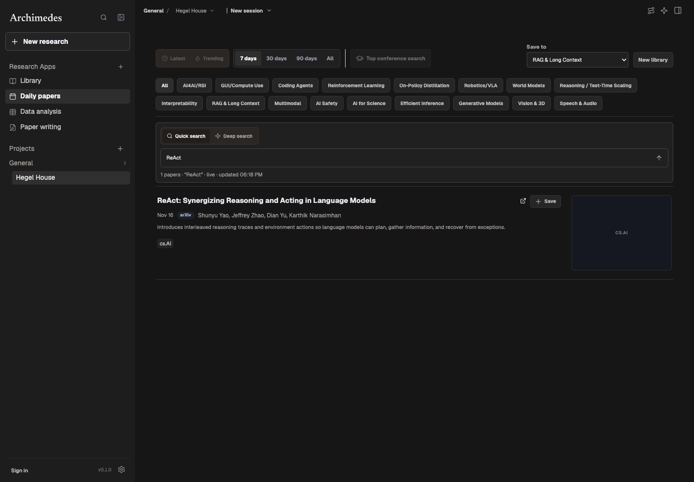

# Discovery return comparison

Both images use the actual renderer, 1440×1000 CSS pixels, charcoal, English and
default text size. Before: upstream `1f4b375`. After: this branch's code at
`777843b`; the later image commit does not change the rendered behavior.

The same journey was performed in the deterministic browser-preview project:
search `ReAct`, select `RAG & Long Context`, visit Library, then return to Daily
papers. The before image shows the lost query and reset destination; the after
image shows the original query, candidate and selected destination restored. The
candidate data is the bundled preview fixture, with no model or search service.

| Before returning | After returning |
| --- | --- |
|  |  |
