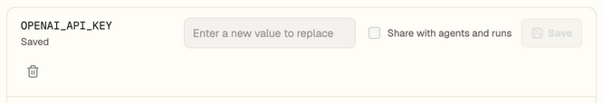
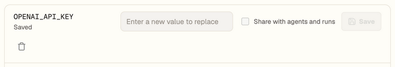

# Environment variable remove icon

Both screenshots show Settings → Environment in macOS Electron using the Paper theme at a 1180 × 900 content viewport. Each image crops the same 666 × 114 area around a saved placeholder row in a disposable workspace. The fixture contains an empty encrypted value and made no network requests.

| Before at `ae8c18d` | After |
| --- | --- |
|  |  |

Clicking **Remove OPENAI_API_KEY** cleared the placeholder from the disposable vault in both builds. The existing icon audit failed on the baseline with `Trash2 is still rendered` and passed after the change.
