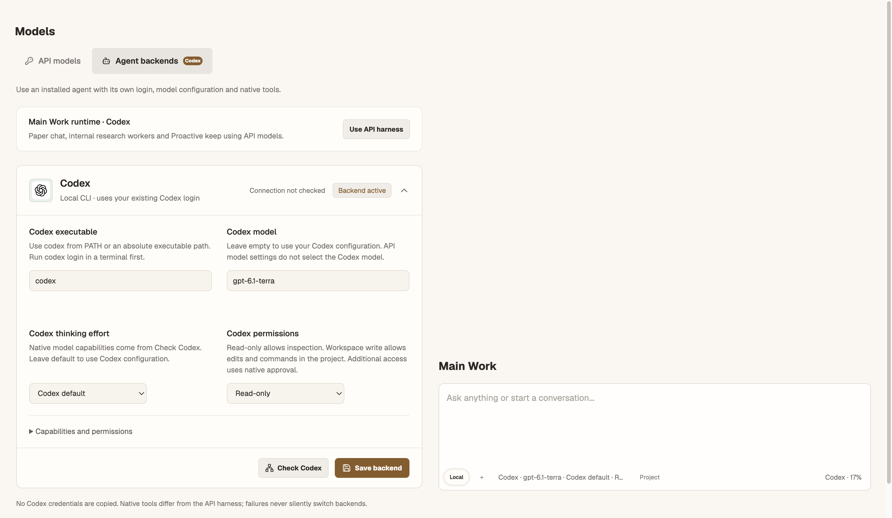
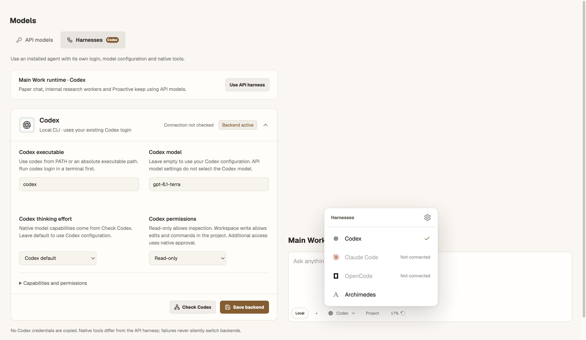
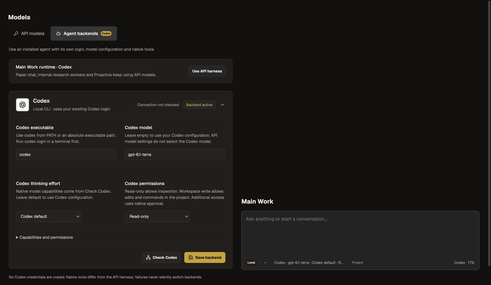
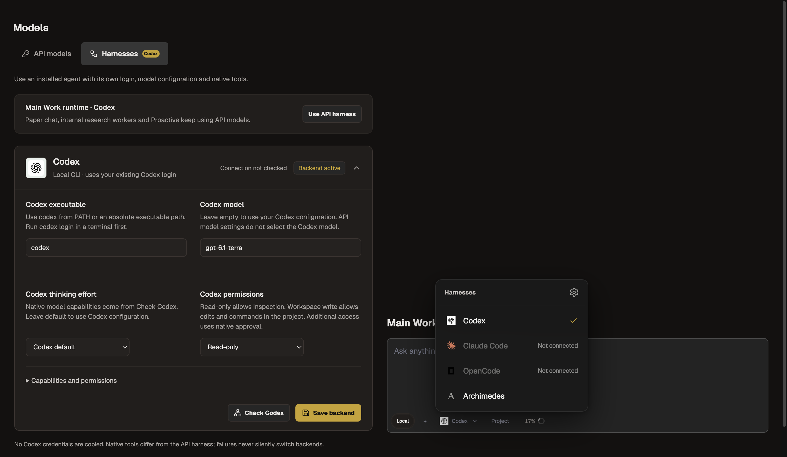

# Harness controls verification

Issue [#237](https://github.com/Johanson-colab/Archimedes/issues/237) records the owner's exact UI request and explicit authorization to edit/push main directly. This task follows that instruction instead of the default PR workflow.

## Changes

- Models tab renamed **Harnesses**, using the Workflow icon.
- Main composer uses a compact brand-icon picker with Codex, Claude Code, OpenCode and Archimedes. Codex/Archimedes persist the actual backend selection; Claude Code/OpenCode are visibly unavailable until their adapters exist. Opening the picker does not start/check a CLI.
- Top-right settings gear opens Models and participates in shared menu keyboard navigation. Switching is disabled during execution or a pending save; failed saves preserve the current selection.
- Composer thinking/context-length selectors moved to Models. Existing API preference state/storage and Codex native settings are retained.
- Native usage uses the same percentage/ring classes as API usage. Unknown native usage remains indeterminate; reported percentages still use actual native tokens.

## Checks

- Full serial suite: **828 tests, 821 passed, 4 skipped, 3 failed**. Failures remain the unchanged macOS/Windows-shell baseline cases. Full test process-tree peak: **359.6 MiB**.
- Focused component, settings, translations, composer and typing-performance tests: **39 passed**. Additional harness keyboard/menu audit run: **8 passed**.
- Independent read-only review found a keyboard-inaccessible settings gear; it now uses shared MenuItem and has a keyboard regression test. Recheck passed.
- Lint, build, theme and diff checks passed. Build retained the existing large-chunk warning and peaked at **824 MiB** process-tree RSS.

## Screenshots

Same 1440 × 1000 viewport, saved Codex/read-only configuration and fixture state. Before loads the original Models/native usage components from `fd35ffb`; after loads current components. Composer excerpts are controlled fixtures, not the complete live application. No credentials or live inference are used. Both themes had no horizontal overflow.

| Theme | Before | After | Open picker |
| --- | --- | --- | --- |
| Paper |  |  |  |
| Charcoal |  |  |  |

Reproduce with `node scripts/capture-harness-controls.mjs before` or `after`, then launch Electron with the printed runner path. Build and capture are separate to bound memory. Final screenshot tree peaks were **564.8 MiB before** and **660.1 MiB after**; owned capture processes closed normally.
