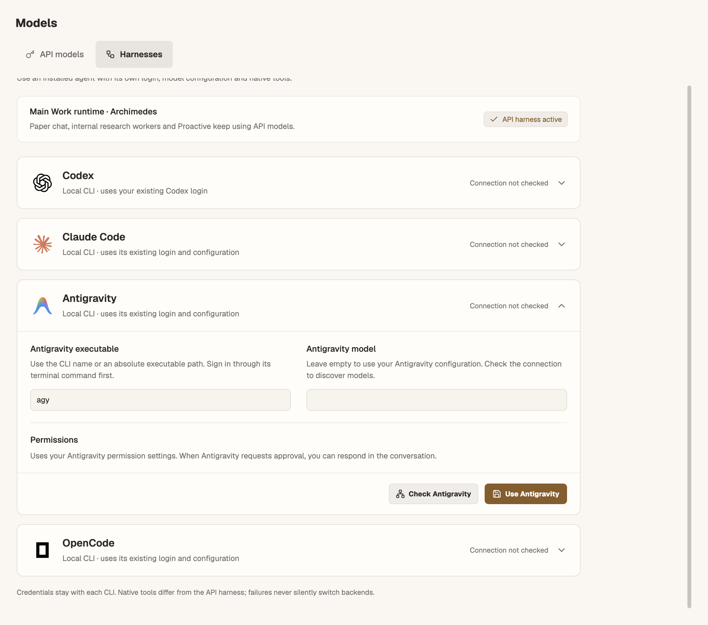
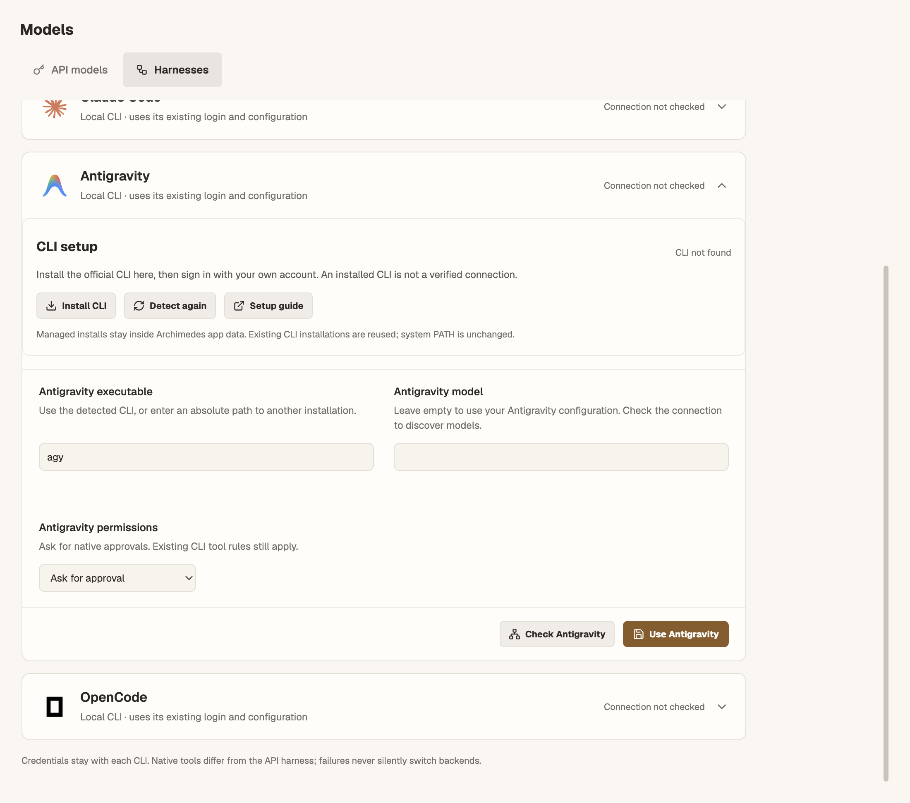
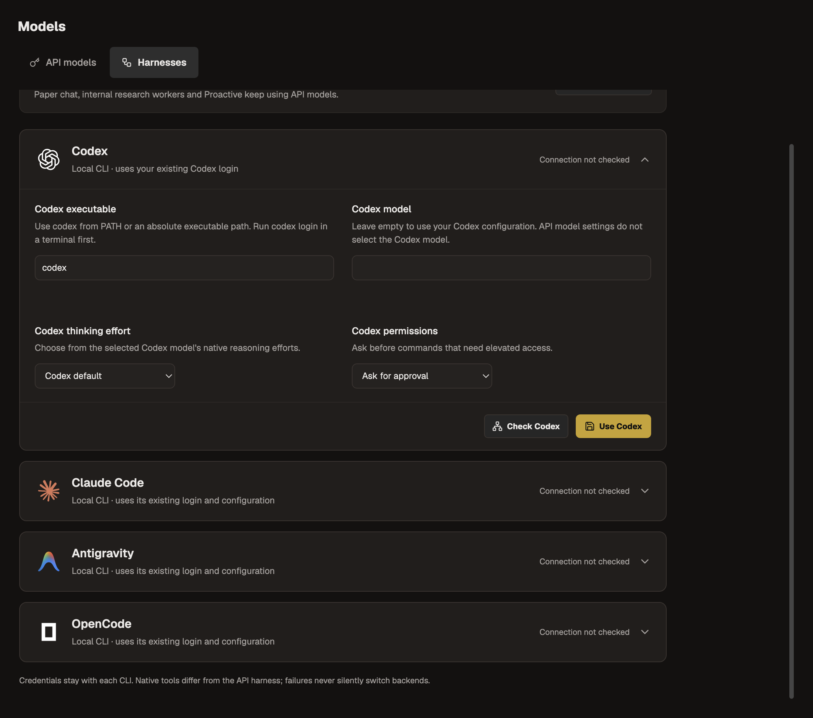
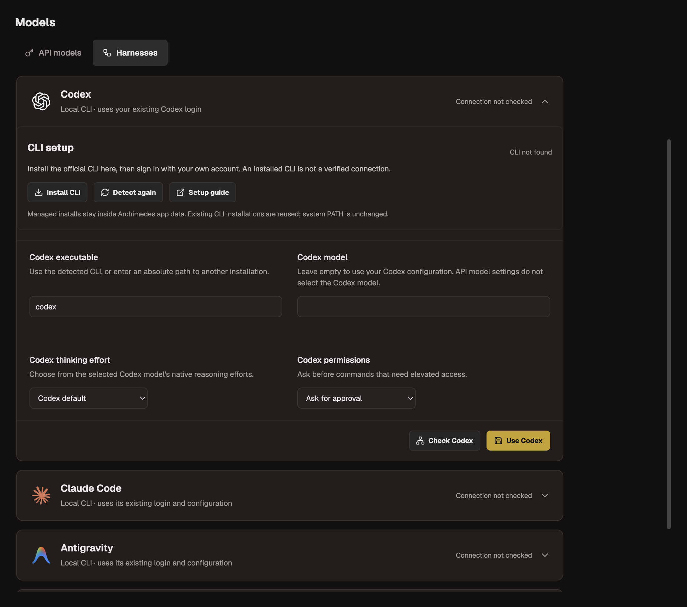

# Native harness installation and sign-in

Settings → Models → Harnesses now offers the same setup flow for Codex, Claude Code, Antigravity and OpenCode:

1. Expand a harness to detect its executable and version. This is not an account or model-access check.
2. If missing, click **Install CLI**. Download the official native release into Electron userData/harnesses; verify the published digest, validate archive members, launch-test the staged executable, then publish it without replacing existing files.
3. Click **Sign in / Connect provider** to open an external interactive terminal. The native CLI handles account/provider selection, browser authorization and credential storage.
4. Return to Archimedes and click **Check**. Save/activate the harness explicitly.

No Node/npm installation or desktop Antigravity application is required for these managed CLI installs. Existing detected CLI installations are reused. System PATH is unchanged. Login is not completed automatically and launching the sign-in terminal does not mark a connection verified.

Antigravity permissions map to its advertised native modes: Ask → `default`, Accept edits → `accept-edits`, Auto → `auto`, Plan → `plan`. Both connection checks and actual turns require native confirmation. Unsupported/unconfirmed modes fail before the prompt is delivered. Codex and Claude Code retain their existing permission selectors; OpenCode follows its native configuration and returns approval requests to the conversation.

## Verification (macOS arm64)

All four installers were exercised with real official downloads in a temporary, isolated managed-install root. Each passed digest verification, archive handling where applicable and a real `--version` execution. The temporary root was removed; existing installations and account credentials were not changed.

| CLI | Version | Real installation/launch |
| --- | --- | --- |
| Codex | 0.172.0 | Passed |
| Claude Code | 2.1.332 | Passed |
| OpenCode | 2.4.1 | Passed |
| Antigravity | 1.5.17 | Passed |

Interactive login launchers and shell/path quoting were tested with mocks; a fresh browser/account login was not performed. Windows/Linux download plans and launch commands are implemented but have not been exercised on those operating systems.

- 73 focused tests passed: installer, settings interactions, native permissions, independent profiles and application lifecycle.
- Full suite: 1,629 tests; 1,623 passed, 5 skipped, 1 failed. The failure is the existing LaTeX template compile test on this machine (`phvr7t.tfm` unavailable).
- TypeScript lint, production build and theme checks passed. The existing large-chunk build warning remains.
- Coverage includes hash mismatch, unsafe archives/symlinks, wrong-window cancellation, concurrent installs, streaming download cancellation and cleanup, existing-install reuse, failure/retry, login launch, switching cards mid-install and unmount cleanup.
- Merely opening Models does not install or sign in. There is no installation polling until an installation is in progress. Renderer/window shutdown cancels owned downloads; application shutdown cancels all downloads.

## Visual evidence

Credential-free React Settings fixture rendered in real Electron/Chromium; these are component previews, not screenshots of a logged-in user session. Both themes and 1100/680 px window widths passed panel-overflow checks. The before state is commit `398b3d9`; after uses this worktree.

Antigravity, paper theme:

Codex, charcoal theme:

Additional matched screenshots for each harness/theme and geometry reports are in this directory. Reproduce with `node scripts/capture-harness-setup.mjs before` / `after`, then run the printed runner with Electron.

## Official sources

- Codex: https://developers.openai.com/codex/cli/ and openai/codex GitHub release assets (SHA-256).
- Claude Code: https://code.claude.com/docs/en/setup and downloads.claude.ai release manifests (SHA-256).
- OpenCode: https://opencode.ai/docs/ and the official CLI update endpoint plus @opencode native npm packages (SHA-512 integrity).
- Antigravity: https://antigravity.google/docs/getting-started?tab=cli and the official updater manifest/storage download (SHA-512).
