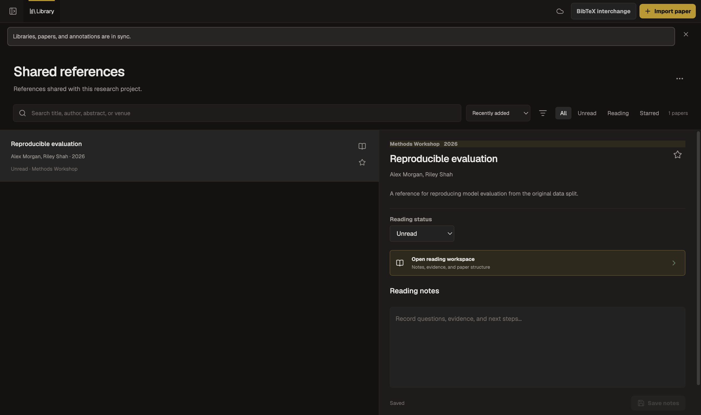
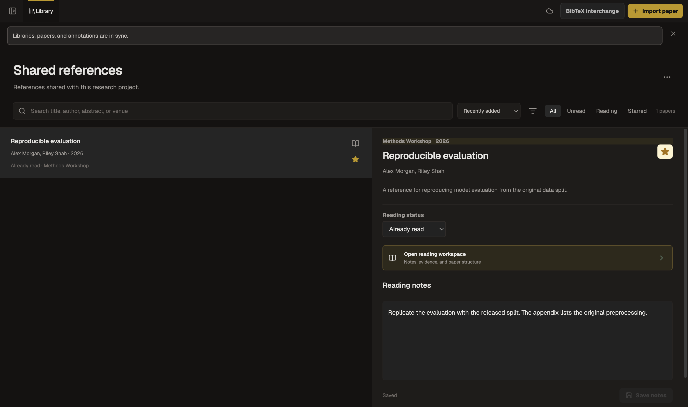

# Cloud import comparison

The same SQLite fixture ran against upstream `ae8c18d` and the fix at `8f7dd3d`. A library contains a paper with a local DOI and saved personal state. The cloud import supplies the same DOI with a different canonical key, an older state timestamp, and empty notes and tags. Each result came from reading the destination collection after the import.

| Output | Before | After |
| --- | --- | --- |
| Reused the local paper ID | Yes | Yes |
| Notes | Empty | Keep this field note |
| Reading status | Unread | Read |
| Starred | No | Yes |
| Tags | None | methods |

The import still adds the same paper to the cloud collection. The sync service receives its existing local timestamp and can reconcile the two versions of the personal state.

## Electron comparison

Both captures use the Library view at 1350 × 800 CSS pixels, Charcoal and English. In each fixture, the shared collection starts empty. Clicking **Sync cloud** calls the application's library sync service with a simulated remote response that contains the same DOI under a different canonical key and an older reading state.

| Before (`ae8c18d`) | After (`8f7dd3d`) |
| --- | --- |
|  |  |

The inspector reads the synced paper from the shared collection. The fixture also verifies the same local paper ID in both runs and preservation of its local tags after the fix.
