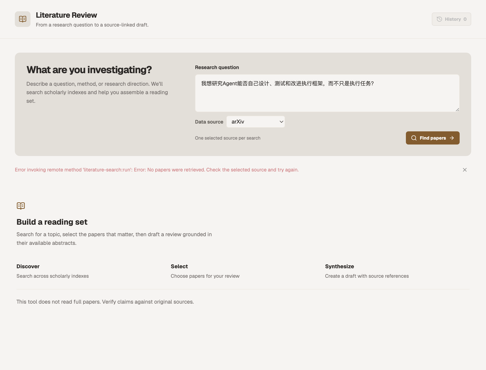
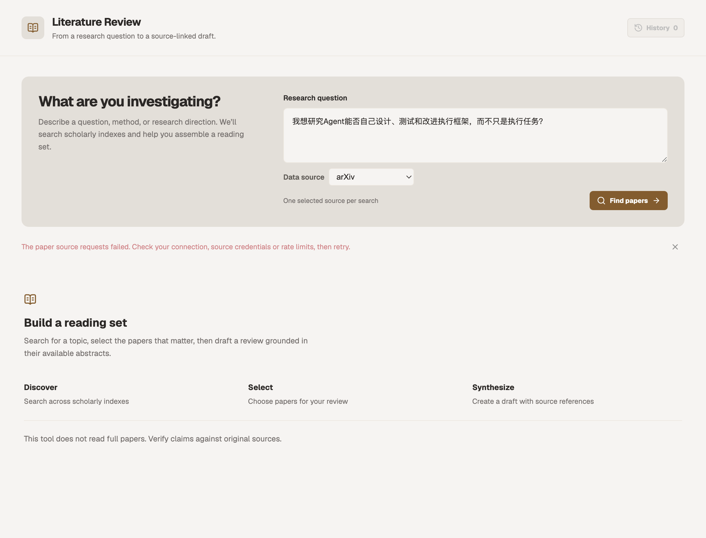
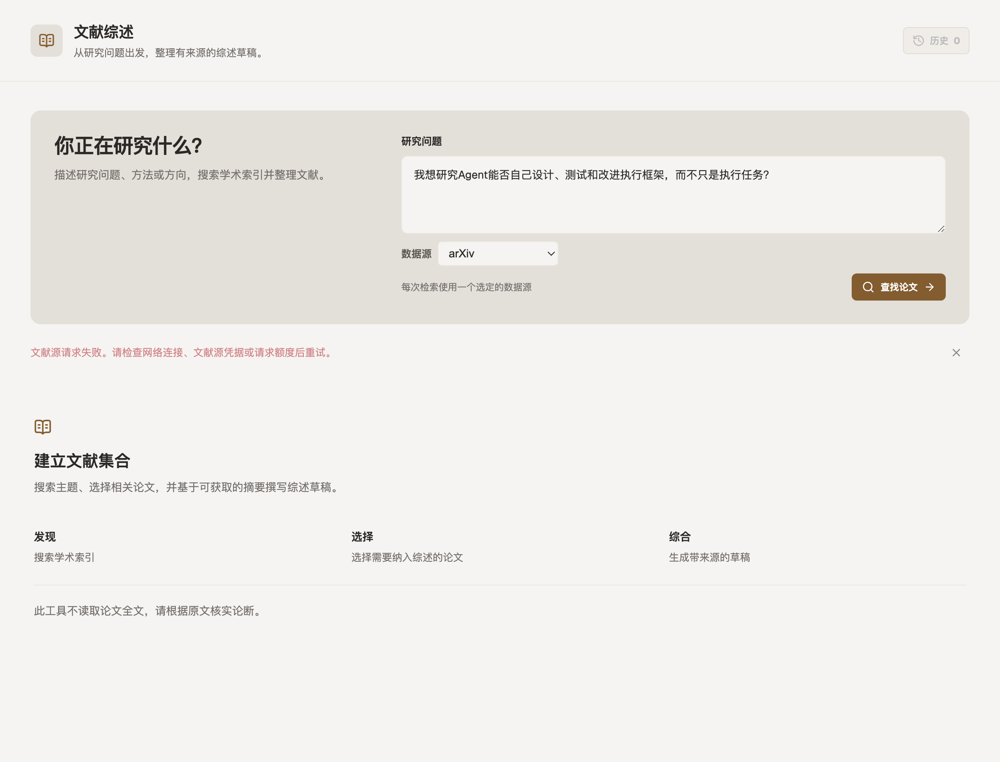

# Bilingual Literature Review search

Literature Review now translates Chinese research intent into English academic keyword queries, while retaining the original question for synthesis and relevance scoring. English input uses the same planning path. Invalid Chinese-only plans get one translation retry; if translation remains unavailable, the UI asks the user to check the API model instead of sending Chinese prose to arXiv. English input can fall back to locally extracted keywords.

arXiv research queries combine individual terms rather than invoking the full-title phrase heuristic. Existing paper-title lookup keeps its phrase behavior. Empty successful searches and failed source requests now produce different, localized messages; Electron's IPC wrapper is removed from the displayed message.

## Matched screenshots

These are the real LiteratureReviewView component rendered in an isolated Electron window, Paper theme, 1180 × 900 content viewport, with the same Chinese question and controlled source-request failure. The before component is from base `a21405d`; the after component uses this change. Both use a synthetic bridge and do not represent a live search failure.

| Locale | Before | After |
| --- | --- | --- |
| English |  |  |
| Simplified Chinese |  |  |

## Verification

- Actual configured API model plus actual arXiv API: the question “我想研究Agent能否自己设计、测试和改进执行框架，而不只是执行任务？” generated `self-improving autonomous agents`, `agent self-design execution framework`, and `meta-agent architecture search`, returning 37 retained candidate results with model scores.
- The equivalent English question returned 64 scored results using independently generated English queries. Counts are observations, not recall or relevance guarantees; no model credentials are recorded here.
- Deterministic tests cover both input languages, real arXiv query construction with controlled responses, a Chinese-only plan retry, invalid refinement, translation failure, English fallback, source-request failure versus empty results, and localized IPC errors in the React component.
- Type checking, theme checking and renderer build passed. The full macOS suite recorded 1,499 passes, 5 skips and 4 failures: the existing experiment retry audit, missing local TeX font `phvr7t`, the Library tab audit, and ordering in the unchanged `researchGraph.ts` translation shard. These unrelated tests were not weakened.

Chinese query translation requires the configured Agent API model. Native Codex/Claude/OpenCode selection alone does not supply this API configuration. Document-title lookup and Daily Papers are not switched to research keyword mode.
