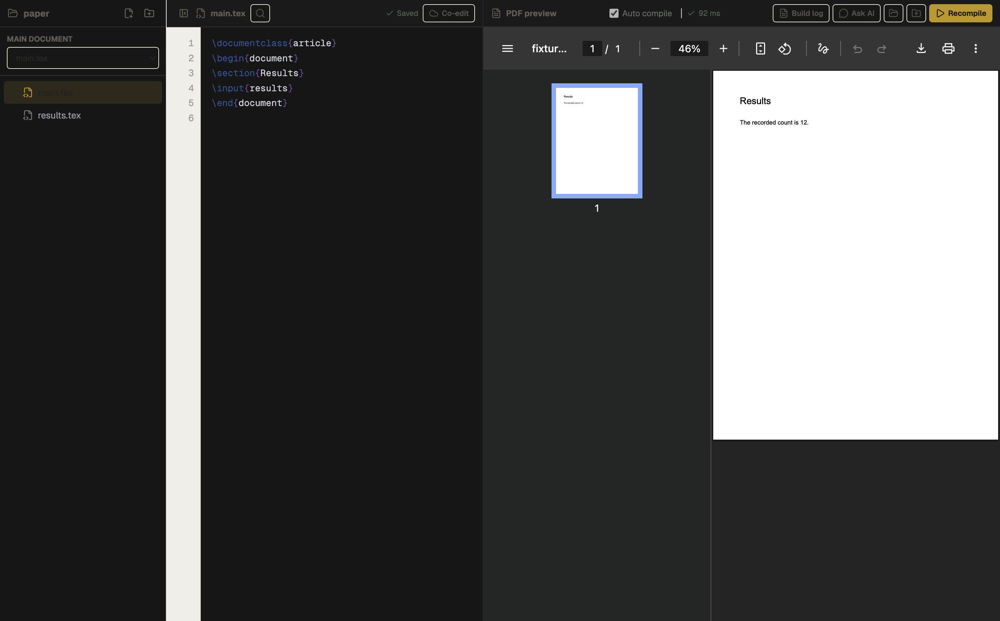
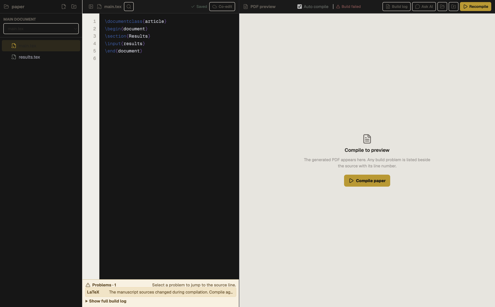

# Compilation artifact evidence

Both observations used the real managed Tectonic 0.17.0 engine on macOS arm64
with its existing font/package cache. Each fixture contained `paper/main.tex`,
a section file and a bibliography. The second build changed a section and
bibliography. No generated PDF or cache is committed here.

| Observation | Upstream main `1f4b375` | This branch |
| --- | --- | --- |
| First PDF path | `.archimedes/latex-build/defc3a7a99c3/main.pdf` | `.archimedes/latex-build/defc3a7a99c3/62d5a110-feec-4b8d-a12c-c6d5e86ab032/main.pdf` |
| Second PDF path | Same as the first | `.archimedes/latex-build/defc3a7a99c3/5d53cafc-031c-4226-8b53-73cfe7a0f500/main.pdf` |
| First PDF after the second build | Replaced by different bytes | Original SHA-256 unchanged |
| Saved source version | No receipt | Different version hashes for the two source sets |
| Fresh verification after the edit | No receipt | First build `current: false`; second build `current: true` |
| Compile result | Both builds succeeded | Both builds succeeded (316 ms and 281 ms with warm cache) |

Before, the first PDF hash was
`41221e0b58438f88daecfcf0f3db3d249211a8bf4849532696d51dcfede8e398`;
after the second build the same path contained
`1e01ad918c03386c368b8918c5c31f9108199a45f59b62675f6ec65c8523343f`.

On this branch, the first retained PDF was 7,457 bytes with SHA-256
`cb9496814cd87942149dc99f493b323c1e6e1f1df68da18f739fd42a21750ad5`;
the second was 7,525 bytes with SHA-256
`bfb2895e9f44c08a3c26b628bbc893274502a0946259fcf988524d8779def365`.
Each receipt also retained its 2,400-byte compiler output log with a hash.

## When a section changes during a build

Both screenshots show the Electron Writing view at 1320 × 820 with the same manuscript, theme and layout. A controlled compiler read the value 12, then the section on disk changed to 18 before the PDF was returned. The baseline showed a successful build with 12 in the preview. The updated editor flags the source change and withholds the stale preview. These screenshots use a controlled compiler to make the timing reproducible. The file and hash observations above used real Tectonic.

| Before | After |
| --- | --- |
|  |  |
