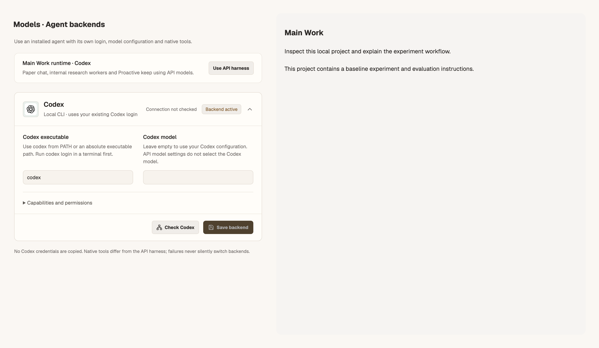
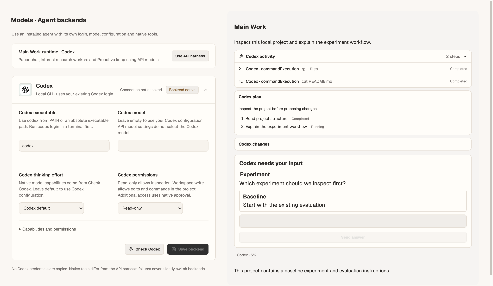
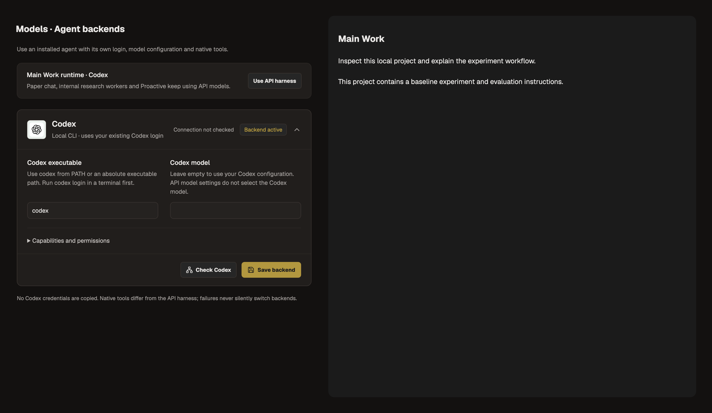
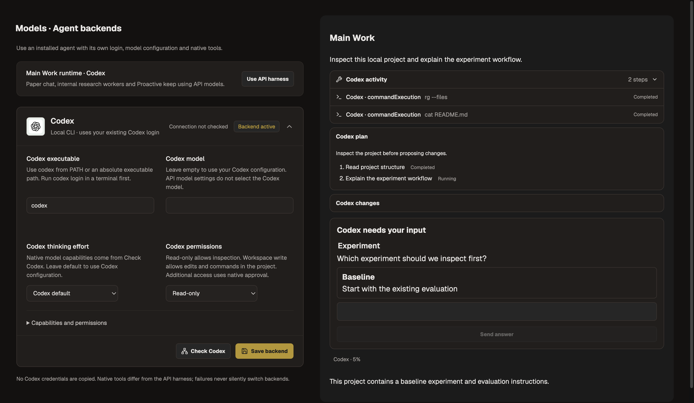

# Native Codex workflow verification

Issue: [#235](https://github.com/Johanson-colab/Archimedes/issues/235). Owner authorization is recorded in the issue. Branch: `codex/native-codex-workflow`; no automatic merge to main.

## Results — 2026-11-03

- Full Node suite, serial with 256 MiB heap: **825 tests, 818 passed, 4 skipped, 3 failed**. All three failures are Windows-shell selection expectations in `electron/terminal-shell.test.cjs`. An independent run on unchanged main reproduced those same three failures (4 passed, 3 failed). Neither shell implementation nor those tests changed.
- Focused native protocol/real-child dispatch/window lifecycle suite: **37 passed**. Includes native-only context, model/effort validation, explicit sandbox, stable activity IDs, bounded output/imports, final-answer phases, actual token usage, plans/diffs, questions, steering, compaction, approval expiry, uncertain delivery and cancellation.
- Renderer/state/commands/input-performance regressions passed, including background questions, prototype-like question IDs, native compaction editor authorization, and memoized long-history rendering during typing.
- `npm run lint`, `npm run build`, `npm run check:theme`, `node --check electron/main.cjs` and `git diff --check` passed. Build retains its existing large-chunk warning.
- Actual installed Codex CLI **0.161.0** initialized with the new capabilities, authenticated, and returned **8 models** with native effort capabilities. No credentials were printed or copied. This handshake did not run paid model inference; execution coverage uses controlled protocol peers and a real child-process fixture.
- Spec and independent code-quality reviews found and verified fixes for background question loss, stale activity, editor authorization, outbound bounds, arbitrary question IDs, and delayed emissions after window destruction.

## Resource measurements

Checks ran serially. Process-tree RSS peaks: full suite **361.3 MiB**, focused lifecycle suite **190.9 MiB**, build **817.2 MiB**, actual CLI handshake **254.8 MiB**. The 25 normal and 25 StrictMode Settings mount/unmount loops made no automatic Codex checks and retained approximately **1.8 / 1.5 MiB** heap after GC.

Screenshot builds and capture were separated after a combined development capture hit its watchdog. Final capture peaks: **562.2 MiB before**, **615.1 MiB after**. Owned capture/CLI processes were closed. These measurements do not establish the cause of the user's earlier application-wide memory incident.

## Visual evidence

Matched 1440 × 1000 component fixtures, same saved Codex/read-only state, English, both themes. Before uses `4d894f2` Settings and the old result-only activity representation; after uses the new components with equivalent command results plus supported native plan/diff/question/usage snapshots. These are credential-free component fixtures, not screenshots of live inference or the complete application.

| Theme | Before | After |
| --- | --- | --- |
| Paper |  |  |
| Charcoal |  |  |

Reproduce with `node scripts/capture-native-codex.mjs before --build-only` (then run Electron with the printed runner path); repeat with `after`. Building separately avoids retaining Vite's heap during capture. No horizontal overflow was detected.

## Remaining boundaries

Only main Work uses native Codex. API, Paper chat, Side, FigureForge and internal workers retain their paths. Claude Code/OpenCode native adapters, Archimedes tool exposure via MCP, broad permission grants and automatic artifact registration are not included. Unsupported requests fail explicitly; native plugin/skill attachments remain unsupported. Windows runtime requires a native executable and was not verified on this Mac.
