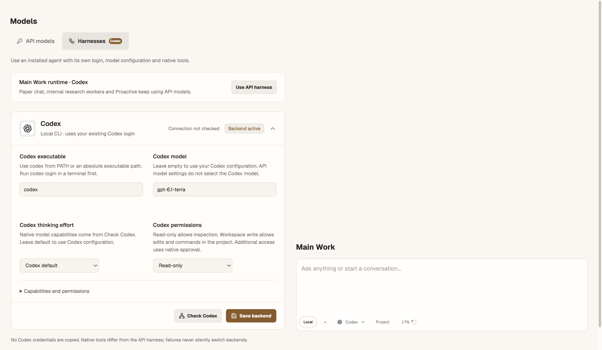
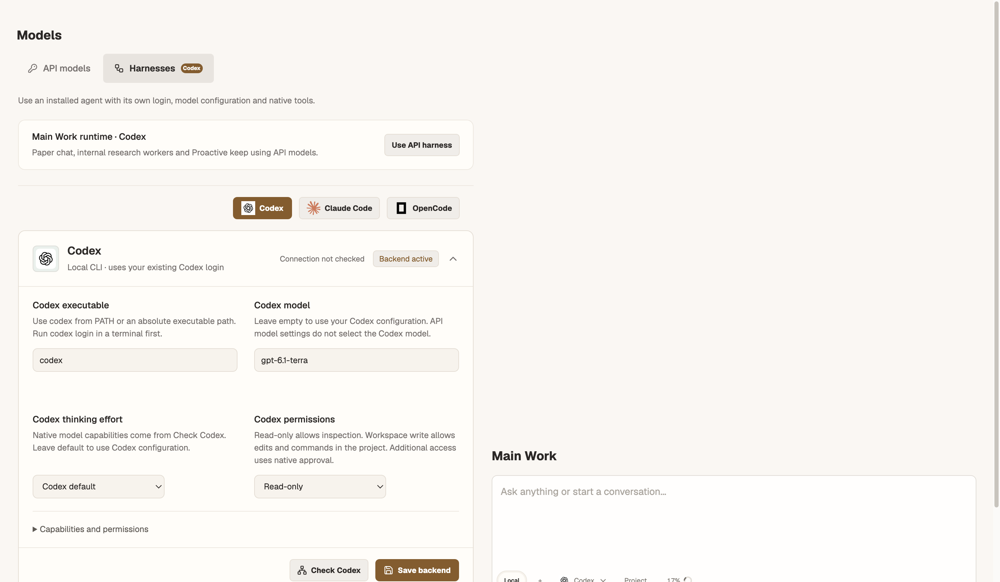
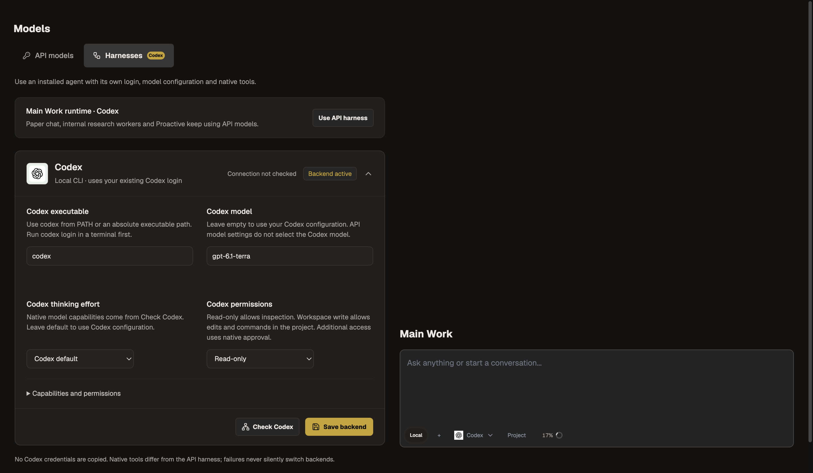
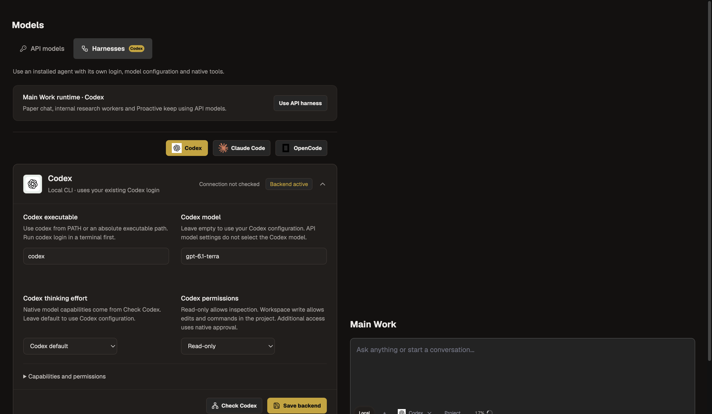
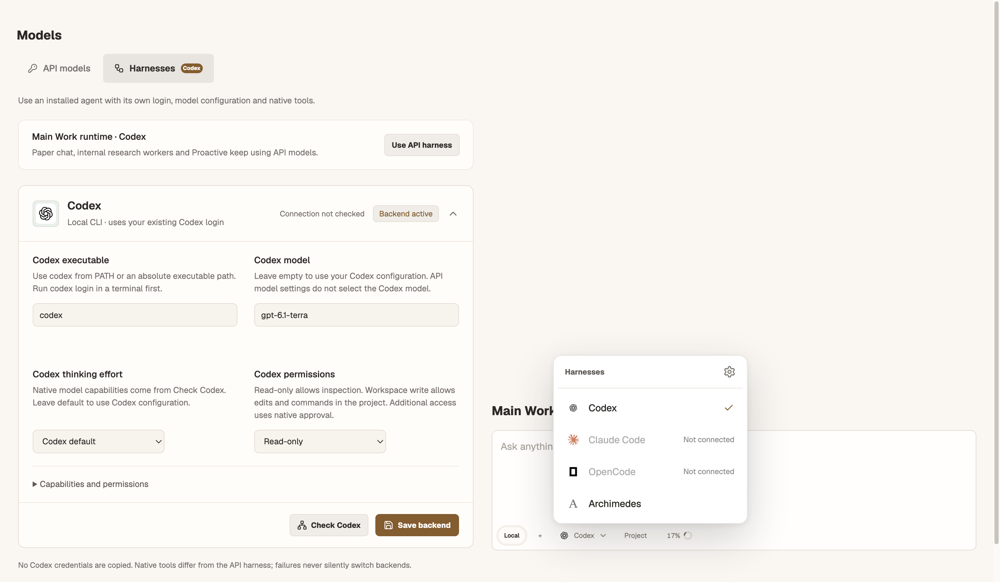
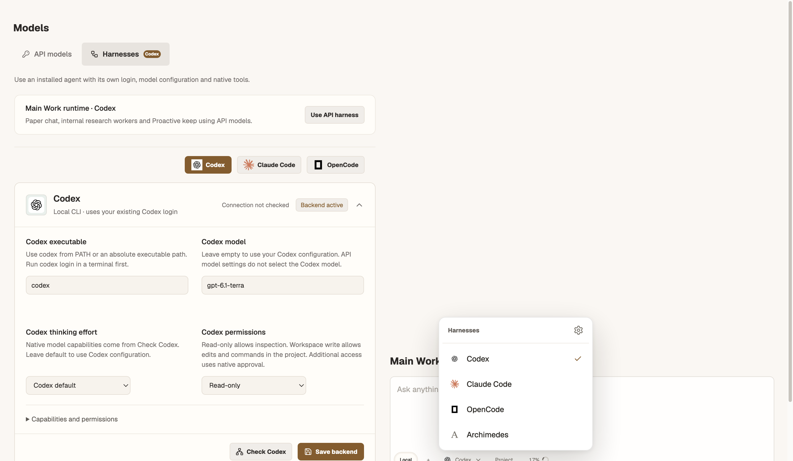
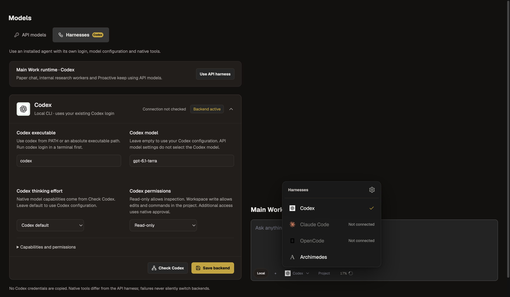
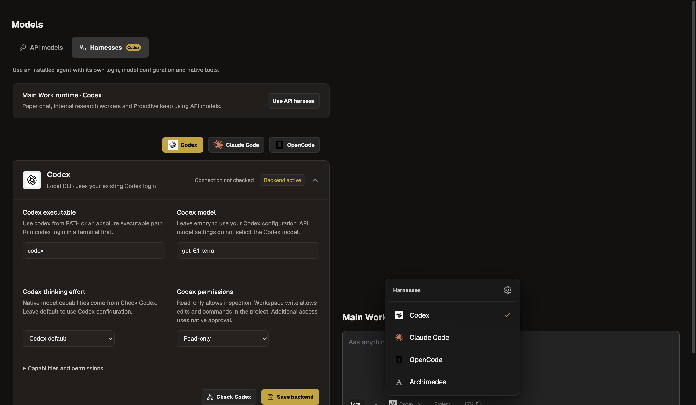

# Native Harness verification

Tracking: [#239](https://github.com/Johanson-colab/Archimedes/issues/239). Base: `c18c92e`. Owner authorized direct main development/push in Codex chat, overriding the default PR workflow for this change.

## Interface evidence

Credential-free Electron fixtures, same 1440 × 1000 viewport, state and theme. Before uses source from `c18c92e`; after uses this implementation. Each capture reports no horizontal document overflow. The fixture combines Models and the composer; it does not read the user's active chats or credentials.

| Surface | Before | After |
| --- | --- | --- |
| Paper settings |  |  |
| Charcoal settings |  |  |
| Paper picker |  |  |
| Charcoal picker |  |  |

Reproduce with `node scripts/capture-native-harnesses.mjs before` or `after`, then run the printed Electron capture script separately so the build heap is released first.

## Automated checks

- Focused integration/config/UI/native tests: 50 passed before the final lifecycle regressions; process-tree peak 353.5 MiB.
- Final focused config/transport/Codex compatibility checks: 28 passed; Electron main-process syntax check passed.
- Feature-only full suite (`81cbf89`): 864 tests, 857 passed, 4 skipped, 3 known pre-existing macOS Windows-shell failures; process-tree peak 504.1 MiB. Node tests ran serially with a 256 MiB heap and a 700 MiB process-tree watchdog.
- Existing failures: “Windows prefers PowerShell 7 when it is installed”, “Windows falls back to Windows PowerShell before cmd”, and “explicit shell profiles do not fall through to a different shell”. These tests were not weakened.
- `npm run lint`, `npm run build`, and `npm run check:theme` passed. Build used a 512 MiB heap / 1024 MiB process-tree limit; observed peak 824.8 MiB. Existing bundle-size warnings remain.
- New coverage includes real child protocols through the Work orchestrator without API calls; old binding migration; independent profile switching; failure/abort/approval expiry; hidden-thought and replay omission; child output after `exit`; Windows owned-tree cleanup; bounded activity coalescing; and safe quota/auth error hints. Windows cleanup tests are simulated on macOS, not a real Windows integration run.
- Repeated settings mount/unmount and StrictMode audits remained bounded, with heap growth about 1.8 / 1.5 MiB across 25 cycles; checks never launch automatically.

## Installed CLI evidence

- Claude Code 2.1.119: native control initialization succeeded. Two actual model turns succeeded using existing native configuration, including successful session resume and recall of the first turn's marker. Peak test process tree 682.3 MiB.
- OpenCode 2.2.5: ACP v1 initialization, session creation, model catalog and explicit model selection succeeded. The native default `opencode/pulse-alpha-free` rejected inference with `provider.free-limit`. An explicitly selected advertised OpenAI model returned ACP authentication-required code `-32000`. Actual OpenCode model completion/resume therefore remains unverified until the user supplies valid native provider access. Global OpenCode configuration was not changed.
- A first combined CLI smoke was stopped by the 700 MiB memory guard when teardown/startup overlapped (sampled peak 822.1 MiB). The isolated OpenCode smoke stayed below 600 MiB. No user-owned CLI/app process was terminated; owned test children were cleaned up.

Native errors now explain the recognized free-quota and authentication conditions without exposing raw provider errors or secrets. Check buttons validate protocol availability without inference; they do not promise usable model credentials or quota.

## Deliberate limits

Claude/OpenCode retain native configured permission rules and expose one-time approval requests; this is not an OS sandbox. Live steering, native question cards, explicit compaction and plugin/skill attachments are not supported by these two adapters. Unsupported requests fail explicitly. Unknown context capacity remains unknown; credentials and native session IDs remain local.

Independent source/spec and code-quality reviews completed. Both lifecycle findings (stdout drain and Windows descendant cleanup) were fixed with regression tests and re-reviewed.

## Integration with updated main

Before publication, remote main advanced by 24 commits to `d95aabd`. Merge `1cc01d8` preserves those updates and the native Harness implementation; the three shared source files merged without conflicts. Electron main-process syntax and TypeScript checks passed after integration.

The merged full suite ran 925 tests: 915 passed, 4 skipped, 6 failed; process-tree peak 433 MiB. In addition to the three existing Windows-shell failures, the remote Benchmark Radar fallback/cache/empty-data tests fail because this machine has an adjacent `benchmark-radar` checkout, which is discovered ahead of the fixture data. The same three failures were reproduced using unchanged `origin/main` modules/tests in the same working directory; no Harness regression was found and those tests were not weakened.

Merged `npm run build` and `npm run check:theme` passed, with a build process-tree peak of 834 MiB. Native CLI smoke results and capability limits above still apply.
