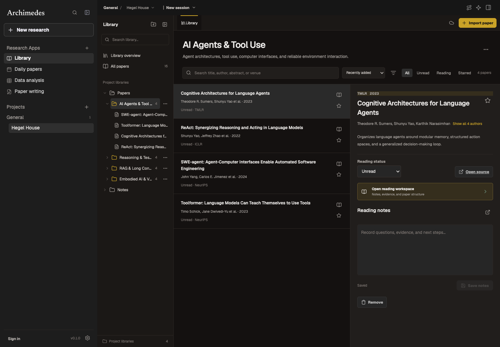
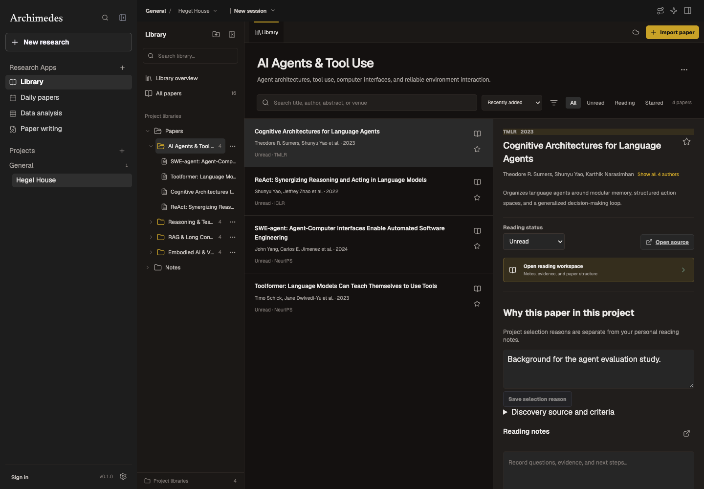

# Project paper selection comparison

Both images use the actual renderer at 1440 × 1000 CSS pixels, charcoal, English,
and default text size. They show the same bundled preview project, collection
(`AI Agents & Tool Use`) and selected paper (`Cognitive Architectures for Language
Agents`). Before is upstream `1f4b375`; after is this branch's code at `d5807a0`
(the following commit adds only this evidence).

| Before | After |
| --- | --- |
|  |  |

The after image shows a manually entered and saved project selection reason.
The new source-and-criteria details are separate from personal reading notes.
Browser preview data is used for this visual comparison; persistence and
project isolation are exercised with real SQLite and component tests.
