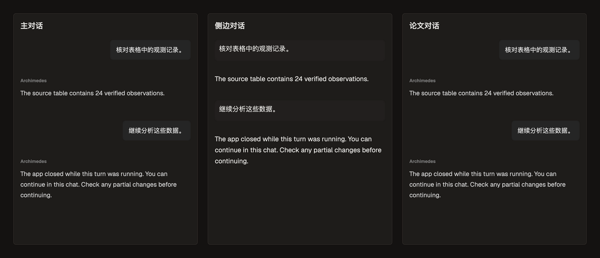
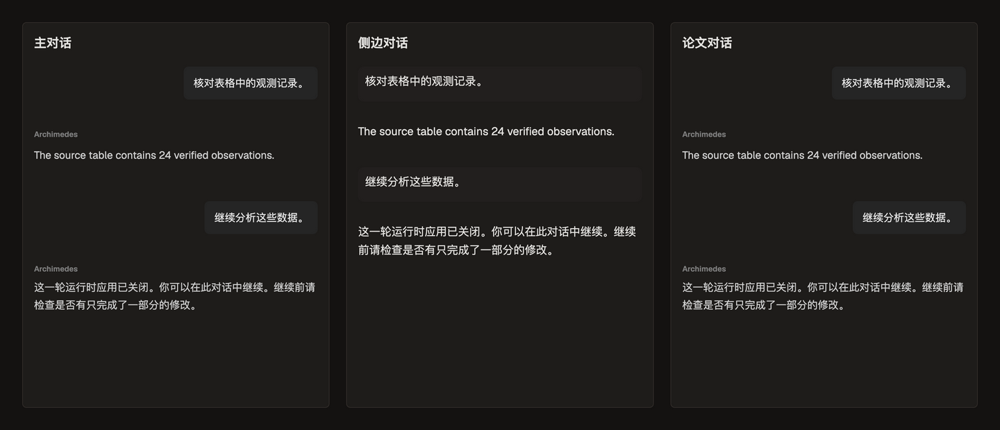

# Recovered answer in Journey

Both captures show the production Journey Story view in Electron at 680 × 760, Charcoal and English. The same local SQLite fixture was copied before reopening. Its task had stored a completed answer, while the corresponding turn was still marked running.

Upstream main at `0637139` leaves that turn **Running** with no answer episode. At `9ff902a`, a fresh process changes the persisted turn to **Complete** and writes one `assistant_message` event with the saved answer. Journey displays that event as **Drafted the answer**. The answer text and recorded tool activity are fixture data.

| Before | After |
| --- | --- |
|  |  |

## Recovery notice in Chinese

The paired Electron captures render the production main, side and paper chat message components at 1440 × 620, Charcoal and Chinese. An isolated process using `a087561` recovered a local SQLite turn before the updated code reopened that same record. The notice switches to Chinese in all three views. The saved English model answer and the two Chinese prompts retain their original text. The panel headings identify the three components in the fixture.

| Before | After |
| --- | --- |
|  |  |
