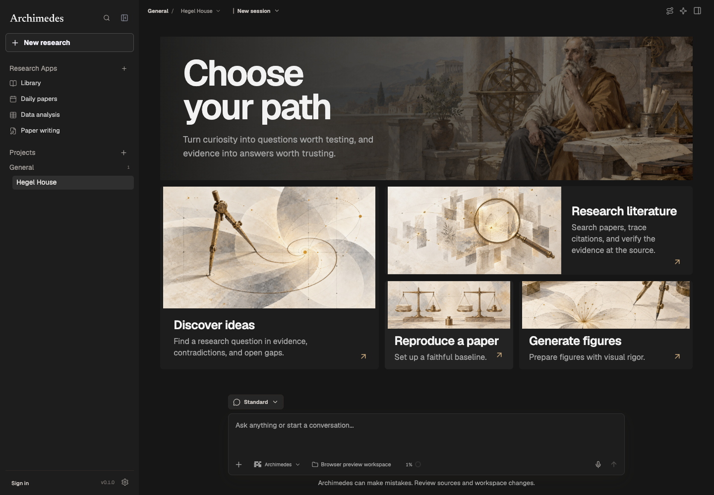
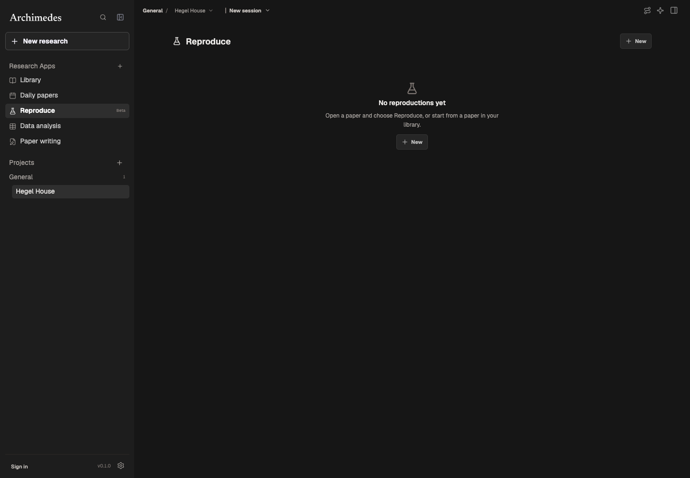
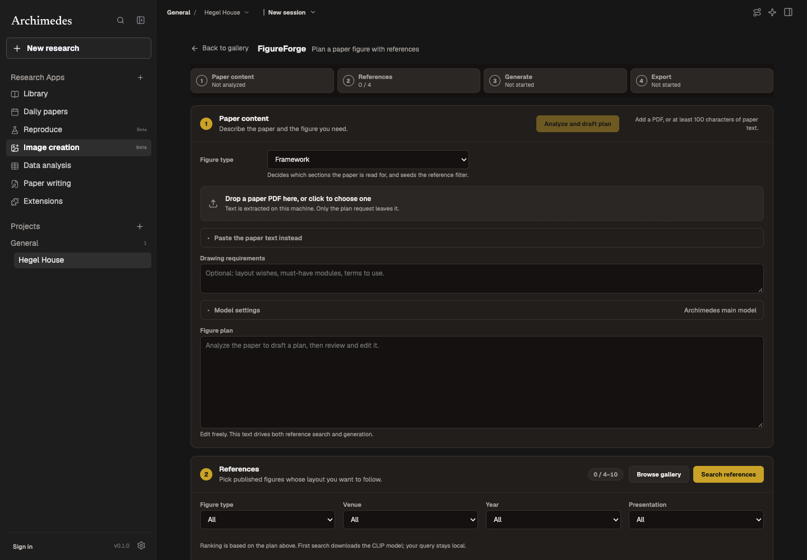
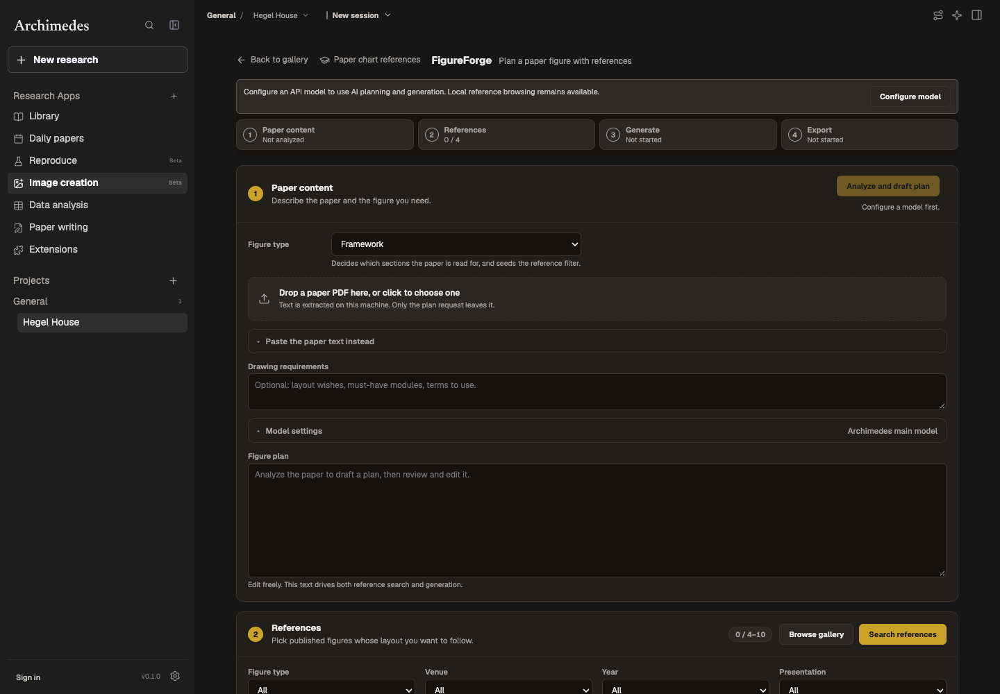
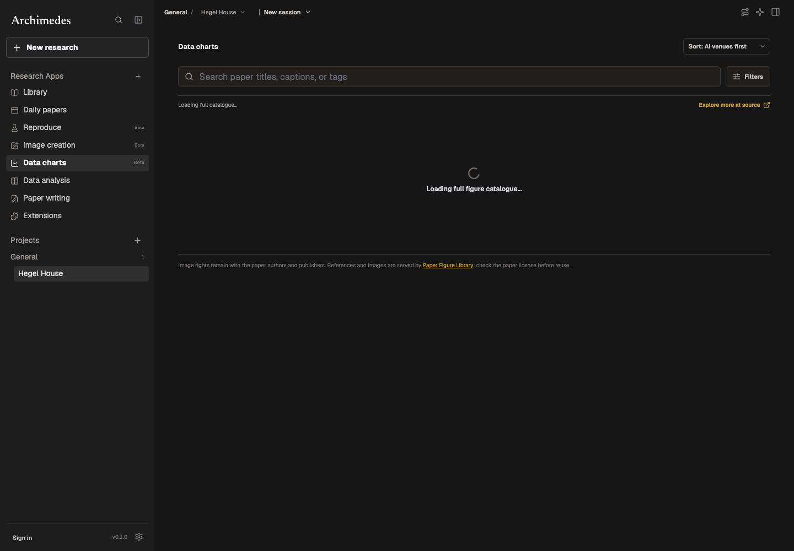
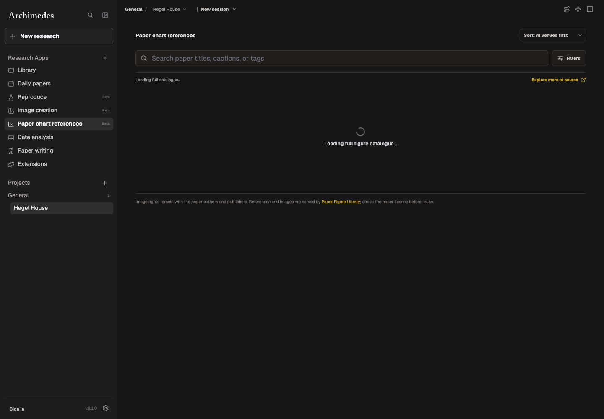

# Research App entry comparison

All images use the actual renderer at 1440 × 1000 CSS pixels, charcoal, English,
default text size and the same deterministic bundled preview project. Before is
upstream `1f4b375`; after shows this PR's feature code.

| Entry | Before | After |
| --- | --- | --- |
| Home: choose Reproduce with the default hidden-app preferences |  |  |
| FigureForge: empty input and unconfigured API model, same enabled apps |  |  |
| Existing chart gallery, same default filters and catalogue-loading state |  |  |

The baseline home action returns to chat because Reproduce is hidden. The new
route first saves the enabled preference and opens the real empty Reproduce
view. FigureForge's after notice has an actual **Configure model** action; it was
clicked and opened Settings → Models. The chart pair shows the entry rename;
gallery data behavior is verified separately with its existing component tests.

The actual preview journey also opened **Browse extensions** from the command
palette on the Available tab and followed FigureForge's **Paper chart
references** link, enabling that previously hidden app. No model task or
reproduction execution was started.
