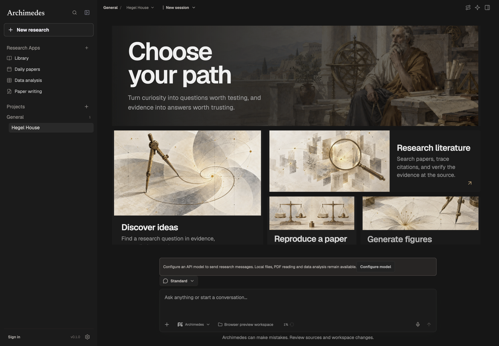
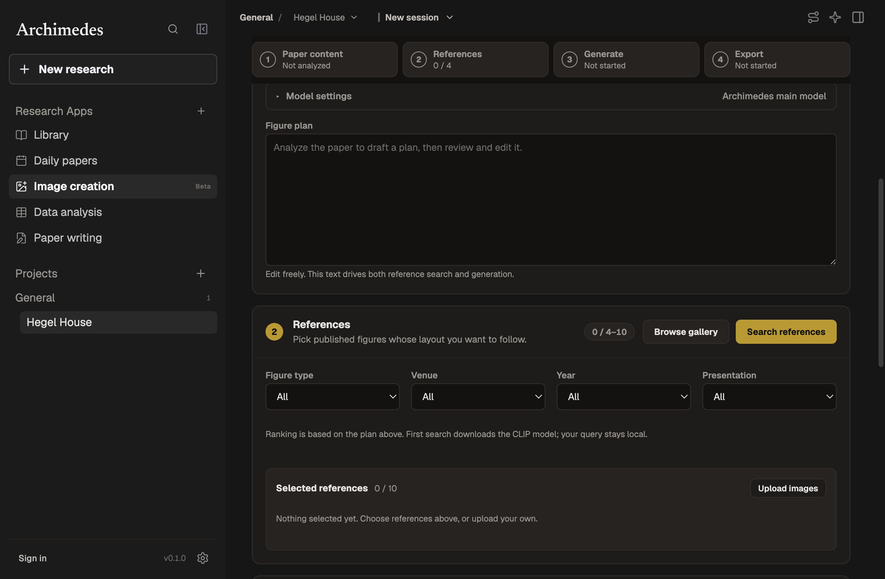
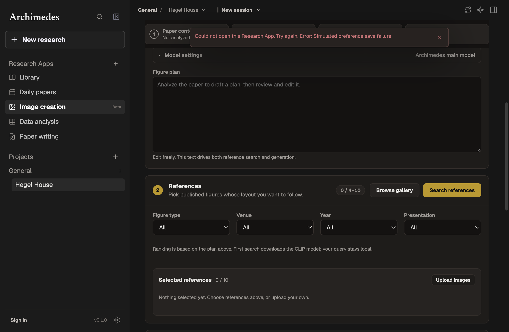
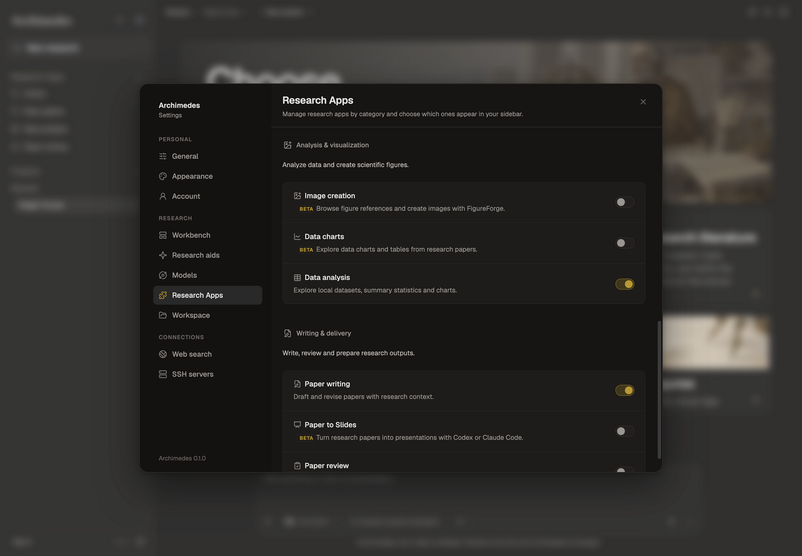
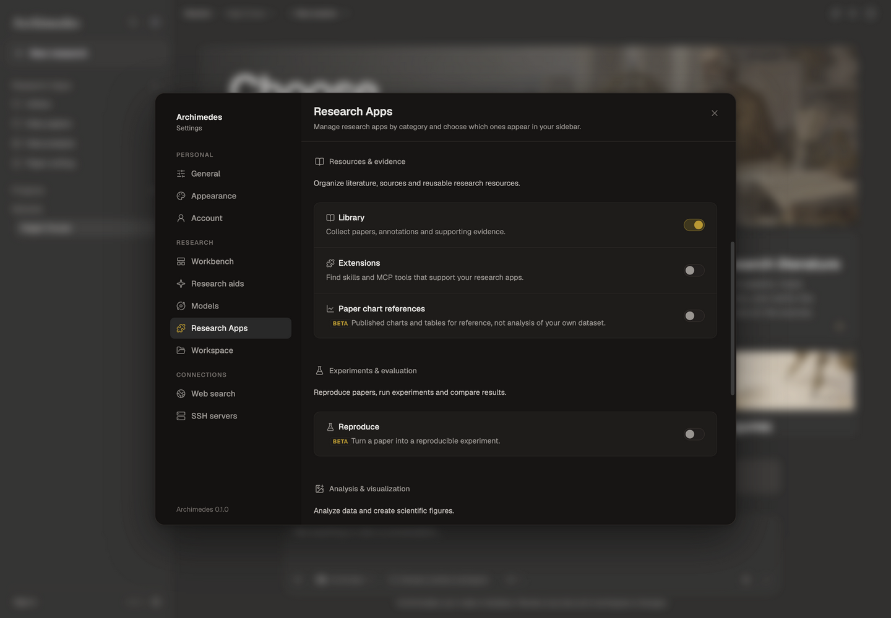
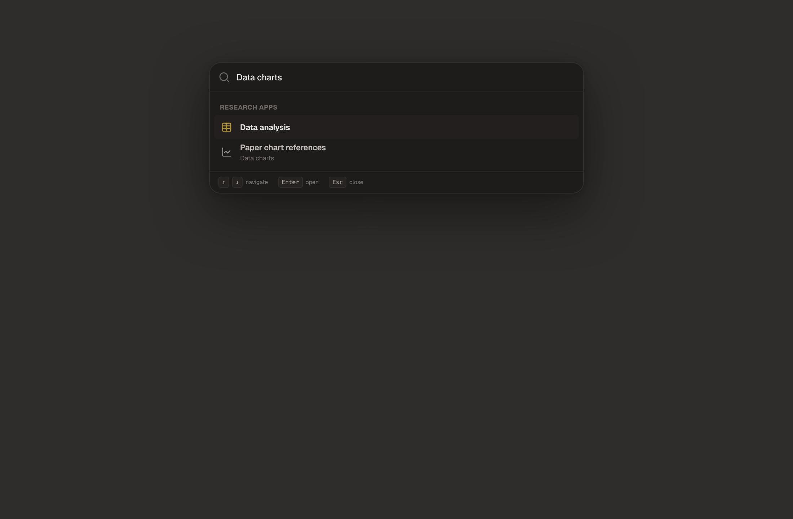
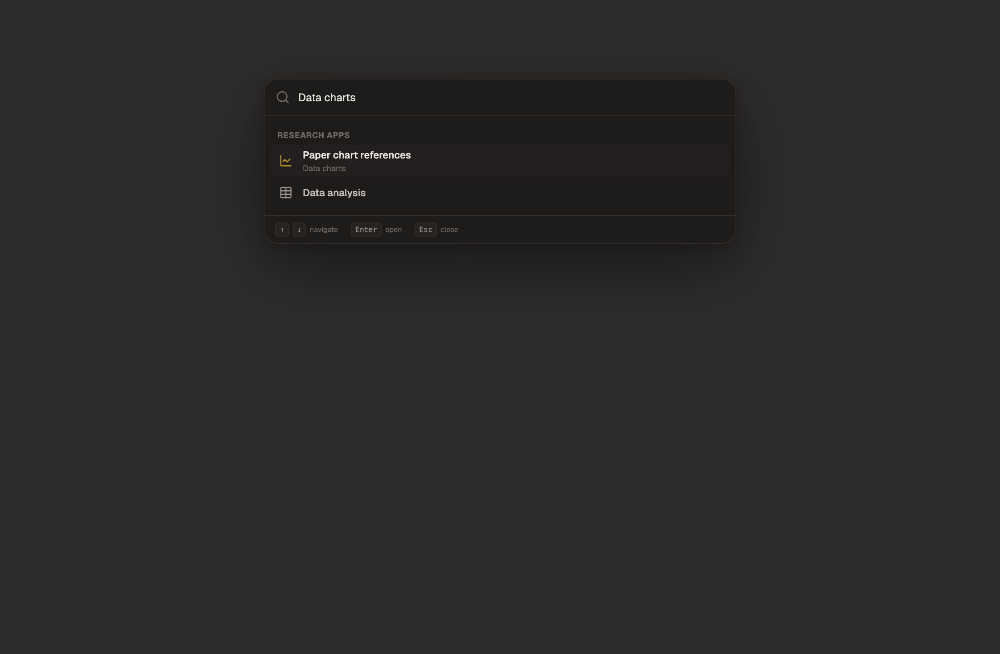

# Research-app entry notice evidence

Both images use the actual `.main-workspace` grid with a full-height research-app
view at 980×620, Charcoal and English. The message and the synthetic catalog
content are identical.

- `before.png` uses the previous markup from `6ade07b`: the entry error is a
  normal second grid child using `.composer-attachment-error`, rendered as 9px
  text at the bottom edge of the workspace.
- `after.png` uses `ResearchAppEntryNotice` (the real `InlineNotice` with
  `app-entry-notice`): a bounded, centered danger alert at the top of the
  workspace with a dismiss control, independent of the full-height view.

The screenshots do not exercise MinerU authentication. They show presentation
of an entry failure only. The effective-harness behavior of the model setup hint
is covered by `electron/research-app-entry-notice.test.cjs`.

The composer pair uses the full App renderer in Electron at 1440 × 1000, Charcoal and English, with the API harness selected and no configured key. Both captures use the same local welcome assets and empty conversation. The before capture uses upstream main at `0637139`. The after capture shows the setup hint and **Configure model**. Clicking the button opened the Settings dialog.

| Before | After |
| --- | --- |
|  |  |

The FigureForge pair reproduces a failed **Browse extensions** action from the command palette in the full App renderer. Both captures use 1100 × 720, Charcoal and English, with FigureForge scrolled 500 pixels. The fixture rejects the same preference save in both cases. The `e521093` layout positions the warning above the viewport. The updated layout keeps the warning visible and its dismiss button works.

| Before | After |
| --- | --- |
|  |  |

Both Research Apps settings captures use the full App renderer in Electron at 1440 × 1000, Charcoal and English, with matching default visibility preferences. The dialog is scrolled to the row's containing category in each capture. At `0637139`, **Data charts** appears under **Analysis & visualization**. The branch shows **Paper chart references** under **Resources & evidence** with the same inactive sidebar switch.

| Before | After |
| --- | --- |
|  |  |

The command palette comparison uses the application palette, app command definitions, and the same search text in Electron at 1100 × 720, Charcoal and English. Both apps are enabled. With the exact query **Data charts**, Enter targets **Data analysis** at `41e7084` and **Paper chart references** at `0082ce5`.

| Before | After |
| --- | --- |
|  |  |
