# Windows path handling verification

Verified on Windows on 2026-11-12 against `main` commit `a17b25990bca42dd149d1b30eb57420d435716cd`.

## Scope

- Related to #196: classify workspace-installed Skills using Windows separators, drive/UNC spelling and case-insensitive comparison, with directory boundaries. POSIX comparisons stay case-sensitive.
- Show the final workspace directory in the conversation composer and full Files browser heading. Preserve the full path in existing title/accessibility text.
- Related to #218: expand SSH identity paths from `os.homedir()` rather than assuming `HOME` exists. Accept `~/` and Windows `~\`; reject unsupported `~user` paths rather than silently mapping them to the current user.

Renderer path comparison is lexical display/classification logic, not a filesystem permission check. It does not resolve symlinks or junctions. Main-process filesystem access checks remain necessary.

## Automated checks

`npm run lint`, `npm run build`, and `npm run check:theme` passed. The build still reports its existing large-chunk warning.

The 14 new tests passed: eight renderer path tests, five local-home expansion tests, and one SSH configuration rejection test. Coverage includes Windows drive roots, mixed separators, directory-prefix collisions, UNC shares, extended paths, Unicode/spaces, malformed paths, and POSIX behavior. Home expansion tests inject platform/home values without modifying system environment variables.

The existing SSH tilde test now checks the exact `os.homedir()` path instead of a POSIX-only slash suffix. The existing Files directory-link integration test loads the real workspace-name helper and passes.

```powershell
node --test electron/workspace-path.test.cjs electron/local-paths.test.cjs electron/ssh-servers.test.cjs electron/workspace-directory-link.test.cjs
```

The SSH suite retains its pre-existing `the saved file is private to the user` failure on Windows: POSIX mode `0600` cannot establish Windows ACL privacy. This test was not weakened or skipped.

Full `npm test` comparison used an isolated copy of unchanged base sources with the same installed dependencies, Node 24.14.0, and Electron 43.4.1 runtime. `App.tsx` used LF in both runs because existing source-extraction tests assume LF. Neither run is fully green:

| Run | Tests | Passed | Failed | Skipped |
| --- | ---: | ---: | ---: | ---: |
| Unchanged base | 1182 | 1080 | 85 | 17 |
| This branch | 1196 | 1095 | 84 | 17 |

No newly failing test names. The only removed failure is `an identity path starting with ~ is expanded before ssh sees it`; both the implementation and its platform-sensitive assertion changed. See [test comparison](test-comparison.json) for the remaining shared failure names. The 84 remaining failures are outside this patch's fixes; this does not claim that Windows support is complete.

## UI evidence

The screenshots mount the actual `ExtensionsView`, `ConversationView`, and `FilesView` React components using credential-free fixtures. Before uses base sources; after uses working-tree sources. Each pair uses the same 1280 x 900 DIP window, theme, English locale, fixture state, and Windows display scale (150%). HTTP(S) requests were blocked. No actual SSH connection or password authentication was tested.

Fixture workspace: `C:\Users\Researcher\Documents\ArchimedesDemo`. Its Skill uses the equivalent lowercase forward-slash path. The extension row is expanded in both captures; its scope changes from `Global` to `Workspace`. Composer/Files labels change from the entire path to `ArchimedesDemo`. DOM assertions checked the scope, label, and preserved full-path title before capture.

| Surface/theme | Before | After |
| --- | --- | --- |
| Extensions / paper | 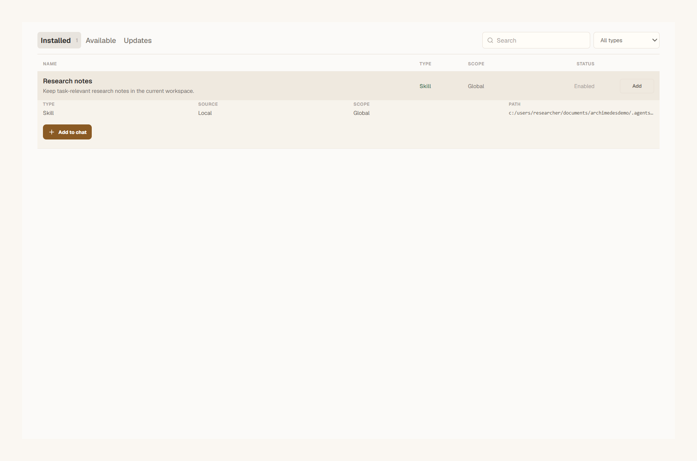 |  |
| Extensions / charcoal | 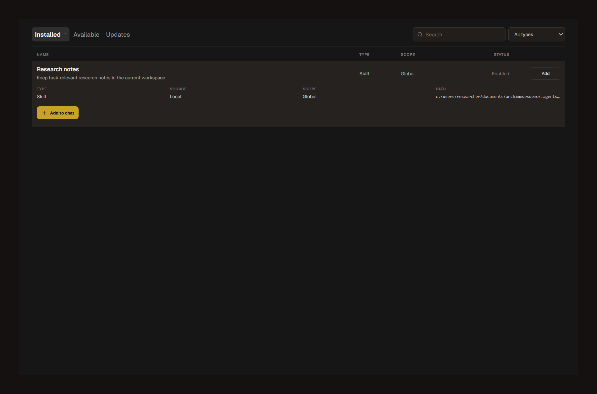 | 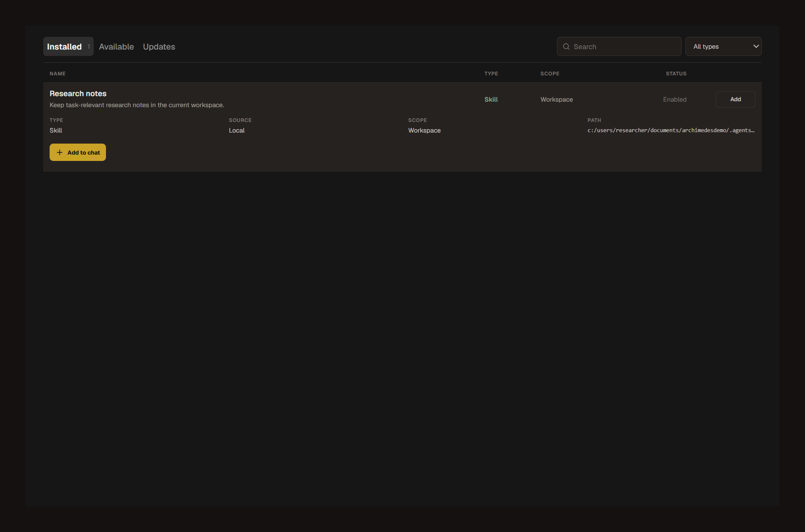 |
| Composer / paper | 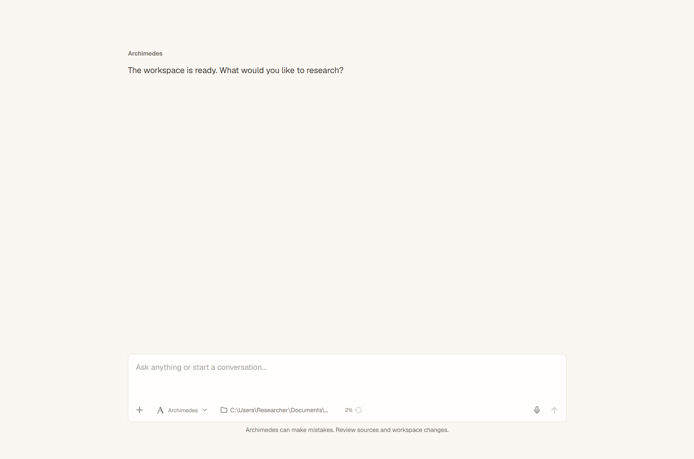 | 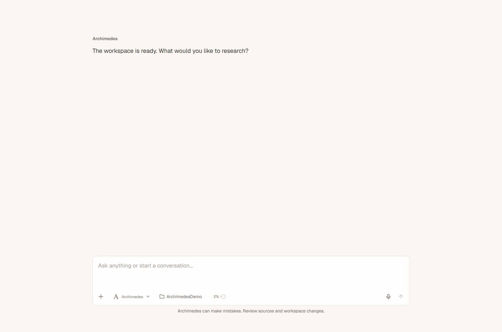 |
| Composer / charcoal | 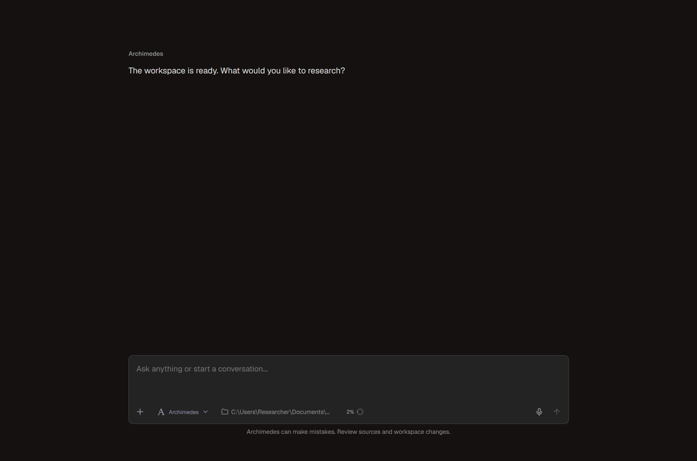 | 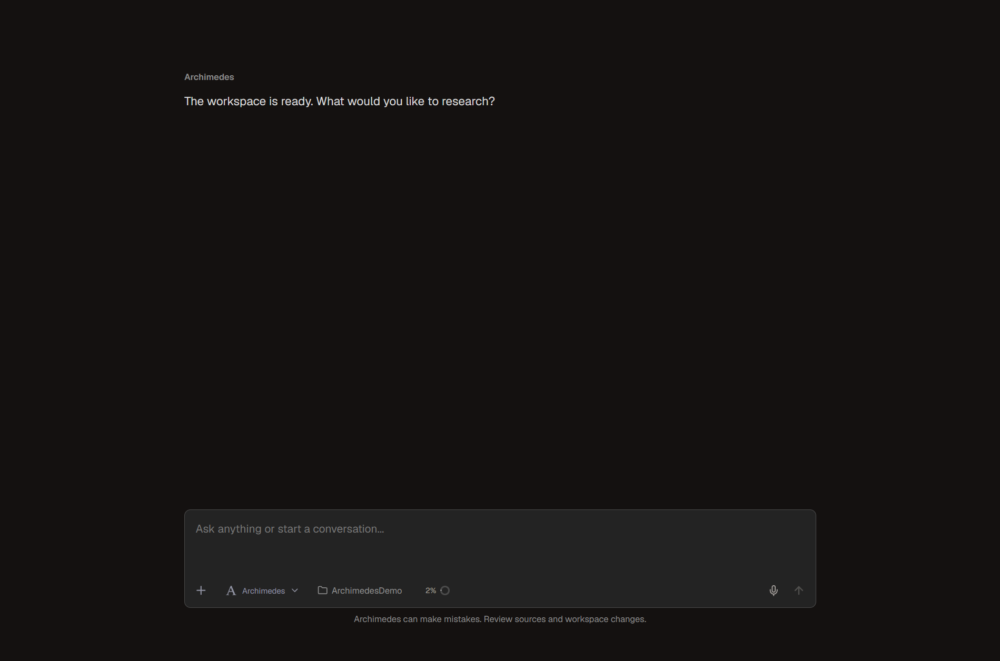 |
| Files / paper | 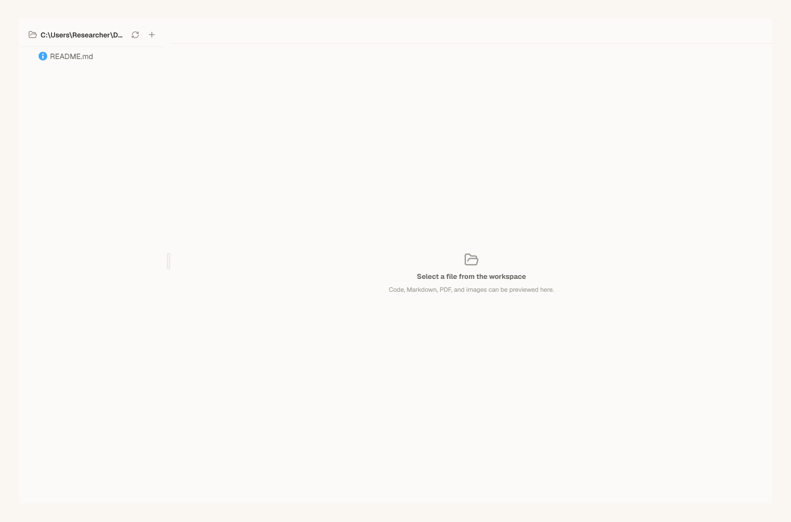 | 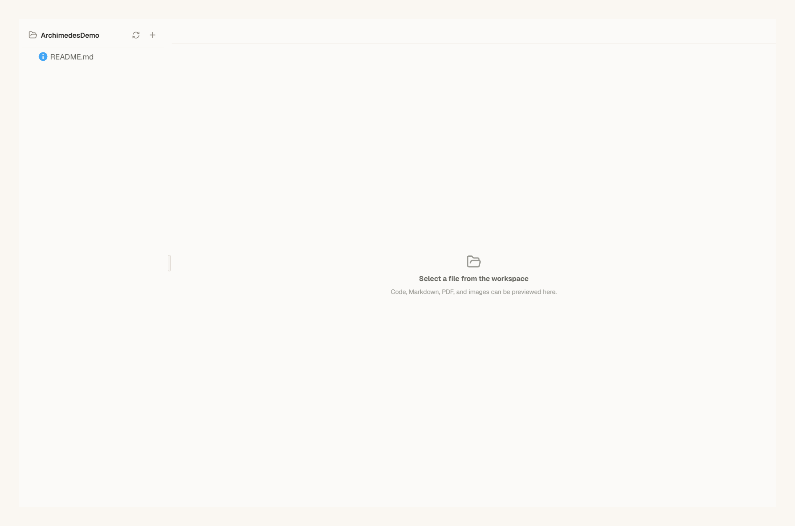 |
| Files / charcoal | 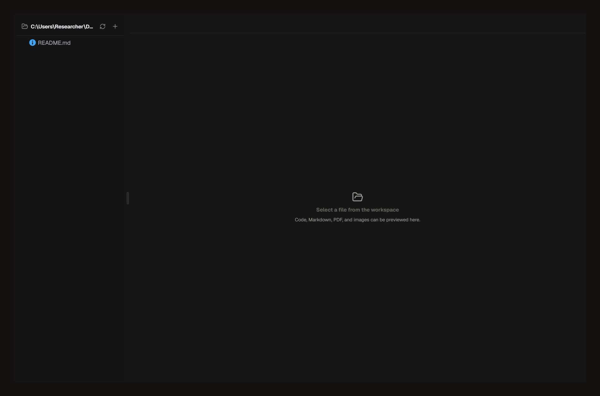 | 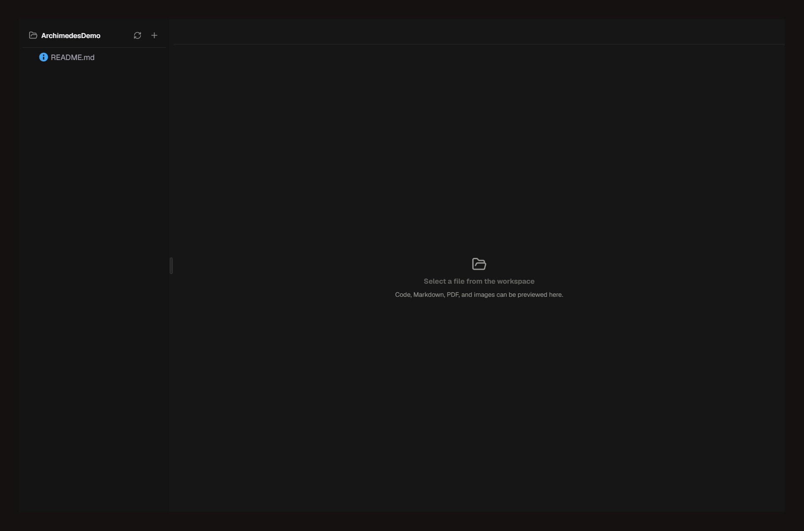 |

This patch covers the path-related portion of #196/#218. Other extension management requests, Windows password/askpass support, Windows ACL handling, and end-to-end remote reproduction remain separate work.
