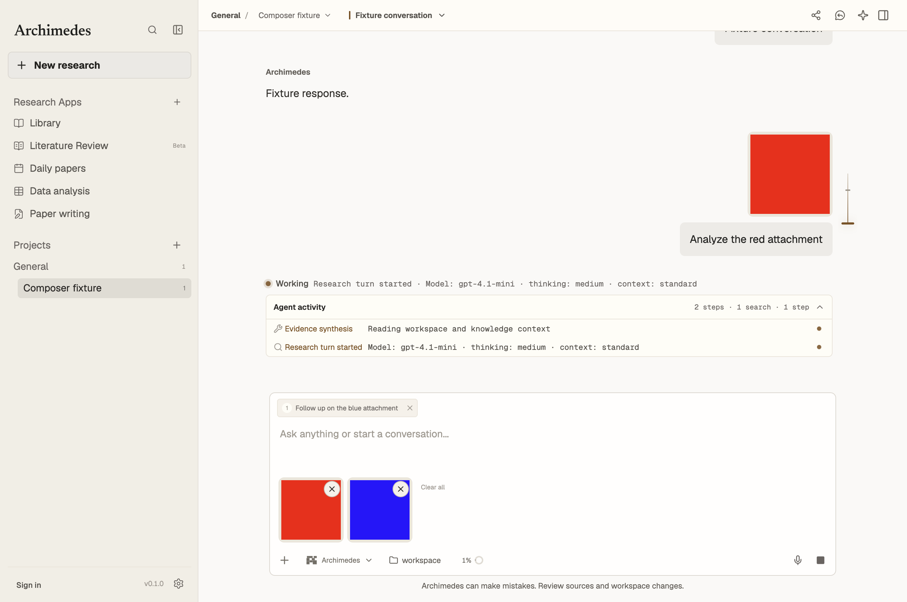
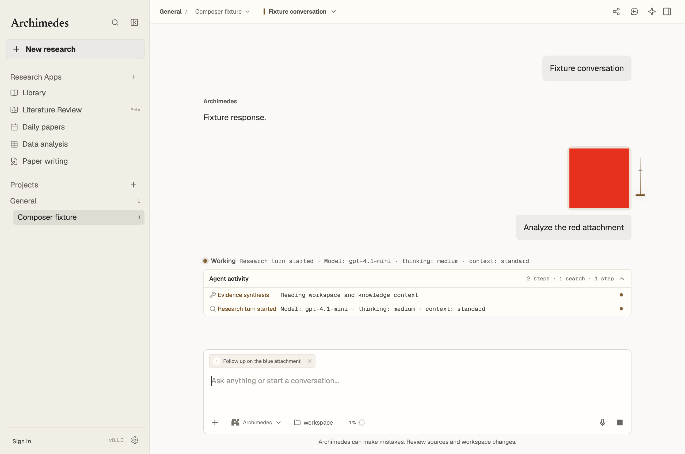
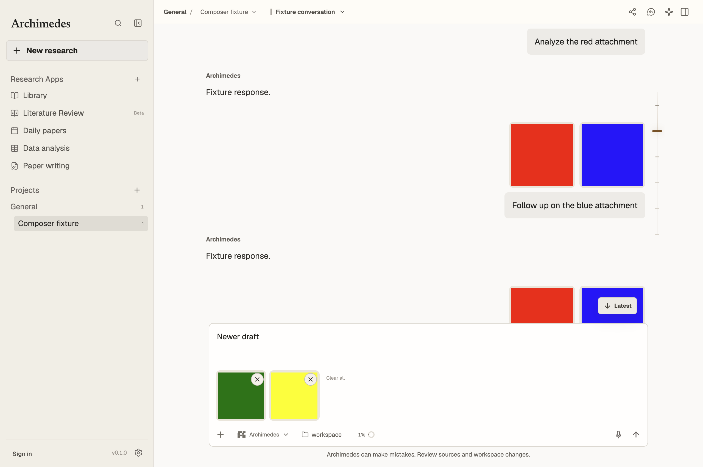
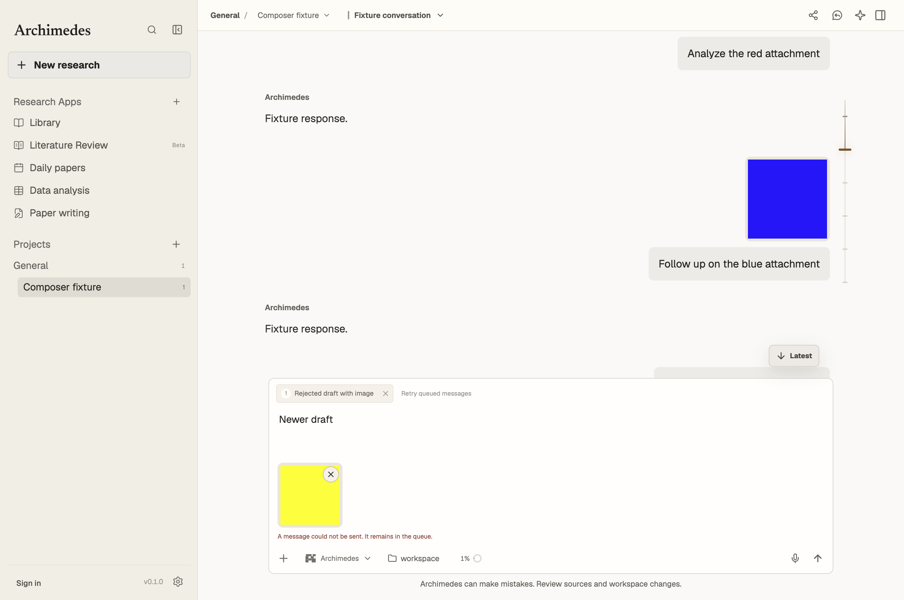

# Work composer attachment isolation

Both screenshots use Electron with the Paper theme at a 1280 × 850 content viewport. The red-image request is still running, and the blue-image follow-up has just been queued. The baseline leaves both images attached to the empty draft. The fix keeps the red image on its sent message and the blue image with its queued message.




## Reproduction

1. Start a Work conversation with an API model, then send a message with an image and hold the model response.
2. Paste a different image and press Enter to queue a second message. Capture the composer here.
3. Type an unrelated follow-up, press Enter, and release the first model response.
4. Inspect the attachments on the three new requests.

The Electron fixture received the following images at its loopback model endpoint.

| Message | Before | After |
| --- | --- | --- |
| Analyze the red attachment | Red | Red |
| Follow up on the blue attachment | Red, blue | Blue |
| Independent text-only follow-up | Red, blue | None |

## Failed send with a newer draft

The second pair uses the same theme and viewport. While the green-image send is pending, the user types a new draft and attaches the yellow image. After the earlier send fails, the baseline leaves both images on the newer draft. With the fix, the failed message can be retried from the queue and the newer draft retains only the yellow image.




The component regression also checks recovery when the composer is empty and can restore the complete failed follow-up in place.

```sh
node --test electron/work-composer-attachments.test.cjs
```
