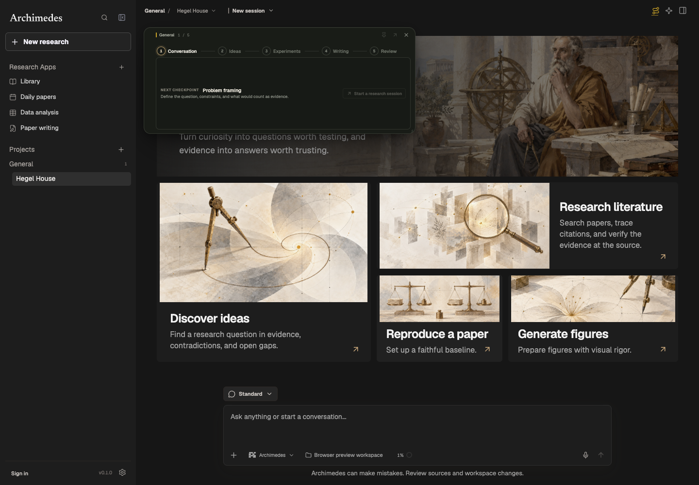
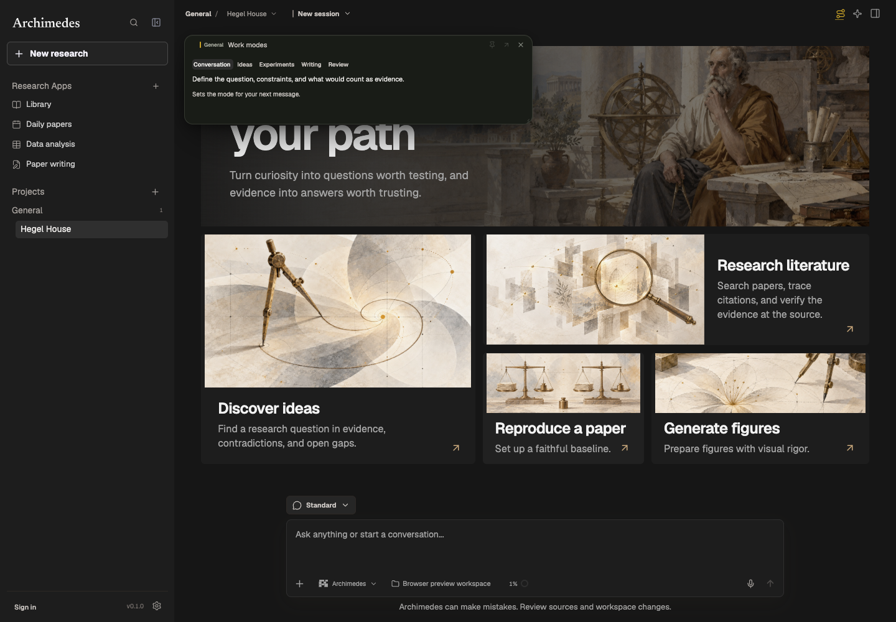

# Work modes comparison

Both screenshots use the actual renderer at 1440 × 1000 CSS pixels, charcoal,
English, default text size, the same deterministic browser-preview project and
empty session. The before renderer is upstream `1f4b375`; the after renderer is
this branch's code at `617284e` (the following commit only adds these images and
this note). No Electron window or paid/model service was used.

| Before | After |
| --- | --- |
|  |  |

The old numbered/checkpoint presentation becomes explicit next-message mode
navigation. Interactive component tests also cover choosing a mode and returning
to a pinned inactive session; these screenshots show the corresponding empty
session entry state.
