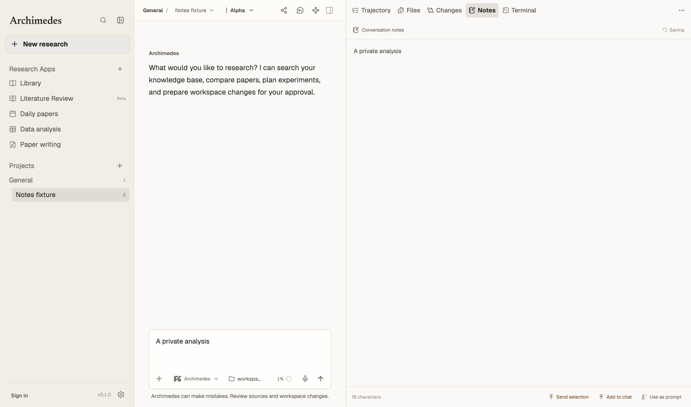
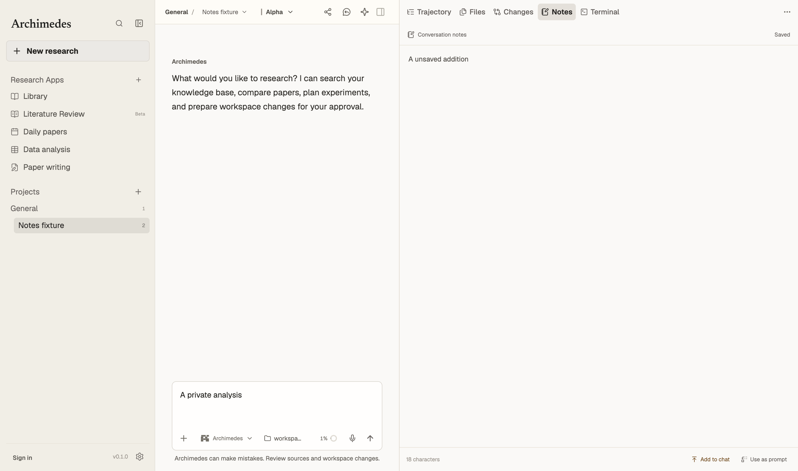

# Workbench Notes across session switches

Both pairs use Electron at 1440 × 850, with the Paper theme and the same two sessions.

## Selected text

Select text in Alpha's note. Switch to Beta with the Notes pane still open. In the baseline, **Send selection** stays visible and inserts Alpha's text into Beta's composer. With the fix, Beta starts with no selected note text. Selecting Beta's text and sending it inserts the expected excerpt.


## Pending edits

Edit Alpha's note, switch to Beta within the 600 ms save delay, return to Alpha, then switch away again and wait for the save. In the baseline, the later read and the stored note contain the previous text. With the fix, Alpha shows its pending edit on the quick return. The saved file and later reopen contain the full edit.




The isolated desktop run also verified a failed save. Alpha kept the latest edit and showed a retry when reopened, while Beta's note stayed intact. Retrying saved the edit. An ordinary first message also adopted its draft note into the created thread without recreating the source after the save delay.

```sh
node --test electron/workbench-notes-ui.test.cjs
```
