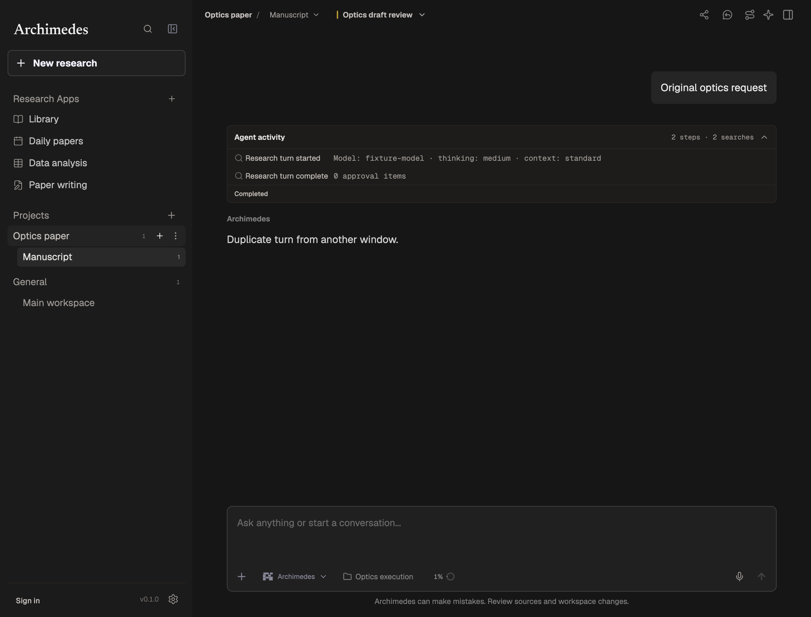
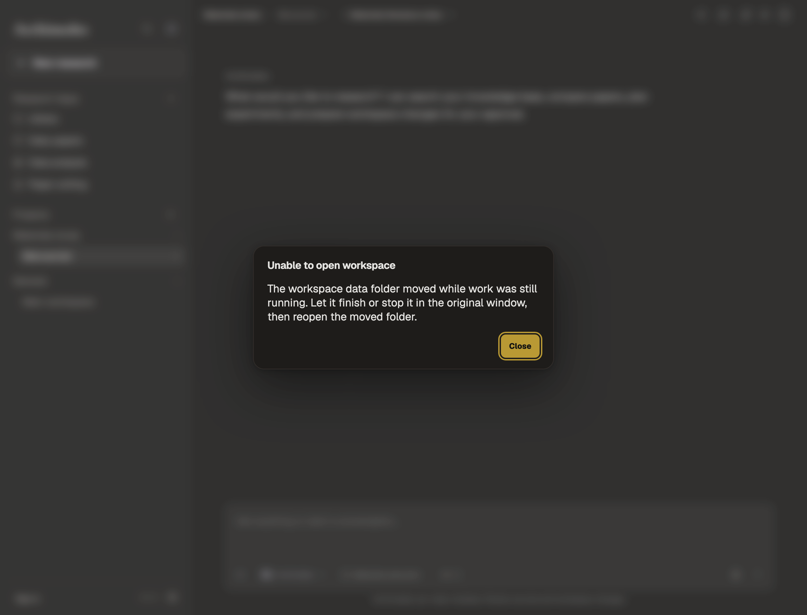

# Moving a data folder during a research reply

Both captures use the same 1,180 × 900 Charcoal viewport in the production
Electron app. The two windows start with separate disposable data folders. A
local model fixture holds the first response open. The Optics data folder is
renamed while its separate project execution folder stays in place. The test
verifies the SQLite file's device and inode before and after the rename.

| Before (`b659be4`) | After (`014cf2b`) |
| --- | --- |
|  |  |

The earlier build made two model requests for the same chat before the first
reply finished. The fixed build made one. After the original reply finished,
reopening the moved folder showed the original reply as the chat's only turn.
The conversation retained the original execution folder.
