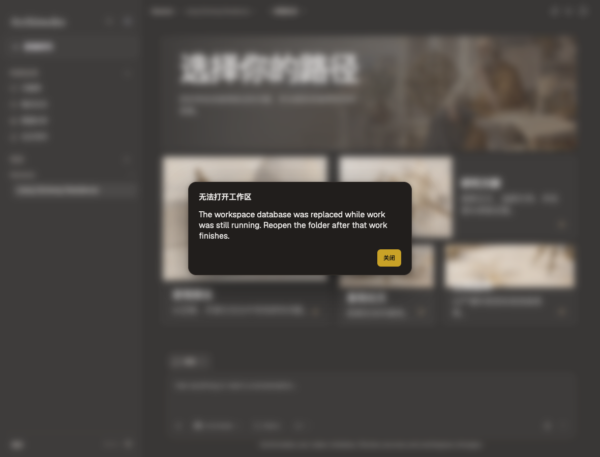
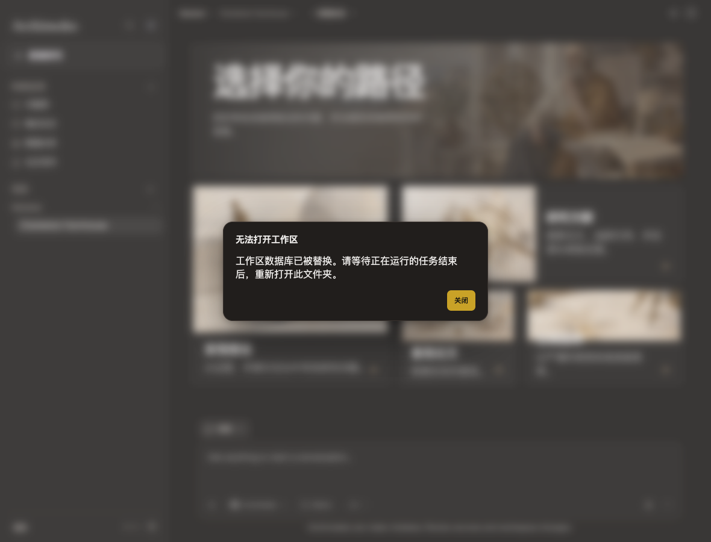

# Reopening a restored database

The two captures use the same 1180 × 900 Charcoal Electron window with Chinese selected. The fixture replaces the open data folder with a backup at the same path while a job holds the original SQLite connection, then reopens the folder through the app's menu event.

| Previous PR revision | Revised PR |
| --- | --- |
|  |  |

The two-window SQLite regression in `electron/accepted-workspace-owner.test.cjs` also covers replacement with no job running. A save attempted before reload and a retry are rejected. Reopening in one window lets it save to the restored database. The second window must retrieve its own replacement snapshot before it can overwrite those notes.
