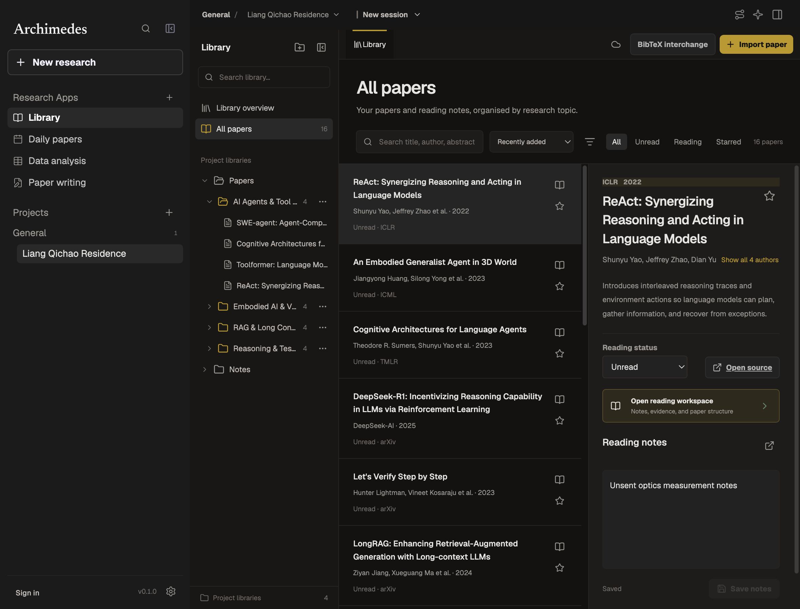
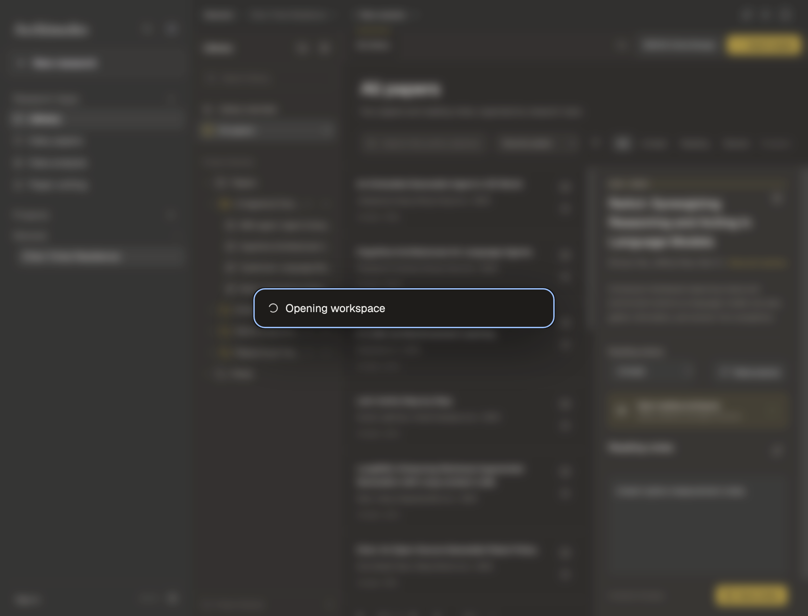

# Library notes during a data-folder switch

Both captures use production Electron at 1,180 × 900 in Charcoal. Optics and
Materials are separate disposable SQLite folders with different notes on the
same seeded paper. The app opens Materials through the folder menu while
Optics has one unsaved note. The fixture holds the open response after
Materials becomes the accepted folder, then clicks the same Save notes
location in both runs.

| Before (`67c339e`) | After (`8db112b`) |
| --- | --- |
|  |  |

Before the fix, that click wrote the Optics text into Materials. After the
fix, the click issued no save. The IPC handler also refused a delayed update
carrying Optics as its owner. After the switch, the Materials Library showed
its original note and its own Save notes control worked.

When opening a missing folder was refused, the app showed the error, kept the
unsaved Optics text, and let that note save to Optics. When further reads
failed after the new database opened, the app reported the file and
conversation errors and left the new data folder selected.
