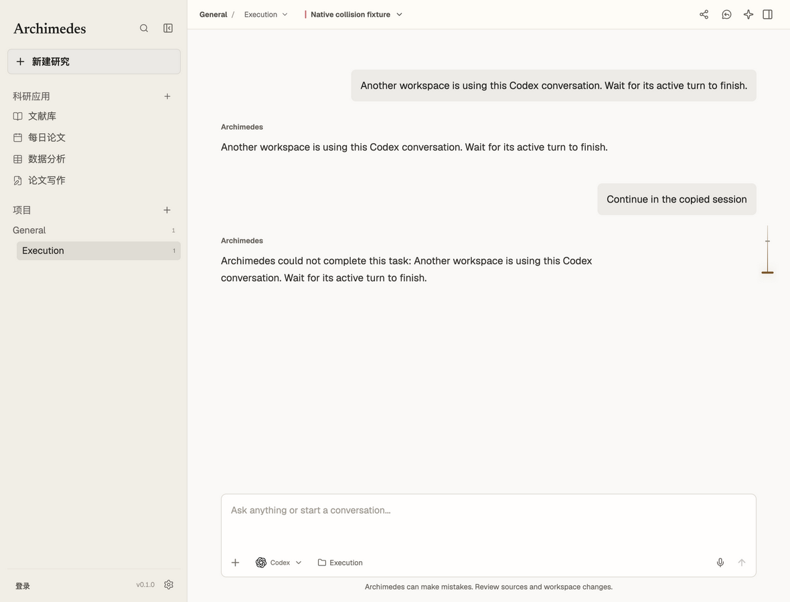
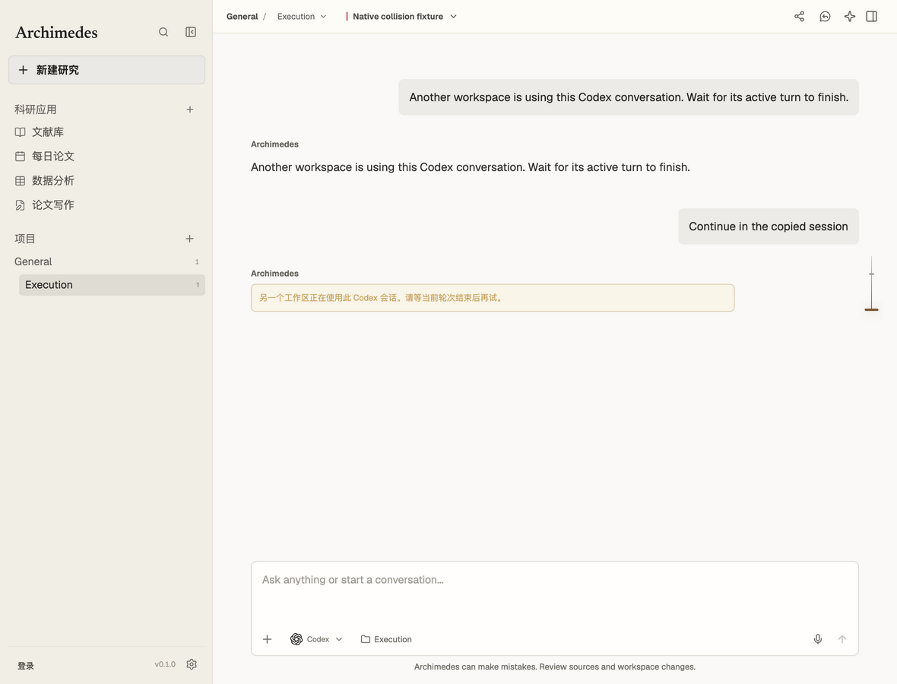

# Localized native-session collision

The same copied chat is shown in both Simplified Chinese Paper captures at 1180 × 900 in macOS Electron. The baseline uses `b05a798`. A local Codex protocol fixture keeps one native turn active while the copied data folder attempts to resume its saved binding. The rejected turn is saved and opened through the app's normal history path.

| Chinese before | Chinese after |
| --- | --- |
|  |  |

The [English after capture](paper-en-after.png) shows the same notice after changing the interface language in Settings. After switching back to Chinese and reopening the chat, the saved notice rendered in Chinese again. The deliberately identical English sentence in the earlier user and assistant messages remains visible as conversation text throughout.
