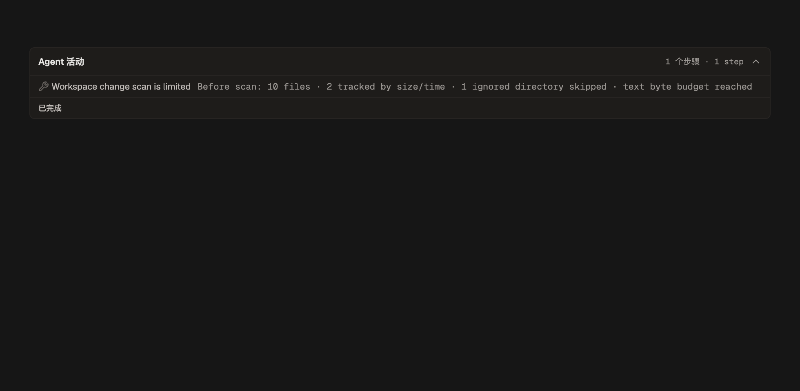
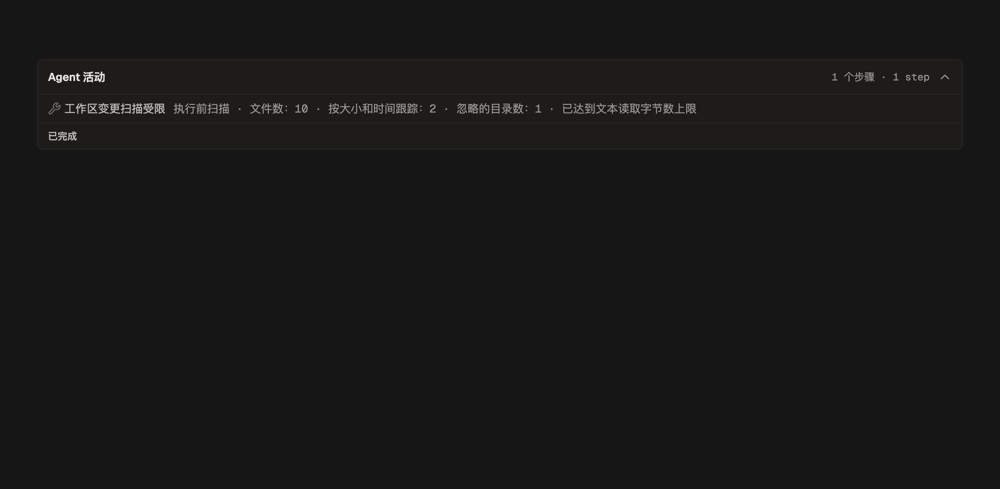

# Snapshot read-budget comparison

`node scripts/measure-workspace-snapshot.cjs` compares the actual upstream
`1f4b375` and this branch's snapshot functions against the same temporary files:
30 user text files of 900,000 bytes each, and a generated `.venv` containing 120
Python files of 100,000 bytes each. It counts actual filesystem reads, leaving
the production function intact.

| Observed counter | Before | After |
| --- | ---: | ---: |
| Text bytes read | 39,000,000 | 7,200,000 |
| File-content read calls | 150 | 8 |
| Tracked user files | 30 (plus 120 generated files) | 30 |
| User files tracked by metadata after the text budget | — | 22 |
| Generated environment directories skipped | 0 | 1 |

Read budgeting now precedes file reads and hashing. Files beyond the text budget
retain size/time metadata; the existing 5,000-entry cap still bounds tracked files.
The action payload records skipped directories and metadata tracking. The UI
reports a limited scan only when text or tracked-file budgets are reached;
ordinary `.git`/environment exclusions do not trigger that notice.

Behavior checks verify a metadata-only file modification, ordinary line diffs,
and an untouched file moving between content and metadata tracking without an
invented change. An actual approved command writes a file and persists both its
change receipt and scan coverage. The measurements concern snapshot I/O; elapsed
time printed by the script is one local observation rather than a UI latency or
memory benchmark.

The screenshots show the actual chat activity component in Electron at 980 × 480, Charcoal and Chinese. Both report a scan that exceeded the text budget before an approved command and finished within budget afterward. The before capture uses `ccdfd47`. The after capture translates the warning, phase, counts and reason into Chinese. The same data survives a conversation reopen.

| Before | After |
| --- | --- |
|  |  |
