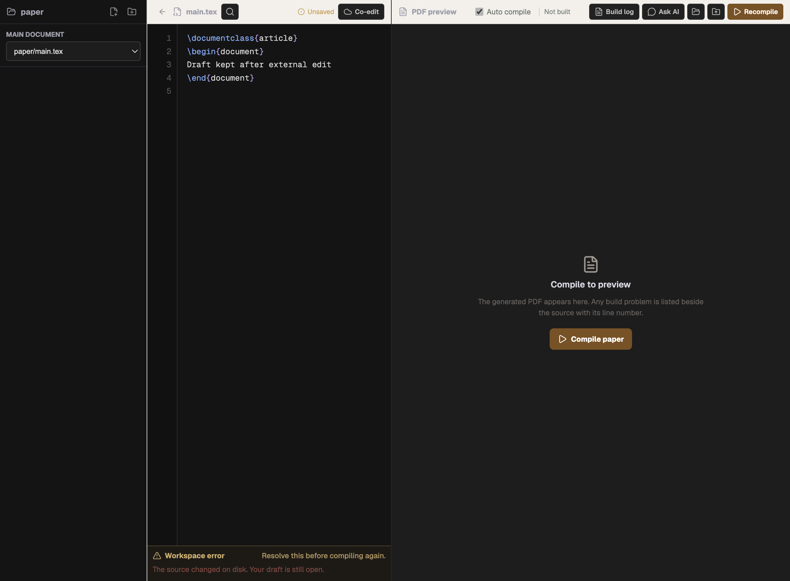
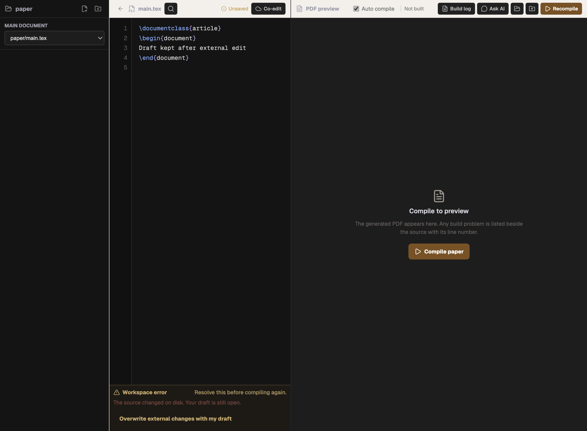

# Writing review recovery follow-ups

The pre-fix run uses a temporary `git archive` of `a7bdb6c3` with only the current
test file overlaid. It does not use a worktree or modify the branch.

```bash
for name in 'a rejected source conflict' 'cached previews are revalidated' \
  'a new manuscript activation cancels' 'a conflicted source in another manuscript'; do
  node --test --test-timeout=12000 --test-name-pattern="$name" electron/paper-writing-workspace.test.cjs
done
```

- `before.log`: a rejected save left no recovery action, a stale cached preview
  survived scope re-entry, a superseded source read reset the activated
  manuscript's main document, and an unrelated save conflict blocked a healthy
  manuscript's compile.
- `after.log`: all four regressions pass.

The only new UI is the conflict recovery action. Both captures use the same
1,180 × 900 Electron window, fixture, draft, and theme; `before.png` is the
pre-fix component and `after.png` is the fixed component. The observations
record the rendered error, available actions, and retained draft.

| Before | After |
| --- | --- |
|  |  |

The recovery action adopts the current disk bytes as the save baseline and
immediately saves the retained draft. Other fixes are lifecycle and state
changes with the focused logs above as evidence.
