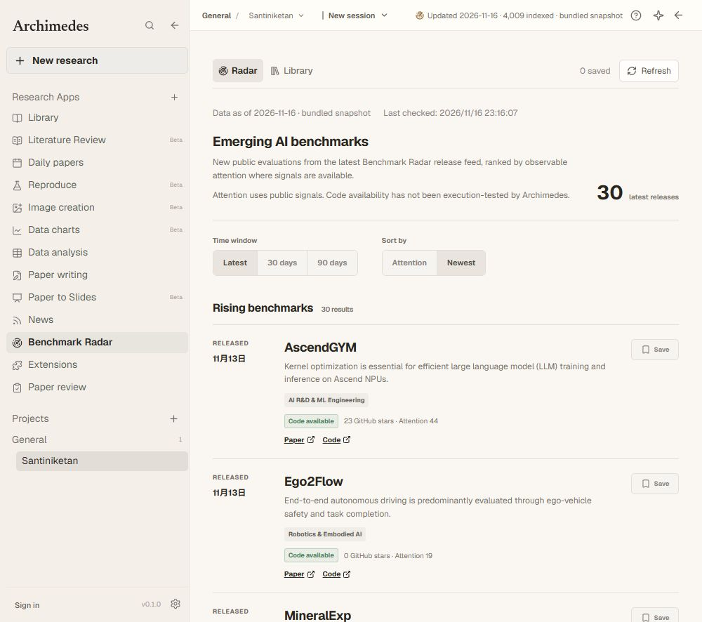
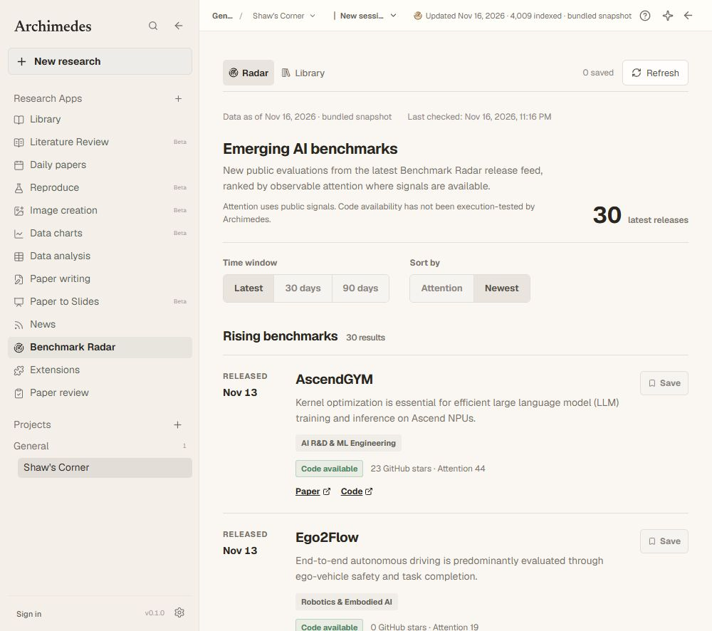

# Benchmark Radar date and typography polish

## Changes

- Benchmark Radar dates and number grouping follow the active UI language,
  rather than the operating-system locale. Date-only release values are
  formatted in UTC to avoid shifting a release to the previous day.
- “Updated” and “Last checked” use the same localized date/time style.
- Increased the small metadata, controls, and body copy to a more consistent
  scale and adjusted row spacing so descriptions, tags, and signal values have
  clearer separation.

## Before / after

Captured in the Paper theme with the app language set to English while the
browser locale is `zh-CN`, so the before image shows the locale mismatch.
Both captures use the same viewport, theme, data snapshot, and Radar tab. The
preview generates its sample workspace title per session, so that unrelated
label differs between captures.

| Before | After |
|---|---|
|  |  |
