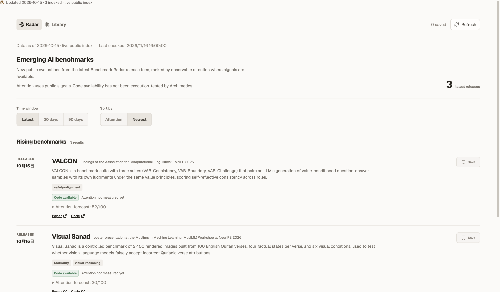

# Benchmark Radar data and refresh

Benchmark Radar reads the original [Claire1217/benchmark-radar](https://github.com/Claire1217/benchmark-radar) project’s two public indexes: `https://benchmark-radar.com/data/benchmarks_index.json` for Radar and `https://benchmark-radar.com/data/library_index.json` for Library. The similarly named `.org` domain serves a different catalog and is not this project’s feed. It renders native Archimedes components, without embedding the external website or running its discovery pipeline.

## Data lifecycle

- Open the app: render the newer saved cache or bundled snapshot immediately, then apply the result of an online check to the current view.
- Successful downloads are cached at `<userData>/benchmark-radar/public-index.json`. Normal checks respect a six-hour TTL. The two canonical indexes are downloaded and committed as one complete pair; a partial failure never overwrites the cache. A single-file ETag is not used to validate both feeds. **Refresh** bypasses the TTL.
- While mounted, the page checks when it becomes visible/focused and every six hours while visible. Concurrent downloads are shared; controls prevent duplicate manual requests. Timers and event handlers are removed on unmount.
- Failed checks preserve the last usable data and display a retry notice. The page separates the source's data date from the last successful online check. Downloading today does not imply that the upstream data was collected today.
- The Electron network stack is used for desktop requests, preserving its system-network/proxy behavior. Requests have a bounded 20-second timeout.
- Latest displays the 30 most recently released entries, sorted newest-first by default; Attention remains an optional sort. The 30/90-day filters use today's UTC date, rather than the date of a potentially stale snapshot.

## Explicit local development override

Set `BENCHMARK_RADAR_ROOT=/absolute/path/to/benchmark-radar` to use that checkout's `data/benchmarks_index.json` and `data/library_index.json`. No adjacent directory is discovered automatically. **Reload local data** rereads both files without restarting Electron; an invalid explicit path reports an error rather than silently selecting another source.

## Interpreting signals

- **Attention** combines the supplied attention score, GitHub stars and Hugging Face votes. Missing observations remain unknown in the displayed signals.
- **Code available** means the source provides code information. Archimedes has not executed or validated it.
- **Attention forecast** is shown only when the source provides a score. Expand it for the supplied reason, horizon and confidence. It estimates future attention rather than benchmark quality. Current public-index records may omit these fields entirely; Archimedes does not invent them.
- **Save** stores selected benchmark IDs locally; it does not download datasets or run evaluations.

## Verification

Run `node --test electron/benchmark-radar*.test.cjs` for the index and lifecycle behavior. Run `node scripts/capture-benchmark-radar-refresh.mjs before` and then `after` for isolated Electron UI checks.

The UI fixture contains three real records from the original October 15 local snapshot, including its original forecast metadata. It intentionally exercises older data and is not the current production feed. Both stages use the same data, themes and window sizes; interactions also cover in-place refresh, duplicate-click prevention, offline fallback, forecast explanations and unmount cleanup. Captures and checks are under `docs/assets/benchmark-radar-refresh/`.

Validation on this Mac:

- Lint, renderer build and theme-token checks passed.
- Index, refresh, source-migration, translations and shared-UI checks passed; canonical fixtures explicitly cover November releases, hidden records, distinct Radar/Library lists, and partial-download failures.
- Paper/charcoal UI captures and behavioral checks passed, including a 780px window without horizontal overflow.
- The canonical snapshot is dated 2026-11-16: 2,351 visible Radar records and 4,009 visible Library records. Radar includes 164 visible November releases, with newest release date 2026-11-13. These counts preserve the upstream `displayEligible` filter. Real-component captures under `assets/benchmark-radar-public-index/` show November entries at the top.
- Full `npm test`: 1,277 passed, 6 skipped, 1 failed. The unrelated LaTeX template smoke test failed because the local TeX Live installation lacks the `phvr7t` font metric. The LaTeX implementation, templates and test were unchanged.

## Source migration

The earlier `.org` feed reported collection activity through November 4 but contained no November release dates. Cache schema 2 records the canonical source URL and keeps Radar separate from Library. Legacy `.org` caches remain readable only as offline fallbacks; their timestamps and ETags cannot suppress a canonical-source refresh. The bundled snapshot was regenerated from `.com` using `npm run radar:sync`.
