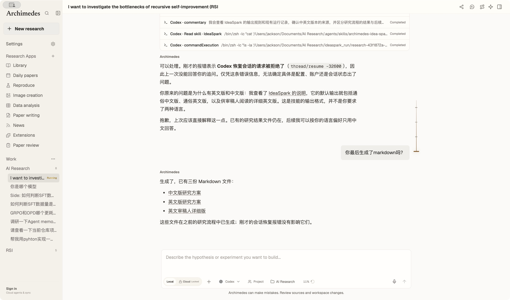
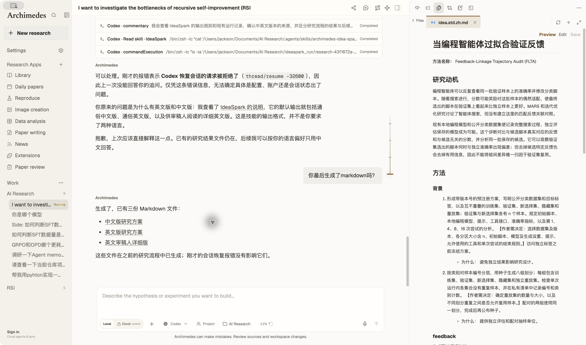

# Open generated Markdown from chat

Local Markdown links from native Codex responses were rendered as ordinary `_blank` links. In development, the renderer server interpreted an absolute filesystem path as an application URL and returned the app entry point in a new Electron window.

Chat Markdown now resolves absolute paths, file URLs and workspace-relative links to the existing Files preview callback. Local clicks, including modified and middle clicks, cancel browser navigation. Paths outside the active workspace are not clickable; the desktop file reader continues to validate real paths before reading. The default Markdown URL sanitizer remains enabled for images and executable protocols. Web links retain their existing behavior.

A memoized context carries the active workspace and stable file-opening callback to chat links without changing the history components' typing behavior.

## Verification

- `node --test electron/workspace-markdown-links.test.cjs electron/chat-input-performance.test.cjs electron/workspace-files.test.cjs`: 8 passed. Tests render real ReactMarkdown, click absolute, relative and file-URL links, read a real Markdown file through the desktop reader, and verify that navigation is canceled. macOS and Windows path cases, encoded traversal, outside-workspace paths and unsafe protocols are covered.
- `npm run lint`, `npm run build` and `npm run check:theme`: passed.
- Full `npm test`: 1081 passed, 4 skipped, 8 failed. Seven match the previously observed failures: three Benchmark Radar local-data cases, three Windows-shell cases on macOS, and the duplicate `Outline` translation key. The remaining Data Charts dialog test passed when rerun independently (`node --test electron/data-charts-view.test.cjs`: 2 passed).
- Desktop audit: clicked the existing Chinese IdeaSpark card in the running Archimedes conversation. It opened `idea.std.zh.md` in the current window's Files pane and displayed the generated research plan.

The screenshots show the same desktop viewport and theme immediately before and after clicking the card with the fix loaded.

