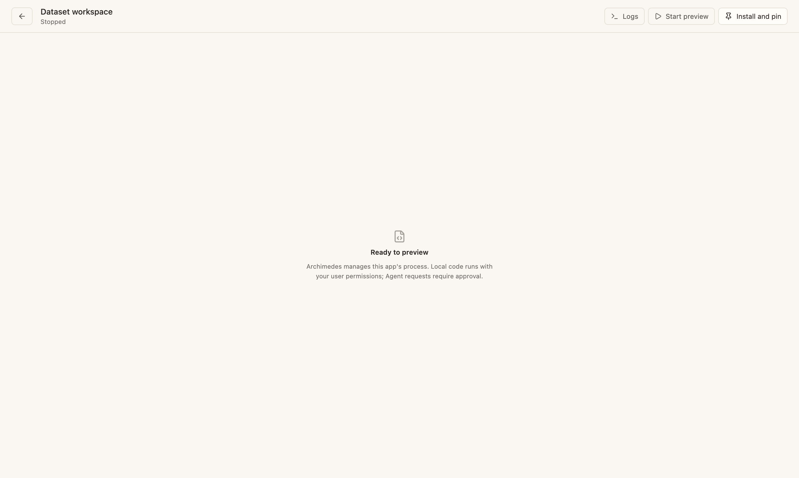
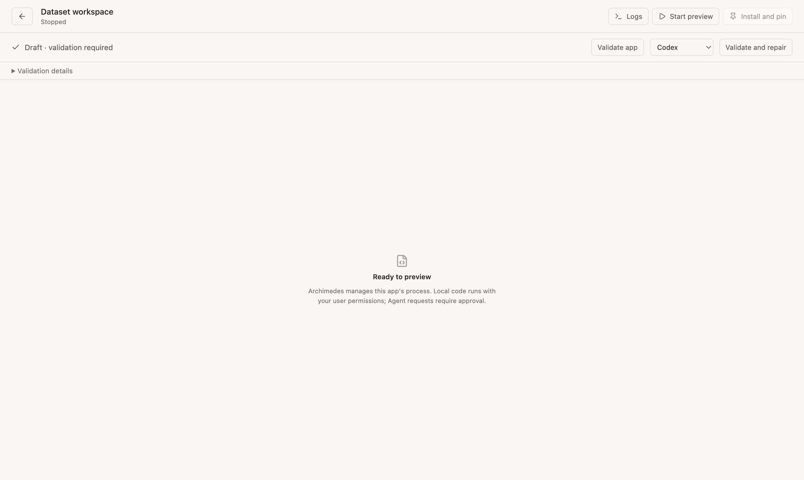
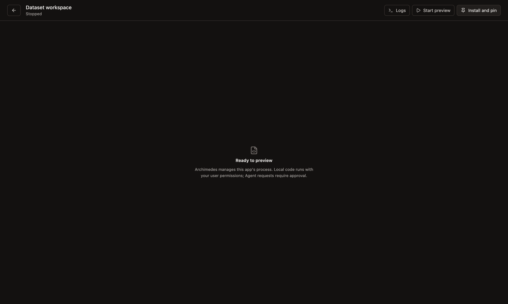
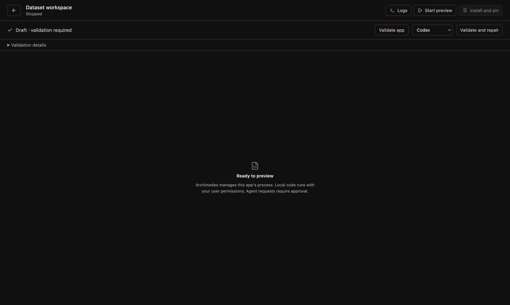

# Research App delivery pipeline

Scope: Research Apps [#256](https://github.com/Johanson-colab/Archimedes/issues/256), continued in [#429](https://github.com/Johanson-colab/Archimedes/pull/429). Written owner approval in the development conversation explicitly requests standard scaffolds, mandatory acceptance evidence, bounded automatic repair and recovery. This extends the initial language/startup fix documented in [create-delivery-validation.md](create-delivery-validation.md).

## Lifecycle

```text
Create request → chosen coding harness + capability retrieval
  → standard scaffold → task-specific code and acceptance plan
  → approved environment setup → host HTTP checks → Chromium workflow
  → Ready, bound to this source/interpreter identity → install/pin
                           ↘ failed → approved repair, at most twice → recheck
                           ↘ missing setup/key → Needs configuration
```

After a Create turn, the desktop compares generated App fingerprints and validates changed, valid manifests automatically. The preview also exposes **Validate app**, a repair-backend selector, **Validate and repair**, cancellation, interrupted-validation recovery, evidence details and **Restore verified version**. A completed chat is not an acceptance certificate. Invalid manifests remain visible for inspection/recovery, rather than executing.

## Standard scaffolds

The native/API harness can use its approved command tool:

```sh
node electron/agent/creator-capabilities-cli.cjs scaffold '{"workspace":"/absolute/workspace","appId":"example","name":"Example","category":"analysis","kind":"python-http"}'
```

Both templates include a manifest, English page, styling, loading/error handling, a bounded Agent-message helper, README and `research-app.checks.json`. The Python template additionally provides a standard-library HTTP server, assigned-port/readiness contract and a requirements file with no third-party packages. Existing Apps are never overwritten. The starter plan is explicitly marked `starter: true` and cannot pass delivery until the requested workflow and its checks replace the example.

Capabilities remain optional: zero, one or multiple skills; direct APIs/scripts need no runtime Agent. The available runtime Agent adapters remain Codex, Claude Code and OpenCode.

## Mandatory acceptance

Each App provides a bounded declarative `research-app.checks.json`, containing a workflow description, HTTP paths and browser actions/assertions. Supported interactions are fill, select, click and expect (text, value or element count). Browser steps can set `timeoutMs` from 100 to 120000 ms; the full browser run is bounded to ten minutes. HTTP assertions support an explicit expected status for negative cases, response text and JSON-path equality/nonempty arrays.

The host runs source in a temporary workspace with fresh local App data, using the App's existing Python environment where needed. This avoids testing against the user's favorites or other `.data` records. Python execution still uses the user's OS permissions; a temporary workspace is not an OS sandbox. Declared keys follow the normal execution approval; no keys or response bodies are persisted in evidence. CLI `verify` remains a bounded diagnostic and cannot grant Ready by itself.

Chromium uses an isolated nonpersistent session, an iframe with the same restrictions as preview, no host preload, denied permissions/popups/downloads, actual DOM interactions, uncaught/console error detection and an overflow check at 1280×900. Apps declaring Agent workflows can use the actual approved host adapter during acceptance; responses are not fabricated.

Successful HTTP **and** browser results are stored outside App source under `.archimedes/app-delivery/<app-id>/`. They bind to the source fingerprint, platform/architecture, interpreter identity and source-controlled requirements. Source changes invalidate Ready. Installation and reopening an installed version require current evidence, including older installations that previously had no acceptance record. Uninstalled drafts can still be previewed under normal execution approval to investigate failures.

## Repair and recovery

Automatic repair uses the selected supported native backend, at most two repair calls and three verification attempts. Missing environments/keys stop as configuration work. Declined approval, cancellation, no source changes or modified existing acceptance assertions stop the loop. Repairing an existing valid plan cannot weaken that plan to pass.

The production repair adapter works on a temporary source copy without the user's local data. Only bounded, valid source files are applied back, with an optimistic fingerprint check so concurrent user edits are not overwritten. The replaced source is retained in a recovery directory. Codex repair requests are ephemeral; tool operations retain native approval handling and shared Environment injection is disabled.

Every successful version has a checked source snapshot. Restore verifies its integrity, stops the host runtime, swaps source transactionally, preserves `.data`, `.venv`, repositories and caches, and keeps rejected source in a recovery folder. It can recover an App whose current manifest is broken. Restoring source does not restore data, dependency installations or remote-service state; those changes may require revalidation.

## Validation evidence

- Lint, renderer build and theme checks passed.
- Full suite: 1,663 passed, five skipped, one failure. The failure is the already reproduced `origin/main` LaTeX template failure from missing local `phvr7t.tfm`; no LaTeX tests were weakened.
- Real Chromium: static word-count and Python text-processing workflows passed input → button → output, using the real host runtime. An explicitly handled HTTP 404 flow also passed. A wrong output was rejected, repaired and rechecked. An uncaught JavaScript error was rejected even when result assertions otherwise matched. Processes were stopped and source restoration preserved a data sentinel.
- Live Codex: the same repair adapter used by the desktop repaired the intentionally broken word-count App, and subsequent Chromium acceptance passed. No assertion was weakened. Claude Code/OpenCode adapter configuration and approval behavior have unit coverage; their live-provider repair flow was not run in this change.
- Additional behavior tests cover installation gating, stale evidence, absent browser evidence, retry bounds, no-op repairs, plan tampering, concurrent source edits, cancellation and shutdown cleanup, interrupted validation, workspace IPC boundaries, restore integrity and local-data preservation.

Reproduce deterministic browser checks with `node --test electron/research-app-browser.test.cjs`. The live-provider test is deliberately opt-in (uses the user's configured provider/account):

```sh
env -u ELECTRON_RUN_AS_NODE ARCHIMEDES_DELIVERY_NATIVE_REPAIR=codex node node_modules/electron/cli.js scripts/check-research-app-delivery.cjs
```

## UI evidence

These are captures of the actual renderer component with identical 1400×900 viewport, fixture and theme. Before uses `b7b3a46`; after uses the new component. The draft now exposes acceptance controls and cannot install. They are fixture-based UI evidence, separate from the live runtime tests above.






Capture again using `node scripts/capture-research-app-delivery.cjs`.

## Coverage limits

Ready means the declared workflow passed at the recorded time. The plan is authored by the coding Agent and still requires review for task coverage and scientific correctness. This release does not certify all possible workflows, export/download contents, file-upload flows, sustained workloads, arbitrary screen sizes, future API availability or full dependency reproducibility. Python environment identity does not fingerprint every installed package file. Additional dependencies/system tools still require appropriate setup; this is not a universal Node/React package installer. Recovery folders are retained rather than automatically pruned.
