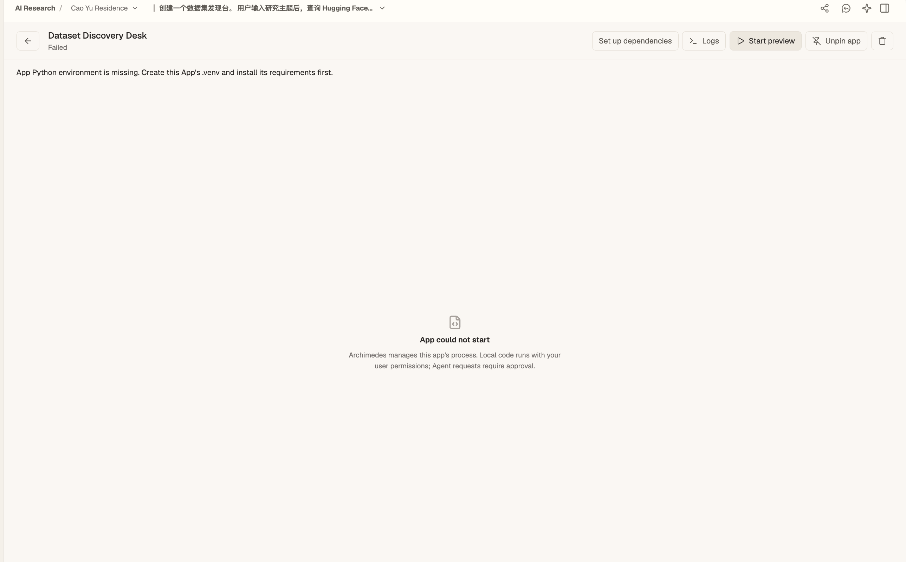
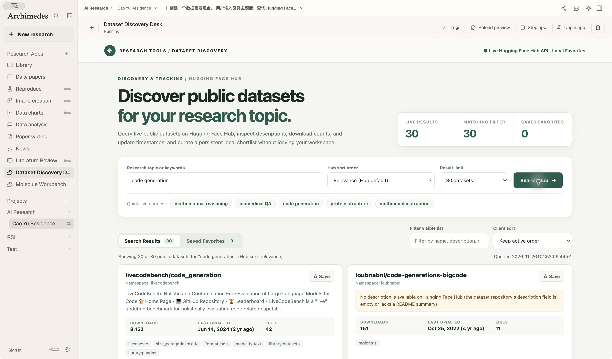

# Create conversation language and delivery checks

Scope: Create / Research Apps from [#256](https://github.com/Johanson-colab/Archimedes/issues/256), following the owner's report that a Chinese creation request received an English reply and Dataset Discovery Desk failed to start. The owner requested this repair in the development conversation.

## What failed

The previous prompt defaulted all user-facing App content to English without explicitly separating App content from the creation conversation. Creation progress, questions and delivery instructions now follow the user's language; generated App interfaces independently default to English unless the user requests otherwise.

Dataset Discovery Desk had syntax and mocked-response checks, but no App-local `.venv`. The host requires that environment even for standard-library-only Python Apps. Installing and reopening the draft therefore produced a startup error. Mocked tests did not cover this delivery path.

## Behavior

- Missing Python environments show **Setup required** and **Set up dependencies**, instead of attempting automatic startup. Start and install are unavailable until setup completes. Host installation also rejects a missing environment.
- Successful setup clears the previous runtime failure and exposes explicit preview startup. Setup alone does not execute the App.
- Creator instructions require manifest, environment, actual host readiness, frontend assets and the real primary workflow to be checked before claiming readiness. Blocked checks must be reported as pending; mock results remain distinguishable from live results.
- `creator-capabilities-cli.cjs verify` supplies a repeatable host-startup / HTTP check. Instructions are a behavioral contract, not a guarantee that every model-generated App is correct.

## Verification command

```sh
node electron/agent/creator-capabilities-cli.cjs verify '{"workspace":"/absolute/workspace","appId":"sample-app","paths":["/","/app.js","/api/example"]}'
```

This command executes local App code through the harness's ordinary approved command mechanism. It uses the real host runtime, checks up to ten relative HTTP paths with bounded responses/timeouts, reports structured evidence, and stops its process afterward. A failed check produces a nonzero exit code. It does not persist installation consent, install dependencies, read vault secrets, or validate interactive browser behavior and layout. Apps declaring Environment keys must be tested inside the host with their normal approval flow. Agent interactions also need separate host testing.

## Observed local results

Dataset Discovery Desk, workspace `/Users/jackson/Documents/AI Research`:

- Prepared the App-local environment through the existing setup mechanism. Its requirements were empty; no third-party packages were installed. App source and its saved execution fingerprint were unchanged.
- Started through `createResearchAppRuntime`; `/`, `/app.js`, `/style.css`, `/api/datasets?q=mnist&limit=3`, and `/api/favorites` all returned HTTP 200. The live Hugging Face response contained three dataset records.
- In the embedded Archimedes page, submitting `mnist` returned 30 live results. The later screenshot shows a `code generation` query with 30 results, also visibly running in the host.
- In an isolated source copy, saved a favorite, stopped/restarted the host runtime, confirmed persistence and removed the test record. The original App's favorites were not changed by this persistence test.
- Focused tests: 32 passed. Lint, build, and theme checks passed. Full suite: 1,630 passed, five skipped, one failed. The unrelated LaTeX template compilation test fails because this machine's TeX installation lacks `phvr7t.tfm`; no LaTeX code or tests were changed.

## UI evidence

The before image is the user's original failure screenshot. The after image is a live host capture after environment setup. Their viewport and App state differ; this is startup outcome evidence, not a pixel comparison. Setup-state controls and recovery are also covered by renderer behavior tests.




