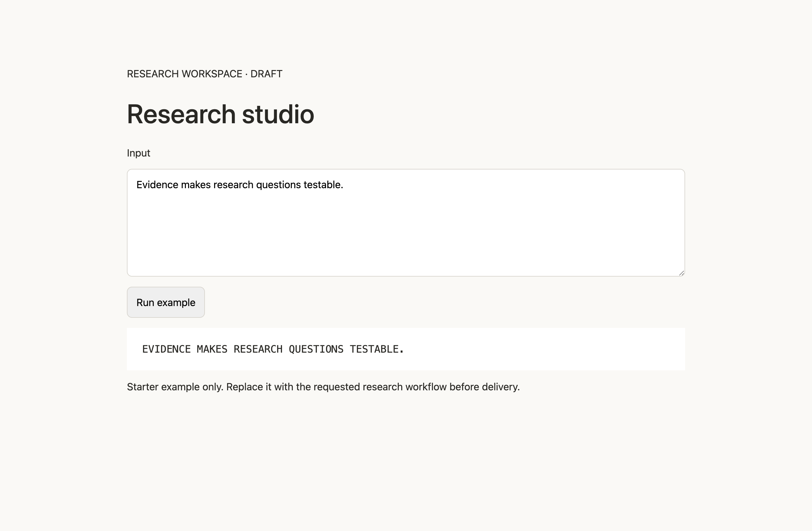
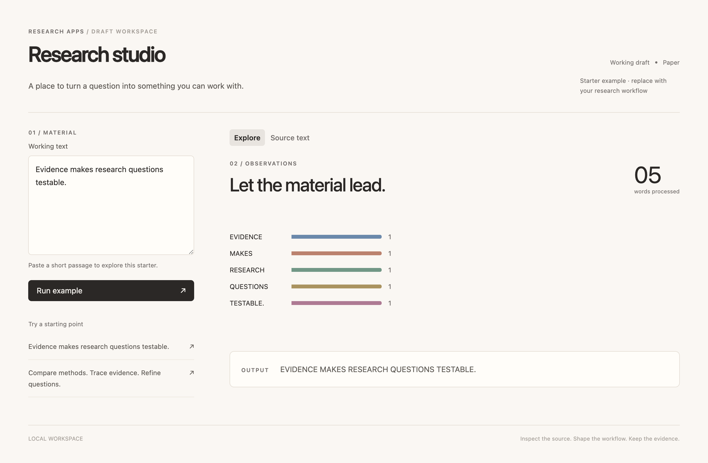
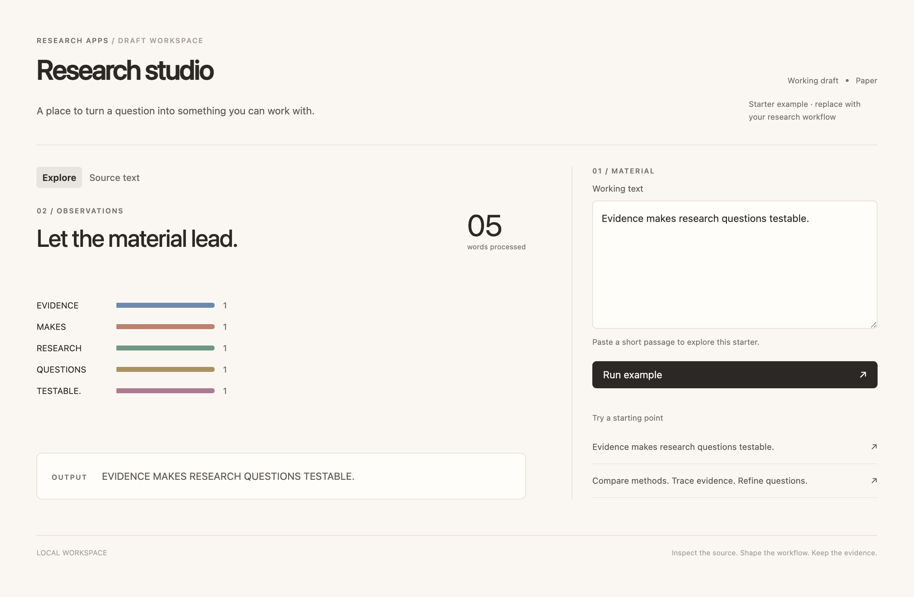
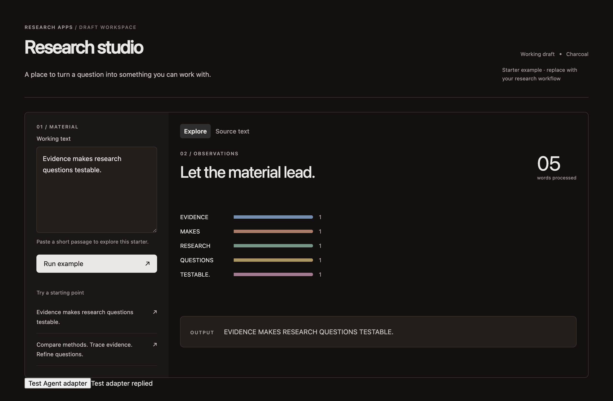
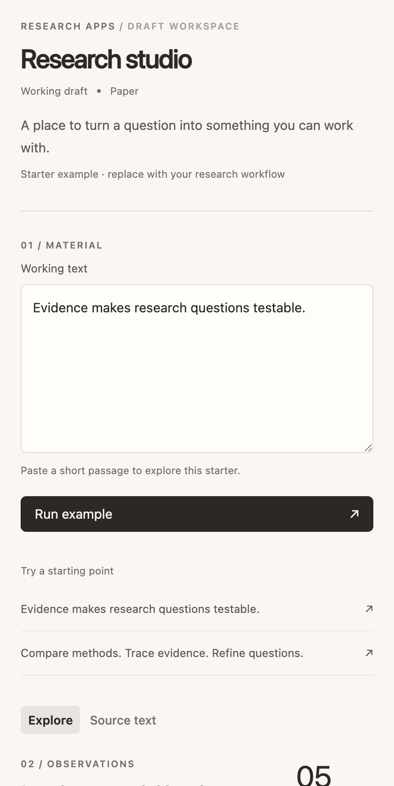

# React Research App foundation

Scope: Research Apps issue [#256](https://github.com/Johanson-colab/Archimedes/issues/256) and [PR #429](https://github.com/Johanson-colab/Archimedes/pull/429). Written owner approval in the development conversation requests **React + TypeScript + Vite + Archimedes theme/shared components + controlled capability interfaces**, keeping the host background while allowing varied, task-specific layouts.

## What changes

Create now defaults to an independently buildable React project. The scaffold includes pinned React/React DOM, TypeScript, Vite and the React plugin, with a minimal integrity-pinned npm lockfile. It does not depend on importing Archimedes source from the user's computer. Existing plain Apps continue to run; `frontend: "plain"` explicitly selects the older minimal template. Existing generated Apps are not silently rewritten or recolored.

```text
research-app.json             frontend: {kind: "react-vite"}
package.json / package-lock.json
index.html / vite.config.ts / tsconfig.json
src/App.tsx / src/app.css     task-owned page and composition
src/archimedes/              shared components, theme, fonts, SDK
app.py / requirements.txt    optional Python service
public/                     generated production output, never hand-edited
```

The default starter is marked as a draft. Its example and acceptance plan must be replaced before delivery. The three starting compositions—canvas, editorial and split workspace—are suggestions, not App types or fixed page schemas. Creator instructions explicitly require task-led hierarchy, replacing starter prose/plots, and freedom to change sections, density, visualizations and interactions. They discourage default green backgrounds, giant decorative heroes and repeated KPI-card grids.

## Theme and components

- Bundled Paper/charcoal tokens come from `src/tokens.css`. Tabs, Tab, FilterGroup/FilterButton, Dialog, focus handling and StateView are extracted from the existing host components. Button, Field and Panel provide small compatible primitives. Geist font assets carry their upstream OFL notice.
- The running iframe asks for visual context. The host sends only an allowlisted set of semantic colors, font family, theme and language. It observes theme/style changes and updates the current frame, including Apps without Agent permissions.
- The SDK checks both the sending parent window and its origin. It ignores peer/self messages. It supplies Paper defaults when opened outside Archimedes. Conversation language remains independent of the App's default English UI.
- Browser acceptance compares a modern App's body background with the host foundation. A green override fails acceptance. Plot/status accents and panel composition remain App-owned.

## Controlled interfaces

`src/archimedes/sdk.ts` exports:

- `useHostContext()` for the visual context above.
- `requestAgent(backend, prompt, {signal})` for bounded declared Codex, Claude Code and OpenCode requests, using the existing host approval mechanism. Request IDs also work in opaque embedded contexts; responses must match the pending request and parent.
- `appFetch<T>("/api/...", init)` for normalized App-local HTTP routes. Public services can be called directly when appropriate; credentialed services belong in Python with declared Environment keys.

There is no general Electron bridge, shell, arbitrary IPC, filesystem or vault-value API exposed to the page.

## Build and acceptance

The delivery manager performs **approved dependency installation → TypeScript checking → Vite production build → existing HTTP/browser acceptance**. Build configuration is executable local code and receives explicit approval; it is not an OS sandbox.

- Frontend dependencies must use exact registry versions. A v3 lockfile must match them, resolve to `registry.npmjs.org`, and include integrity hashes. App-local npm configuration, workspace links and floating/file/git dependencies are rejected.
- Installation uses `npm ci --ignore-scripts`; TypeScript and Vite are invoked directly, rather than executing App-provided package scripts. Build tools receive a cleaned environment without vault/shared credentials.
- Node.js 20.19+ or 22.12+ and npm are required. Missing tools, denied approval, invalid dependency configuration and network setup failures remain configuration-pending. TypeScript/build failures feed the bounded repair loop.
- Output is produced in a temporary directory and promoted only after a successful build and an unchanged source fingerprint. Build records bind source, output hash and toolchain/lock identity. Edited source or tampered compiled files require rebuilding; build success alone cannot grant Ready.
- Source snapshots exclude generated `public/` output and `node_modules`. Validation copies include checked compiled assets. Restoring a React version rebuilds and revalidates its source while preserving `.data` and the Python environment.

The diagnostic CLI can build through the harness's usual command approval:

```sh
node electron/agent/creator-capabilities-cli.cjs scaffold '{"workspace":"/absolute/workspace","appId":"studio","name":"Research studio","kind":"static","layout":"canvas"}'
node electron/agent/creator-capabilities-cli.cjs build '{"workspace":"/absolute/workspace","appId":"studio"}'
```

Standalone development supports `npm run dev` and Vite HMR. Inside Archimedes, managed preview currently serves the checked production build; it does not keep a Vite development server running. Python API development can set `ARCHIMEDES_DEV_API` for the Vite proxy.

## Verification

Lint, the host production build and theme checks passed. Full suite: 1,672 passed, five skipped, one pre-existing failure from missing local TeX font `phvr7t.tfm`.

- A fresh generated App completed real registry-based npm installation (installation scripts disabled), actual TypeScript checking and Vite build on this Mac.
- Deterministic Electron/Chromium tests compile all three compositions with the repository's installed compiler packages. Their npm installer is injected to reuse those packages, avoiding network-dependent CI; TypeScript, Vite, the App server and browser interactions are real.
- Static and Python-backed React flows passed input → output in both themes. A 420px viewport passed without horizontal overflow. Compiler errors triggered a repair and successful rebuild. An incorrect green body background failed; restoring verified source rebuilt successfully and preserved a `.data` sentinel.
- An SDK request completed through an injected test Agent adapter; a self-sent fake theme packet was ignored, and the frame had no host bridge. Live-provider model behavior is separate from this SDK transport check.
- The actual Codex repair adapter also fixed an intentionally introduced React TypeScript error; subsequent rebuild, browser checks, background rejection and verified-source restore passed. Claude Code/OpenCode live repair was not repeated for this frontend change.
- Unit coverage checks package sources/pins, approval denial, cancellation, source/output separation, stale builds, cleaned build environment, visual-context allowlisting and live theme delivery to Apps without Agents.

Run `node --test electron/research-app-frontend.test.cjs electron/research-app-context.test.cjs electron/research-app-react.test.cjs` for focused checks. The production native repair adapter can additionally be exercised with `ARCHIMEDES_REACT_LAYOUT=canvas ARCHIMEDES_REACT_NATIVE_REPAIR=codex` when invoking `scripts/check-research-app-react.cjs` through Electron.

## Visual evidence

These are real rendered prototypes, not mockups. The Paper before/after pair uses the same 1280×900 viewport, title and input. The before image is the minimal plain scaffold; the after is the React foundation. Screenshots illustrate starting compositions, not a finished scientific App or a restriction on future layouts.







Recreate with `ARCHIMEDES_REACT_EVIDENCE=docs/assets/create-react-template` when invoking the React check script through Electron.
