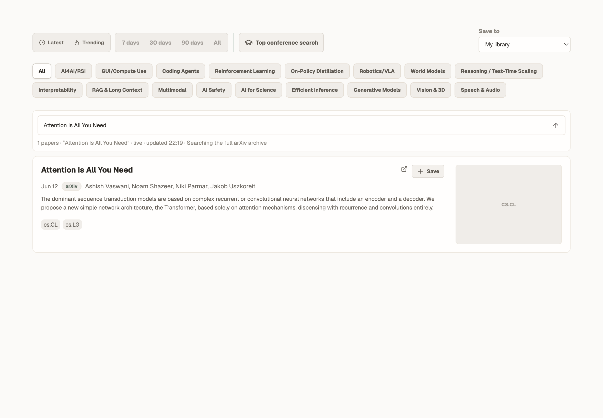
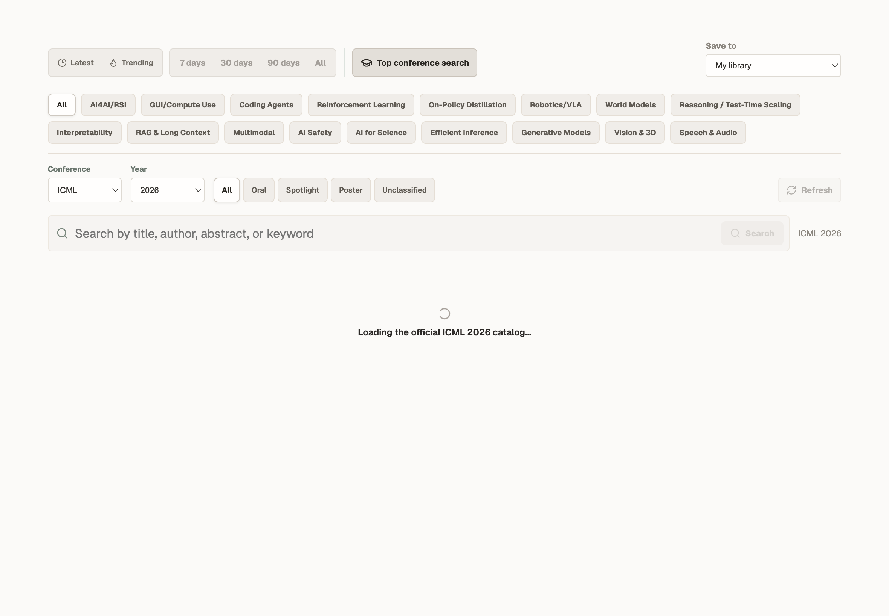
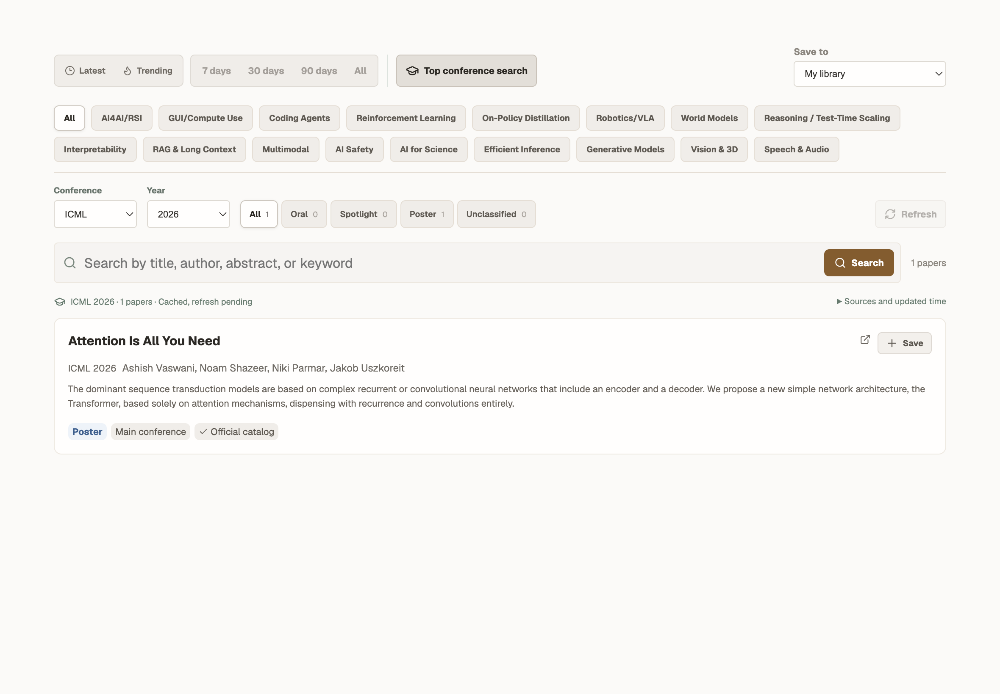
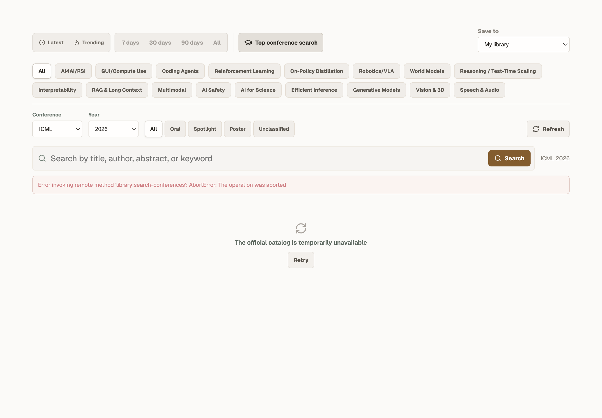
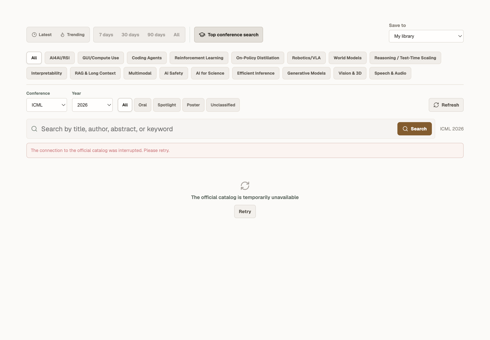
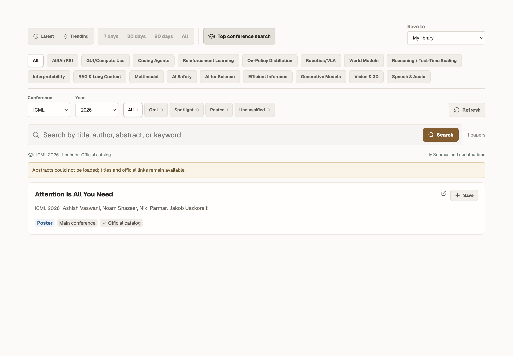
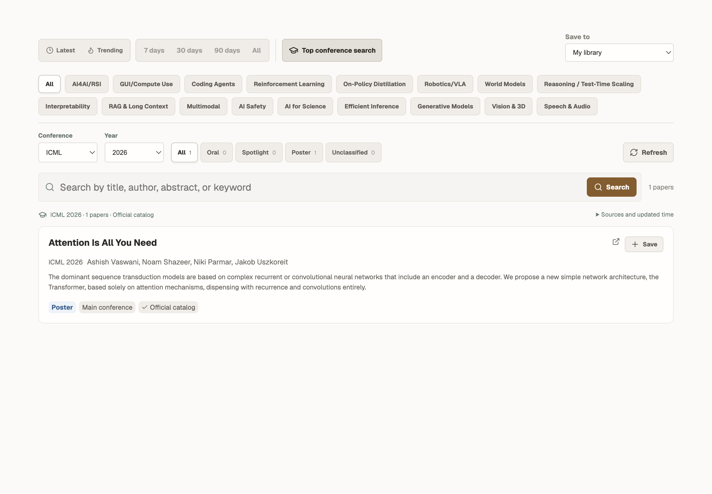

# Daily Papers recovery

Base: `b4a4480` on `main`. This repair covers browsing, return navigation, keyword/title retrieval, and official conference catalogs.

## Changes

- Keep Daily Papers mounted after its first visit. Preserve the chosen feed, topic, query, list, and conference page when returning; reset scoped state when the workspace/project changes.
- Render matching persisted data before refreshing, including stale data. Bound renderer caches to 12 feed responses and 24 conference pages. Never show a previous query's rows under a new query.
- Keep Latest, Trending and Top conference search usable after a search. A newer request supersedes the previous request in the same window, without cancelling other windows or writing their results to another workspace.
- Explicit searches use the archive independently of feed date/category controls. Recognize arXiv IDs and keep multiword title phrases. Browsing uses stable submission-order queries and filters publication dates locally instead of generating minute-specific upstream queries.
- Use Electron `net.fetch` for discovery and conference retrieval so these requests follow the desktop's network/proxy configuration.
- Bound feed/API attempts and validate Atom responses. An unreadable response or API error must not become a cached “zero papers” success.
- On archive failure, browsing can fall back to official RSS announcements, with incomplete date coverage disclosed. Keyword searches can fall back to OpenAlex, clearly identifying its different coverage/ranking. OpenAlex uses an Environment API key if configured. A fallback with no records does not establish an empty primary search.
- Conference abstracts use the same validated segmented downloader as titles. Title snapshots are available while abstracts download and completion updates the visible search automatically. Missing or malformed abstracts cannot discard valid titles/links or erase previously cached abstracts. Legacy incomplete caches retry instead of remaining fresh for six hours, with a one-minute cooldown after a failed attempt. Missing abstracts alone do not trigger expensive CVF catalog rebuilding.

## Measured network behavior

These are individual measurements on this Mac, not latency guarantees. Source/network responses varied during verification.

| Request | Observation |
| --- | --- |
| Original Latest request | 25-second timeout, then HTTP 429; 46.3 seconds total |
| Original ICML transfer via Node fetch | Main catalog is 16.4 MB; only 264 KB received in a 15-second probe |
| Fixed ICML 2026 | 6,430 records; 5.5 seconds in one run with abstracts, 17.2 seconds in another run without optional abstracts |
| Same conference, cached | 5–8 ms |
| Latest / 7 days | 60 papers in 3.7 seconds in one run; a later cold API + RSS request timed out |
| `agent memory`, UI limit 60 | 60 OpenAlex fallback records in 4.5 seconds, including A-Mem and MemoryArena |
| `Attention Is All You Need`, UI limit 60 | Original paper returned through OpenAlex fallback in 3.7 seconds |
| arXiv ID `1706.03762` | Original paper through arXiv in 215 ms |
| Trending | 18 Hugging Face papers in 3.3 seconds |

Upstream arXiv rate limits and cold network failures remain possible. Existing cached papers stay usable during refresh/failure. This does not claim every conference edition or every arbitrary keyword was verified, nor that RSS covers the selected historical range.

## Automated verification

- Focused discovery, conference, figure, transfer and real-component UI tests: 71 passed.
- `npm run lint`, `npm run build`, and `npm run check:theme`: passed.
- Full suite: 1,549 tests, 1,540 passed, 5 skipped, 4 failed.
- All four failures were reproduced in a separate unchanged `b4a4480` checkout: experiment retry-audit temporary-path assertion on macOS, ordering in `native.ts`, locally missing LaTeX `phvr7t` font, and an outdated Library `searchKind` tab audit. No unrelated tests were weakened.
- UI behavior tests exercise stale-first rendering, rapid query/year changes, returning to a saved search without another request, saving into the selected Library, and reselecting the active feed/topic during an initial request.

## Matched visual evidence

Electron captures: 1180 × 820 CSS pixels, Paper theme. These are controlled bridge fixtures using a public paper record and pending refreshes, not live-source results. The conference fixture demonstrates cached-row visibility, not the paper's actual conference membership. Figure requests deliberately return no image so network/image differences do not obscure the comparison.

| Scenario | Before | After |
| --- | --- | --- |
| Old feed cache while refresh is pending |  |  |
| Search result with navigation controls |  |  |
| Old official-catalog cache during refresh |  |  |

## Follow-up: interrupted conference transfers

The running desktop reproduced an `AbortError` whose cause was `ERR_STREAM_PREMATURE_CLOSE`. This is an interrupted response body; the generic AbortError alone did not establish a timeout. Successful isolated requests had not covered this failure mode.

The official ICML endpoint supports HTTP byte ranges and a strong ETag. Virtual catalogs now download in 1 MiB segments with at most three concurrent streams; one broken segment retries once without discarding other validated segments. Content-Range, total length and version validators must match before assembly. A server ignoring Range is downloaded once normally; a ranged source without a version validator falls back to one complete response. The complete operation has a shared 60-second deadline and an 80 MB limit, and requests are aborted on failure. No partial/mixed catalog is saved as a completed result. The UI also translates connection/timeout failures instead of displaying Electron's raw RPC error.

Live segmented transfer: ICML 2026 returned all 6,430 records in 9.2 seconds, then cached access took 7 ms. After restarting the development app, its actual conference page displayed the 6,430-record catalog and cached results; this verification used the desktop's normal workspace rather than only an isolated probe.

Tests cover UTF-8 boundaries, concurrency limits, interrupted-segment retry, ignored ranges, changing ETags, invalid/oversized ranges, non-retryable 403/429 responses, a stalled deadline, and readable UI errors. Full suite still has the same four inherited failures documented above.

Matched 1180 × 820 Paper-theme fixtures for an interrupted request (before = commit `8bcc64d`, after = this follow-up):

| Before | After |
| --- | --- |
|  |  |

## Follow-up: reliable abstract loading

The previous eight-second, single-response abstract download was still vulnerable to the same transfer interruption as the large title catalog. Both files now use the range downloader. The title cache is written as soon as the main catalog is parsed, with an explicit pending state; the active renderer checks cached progress once per second while its live request runs, then replaces the title snapshot with complete abstracts. Polling is non-overlapping and stops on completion, selection change, hiding and unmount; late progress cannot overwrite a completed response. An abstract-only keyword query shows a loading state until its evidence arrives instead of an incorrect empty result.

A legacy cache carrying the missing-abstract warning is refreshed automatically, regardless of its six-hour catalog TTL. A failed attempt waits at least one minute before automatic retry. During failed refreshes, existing abstracts are preserved. Malformed/empty abstract maps are not treated as a successful enrichment.

Live Electron verification:

- ICML 2026: 6,430 records, first 40 of 40 returned papers with abstracts, no missing-abstract warning; 14.2 seconds for complete retrieval in this probe.
- ICLR 2026: one probe still had a transient abstract failure. Its abstract file subsequently downloaded in 9.1 seconds; the complete search retry returned 5,410 records, all 5,410 with abstracts, first 40 of 40 populated and no warning, in 21.2 seconds. This is evidence of working recovery, not a guarantee that upstream connections never fail.
- Actual desktop: restarted using the current production renderer build, opened the normal workspace and observed its missing-abstract ICML cache upgrade automatically to official records with visible abstract paragraphs; the warning disappeared.
- Added integration tests for early title visibility, completion of abstract-only searches, fresh legacy-cache repair, cooldown, preservation of known abstracts, a broken abstract segment retrying independently, late-progress protection, and timer cleanup. Final focused suite: 71 passed. Full suite: 1,549 tests, 1,540 passed, 5 skipped, the same 4 inherited failures.

Matched Paper-theme 1180 × 820 fixtures of the old missing-abstract state versus a successful enrichment (the public example is a UI fixture, not its actual conference membership):

| Before | After |
| --- | --- |
|  |  |
