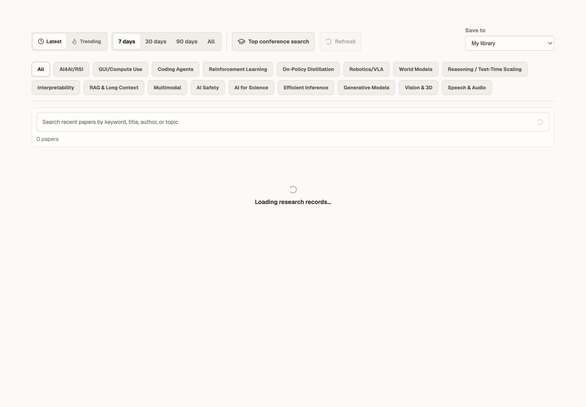
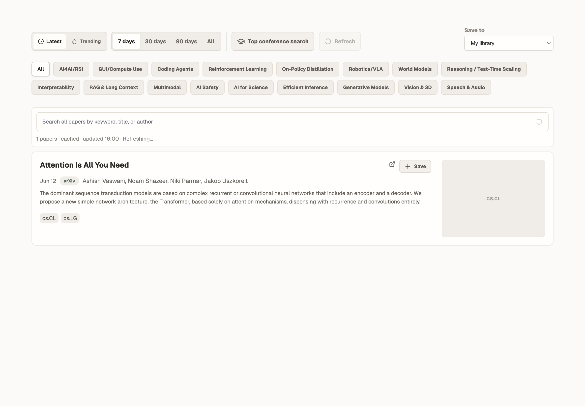
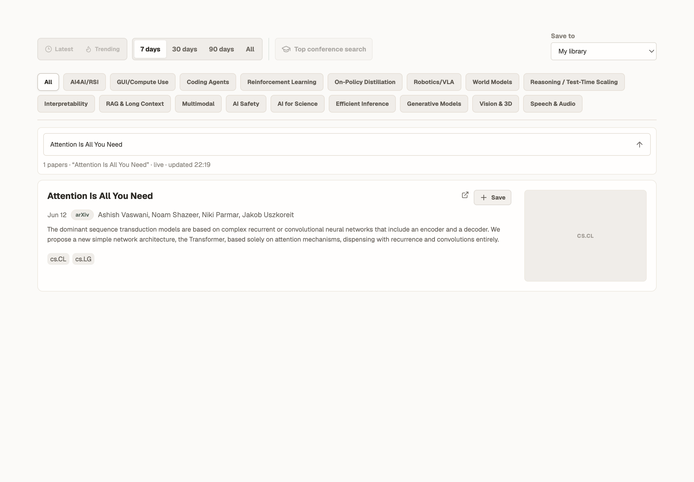

# Daily Papers recovery

Base: `b4a4480` on `main`. This repair covers browsing, return navigation, keyword/title retrieval, and official conference catalogs.

## Changes

- Keep Daily Papers mounted after its first visit. Preserve the chosen feed, topic, query, list, and conference page when returning; reset scoped state when the workspace/project changes.
- Render matching persisted data before refreshing, including stale data. Bound renderer caches to 12 feed responses and 24 conference pages. Never show a previous query's rows under a new query.
- Keep Latest, Trending and Top conference search usable after a search. A newer request supersedes the previous request in the same window, without cancelling other windows or writing their results to another workspace.
- Explicit searches use the archive independently of feed date/category controls. Recognize arXiv IDs and keep multiword title phrases. Browsing uses stable submission-order queries and filters publication dates locally instead of generating minute-specific upstream queries.
- Use Electron `net.fetch` for discovery and conference retrieval so these requests follow the desktop's network/proxy configuration.
- Bound feed/API attempts and validate Atom responses. An unreadable response or API error must not become a cached “zero papers” success.
- On archive failure, browsing can fall back to official RSS announcements, with incomplete date coverage disclosed. Keyword searches can fall back to OpenAlex, clearly identifying its different coverage/ranking. OpenAlex uses an Environment API key if configured. A fallback with no records does not establish an empty primary search.
- Optional conference abstracts have a shorter deadline and malformed/missing abstracts cannot discard valid titles/official links. Missing abstracts alone do not trigger expensive CVF catalog rebuilding.

## Measured network behavior

These are individual measurements on this Mac, not latency guarantees. Source/network responses varied during verification.

| Request | Observation |
| --- | --- |
| Original Latest request | 25-second timeout, then HTTP 429; 46.3 seconds total |
| Original ICML transfer via Node fetch | Main catalog is 16.4 MB; only 264 KB received in a 15-second probe |
| Fixed ICML 2026 | 6,430 records; 5.5 seconds in one run with abstracts, 17.2 seconds in another run without optional abstracts |
| Same conference, cached | 5–8 ms |
| Latest / 7 days | 60 papers in 3.7 seconds in one run; a later cold API + RSS request timed out |
| `agent memory`, UI limit 60 | 60 OpenAlex fallback records in 4.5 seconds, including A-Mem and MemoryArena |
| `Attention Is All You Need`, UI limit 60 | Original paper returned through OpenAlex fallback in 3.7 seconds |
| arXiv ID `1706.03762` | Original paper through arXiv in 215 ms |
| Trending | 18 Hugging Face papers in 3.3 seconds |

Upstream arXiv rate limits and cold network failures remain possible. Existing cached papers stay usable during refresh/failure. This does not claim every conference edition or every arbitrary keyword was verified, nor that RSS covers the selected historical range.

## Automated verification

- Focused discovery, conference, figure and real-component UI tests: 58 passed, followed by a fourth UI case for reselecting an already-active filter. Final full suite includes all of these.
- `npm run lint`, `npm run build`, and `npm run check:theme`: passed.
- Full suite: 1,537 tests, 1,528 passed, 5 skipped, 4 failed.
- All four failures were reproduced in a separate unchanged `b4a4480` checkout: experiment retry-audit temporary-path assertion on macOS, ordering in `native.ts`, locally missing LaTeX `phvr7t` font, and an outdated Library `searchKind` tab audit. No unrelated tests were weakened.
- UI behavior tests exercise stale-first rendering, rapid query/year changes, returning to a saved search without another request, saving into the selected Library, and reselecting the active feed/topic during an initial request.

## Matched visual evidence

Electron captures: 1180 × 820 CSS pixels, Paper theme. These are controlled bridge fixtures using a public paper record and pending refreshes, not live-source results. The conference fixture demonstrates cached-row visibility, not the paper's actual conference membership. Figure requests deliberately return no image so network/image differences do not obscure the comparison.

| Scenario | Before | After |
| --- | --- | --- |
| Old feed cache while refresh is pending |  |  |
| Search result with navigation controls |  |  |
| Old official-catalog cache during refresh |  |  |
