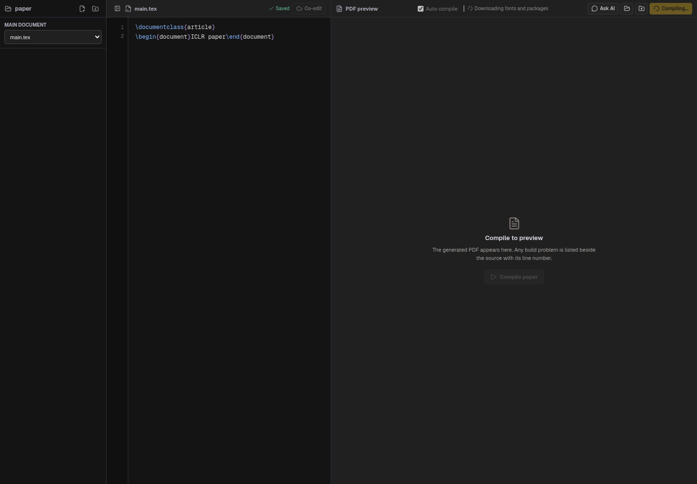
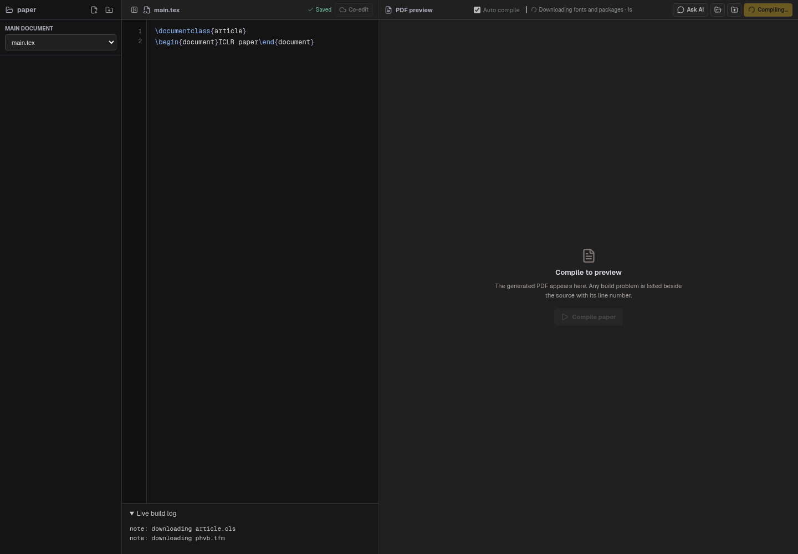
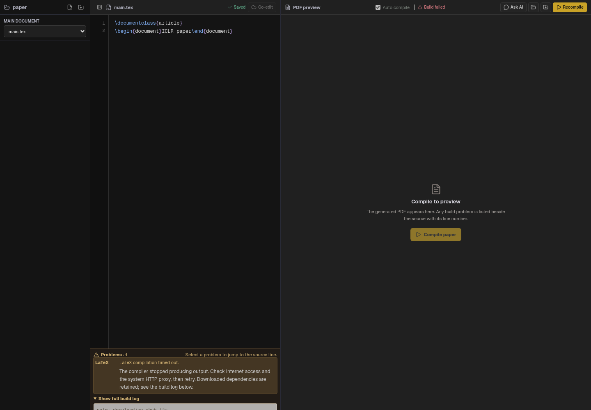

# First-build download progress, proxy propagation and timeout diagnostics

The reported NeurIPS build exceeded the old fixed 180-second compiler limit.
The thrown timeout discarded all compiler output, which prevented distinguishing
slow first-use downloads from an unreachable resource server. The screenshot
alone did not establish which network operation stalled on the user's Mac.

The managed compiler now explicitly receives the HTTP/HTTPS system proxy that
Electron resolves for the bundle URL. Existing HTTP_PROXY/HTTPS_PROXY/ALL_PROXY
bindings take precedence and are never printed or overwritten. Local bundle
fixtures bypass this resolution. A SOCKS-only configuration without an HTTP
endpoint is reported with instructions to enable an HTTP proxy. Proxy resolution
is itself limited to 30 seconds. No TLS verification is disabled.

Tectonic runs with normal chatter and printed output. Download, format
initialization and typesetting messages are streamed to the view with elapsed
time and the most recent 16 KB of output. The log states whether a system HTTP
proxy was explicitly propagated, without exposing its address or credentials.

The managed build has a 10-minute total budget and a 2-minute no-output limit.
New output resets the no-output timer. Reaching either limit kills the compiler
and returns a structured failed build, preserving its output and a retry hint.
It no longer becomes a generic IPC Workspace error. Previously downloaded
resources remain available for retry. Unmanaged development-tool timeouts retain
their existing limits. Stale on-disk logs are not substituted for the timed-out
run's partial output.

Validation:

- Fake-clock tests exercise no-output timer resets, termination, retained output,
  and the longer total deadline without waiting for wall-clock timeouts.
- Proxy tests cover HTTP resolution, explicit-environment precedence, local
  fixtures, DIRECT and unsupported SOCKS-only configuration.
- The real managed-engine HTTP-bundle test still downloads Helvetica resources,
  compiles successfully, and recompiles with its test server offline.
- Browser fixture checks verify live filenames, elapsed time, a retained timeout
  log, dependency help and a cleared failed preview. The paired screenshots use
  the previous and updated React views at the same viewport and input state.
- These checks do not prove that the user's Mac can reach the public bundle host;
  that needs a fresh local build using the newly retained log. The cloud policy
  still blocks public TeX bundle hosts, as documented in managed-latex-engine.md.

