# Library folder workspace

Library now keeps its project folders visible while opening papers and notes in document tabs. The navigation uses existing literature libraries as folders; this change does not move PDFs, create filesystem directories, or change database/API schemas.

The Library overview, folder browsing and reader all share import and cloud-sync actions. Users can search across the current project, filter by reading state or favourites, sort papers, collapse the directory and inspect a paper without opening its PDF. Author lists initially show three names and can be expanded.

Only one reading workbench mounts at a time. Switching tabs remembers PDF page, zoom, reader controls, assistant visibility and an unsent chat draft. Note drafts live separately from the document renderer and survive tab switches. Saving still uses `updateLibraryPaper`; failed saves retain the draft. A running paper conversation, PDF preparation or reproduction prevents switching the active document until it finishes. Up to eight document tabs can be open.

The existing PDF preparation/attachment, page search, highlighting, translation, Canvas, Interactive paper, Project, Codebase, Reproduce, chat streaming, interrupt, Enter/Shift+Enter and file-drop paths are reused. The assistant adds a Notes tab beside Paper chat and retains the existing resizer. Merely opening its Notes tab does not start a paper briefing.

Folder metadata loads on demand. Explicit project-wide search, All papers and opening Notes load remaining metadata with a shared two-request queue. Responses from superseded refreshes cannot overwrite a newer paper update. Project changes remount the entire workspace, separating caches, tabs and drafts. Paper and Charcoal colours continue to use the existing appearance tokens; there is no new global theme or fixed palette.

## Verification

- `npm run lint`, `npm run build`, `npm run check:theme`, and `git diff --check` passed.
- 34 focused tests passed, including metadata concurrency/cancellation, stale-response protection, note drafts/failed saves, project ownership, membership removal, cloud annotations, and Paper chat keyboard/drop/layout/performance checks.
- Full suite: 995 passed, 7 failed, 4 skipped (1,006 total). The unchanged baseline reproduces the three Windows shell failures, the PaperReviewView native-confirm audit failure, and three Benchmark Radar fixture failures when run from this checkout next to the local `benchmark-radar` repository. These failures were not weakened or changed.
- Browser preview screenshots use seeded records and an isolated Electron profile; no real model request or user database is needed for the comparison.
- A real two-page PDF fixture rendered successfully. Switching away and back restored page 2 and 110% zoom with exactly one reader mounted. Notes opened without a model call; the page had no horizontal overflow at 1024px and 760px.

## Screenshots

Same 1440 × 1000 viewport, theme and seeded project for each pair.

| Surface | Before | After |
| --- | --- | --- |
| Paper overview | 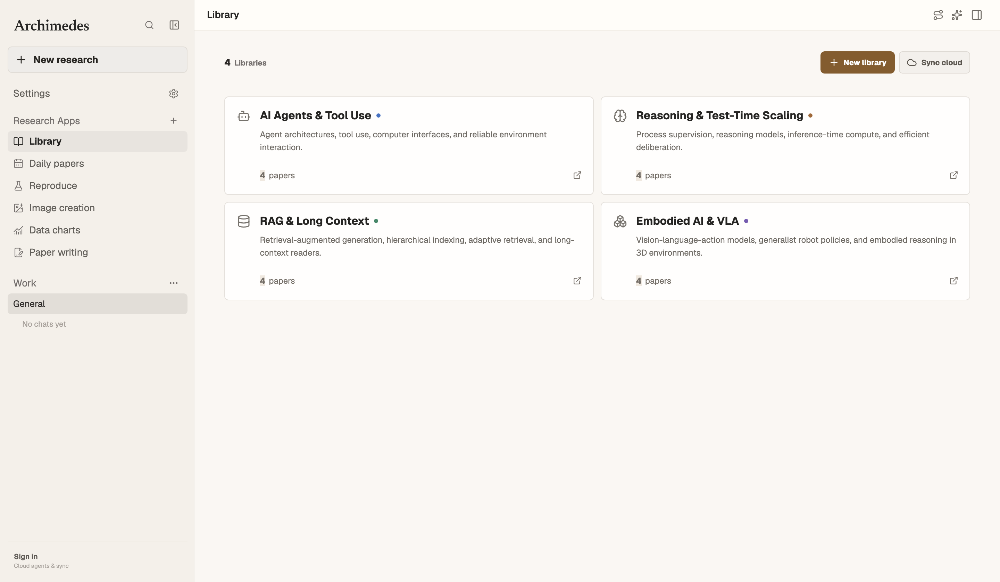 | 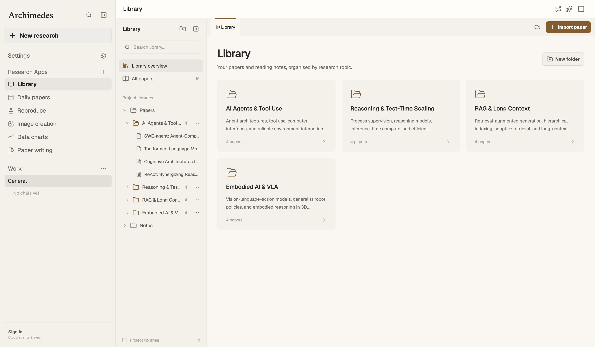 |
| Paper folder | 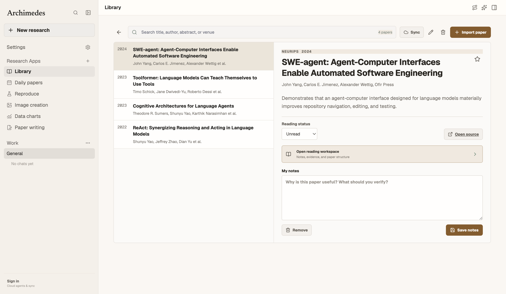 | 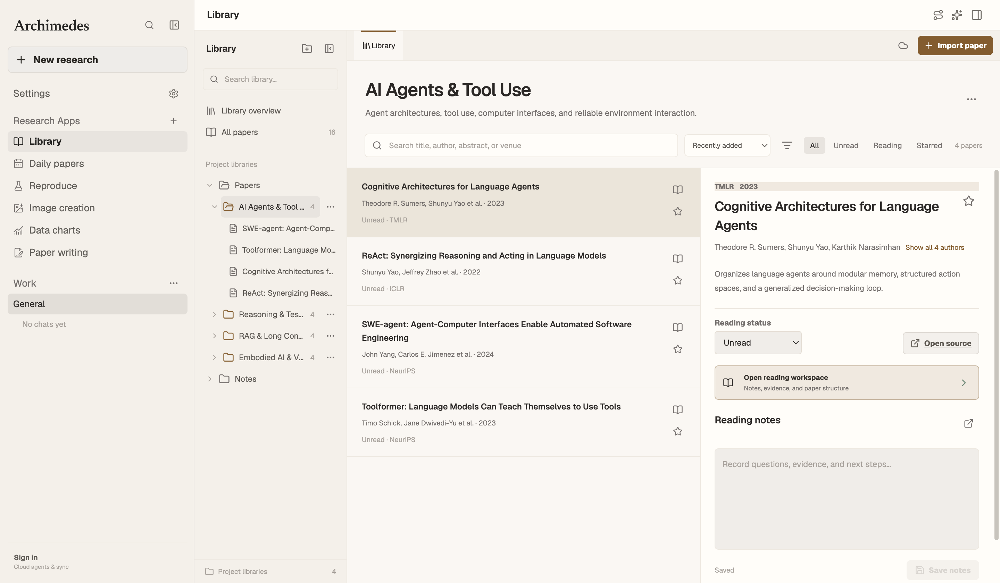 |
| Charcoal overview | 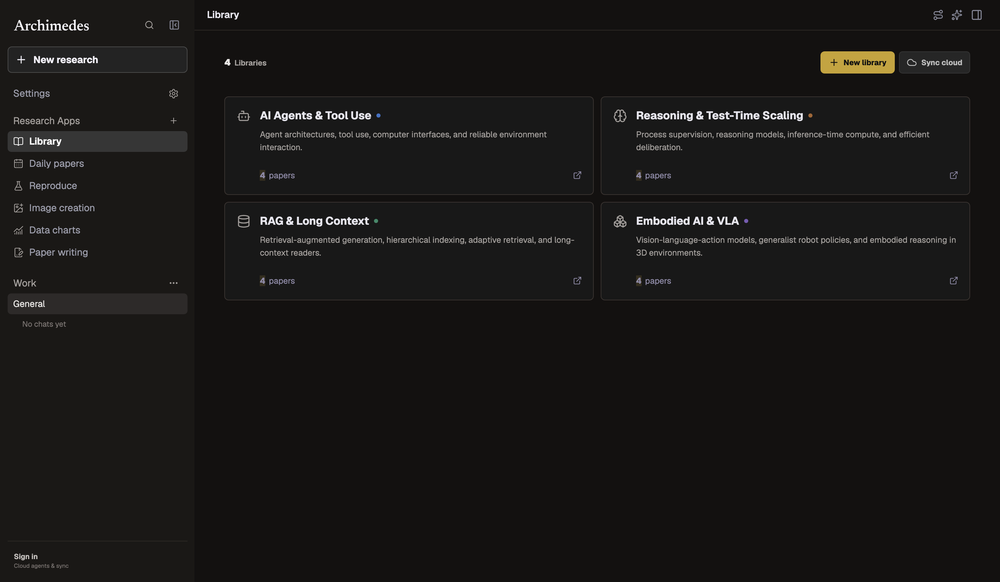 | 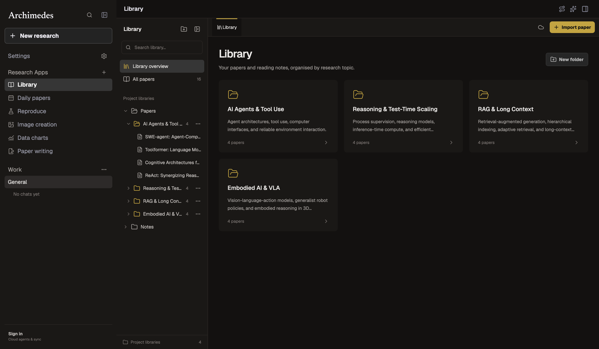 |
| Charcoal folder | 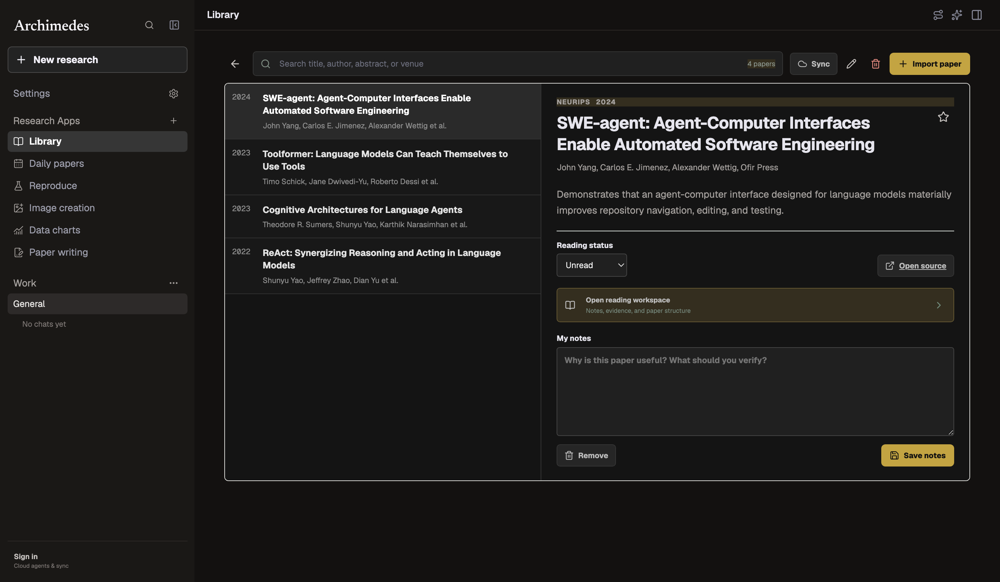 | 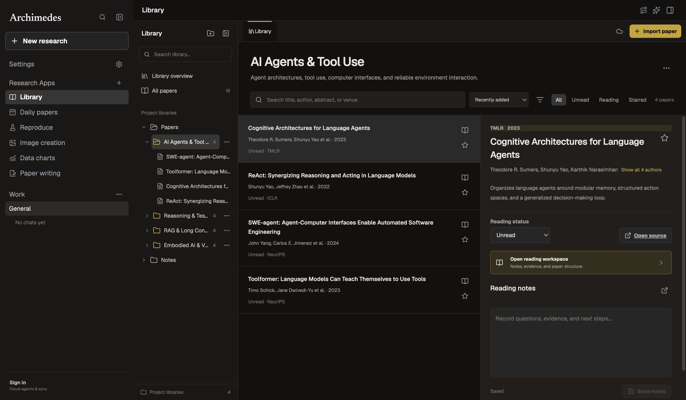 |
| Paper reader | 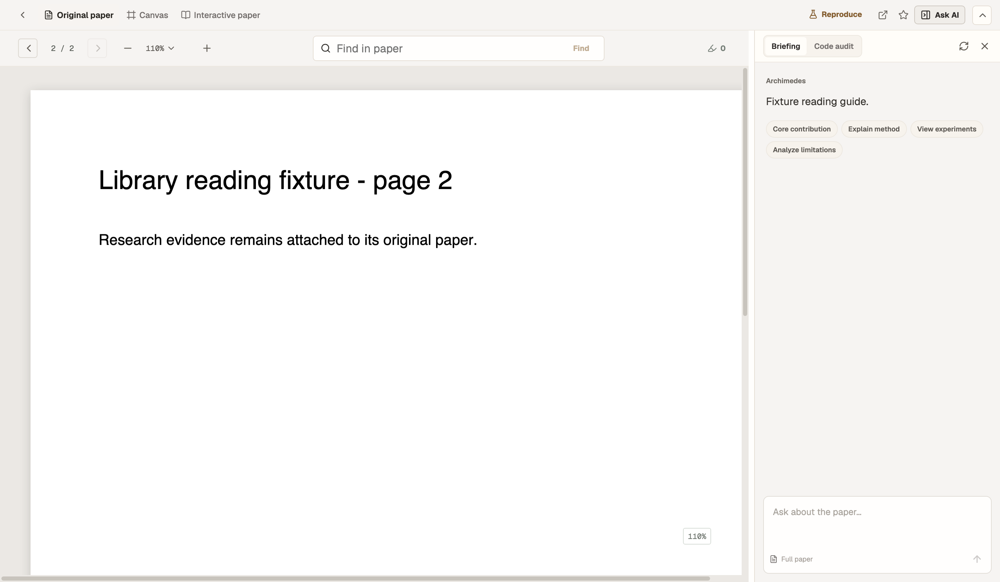 | 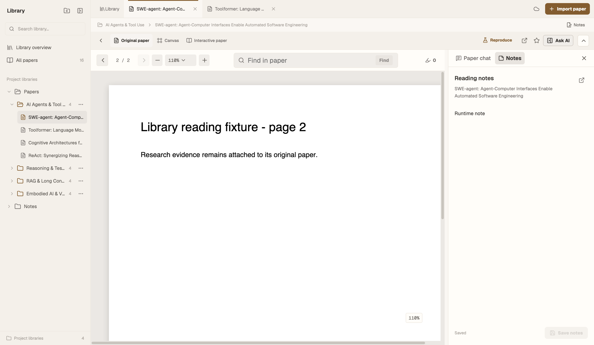 |
| Charcoal reader | 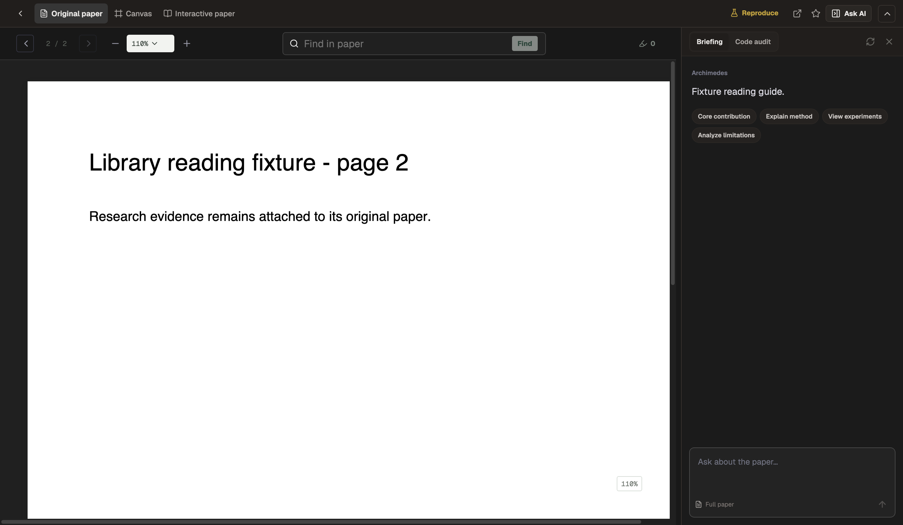 | 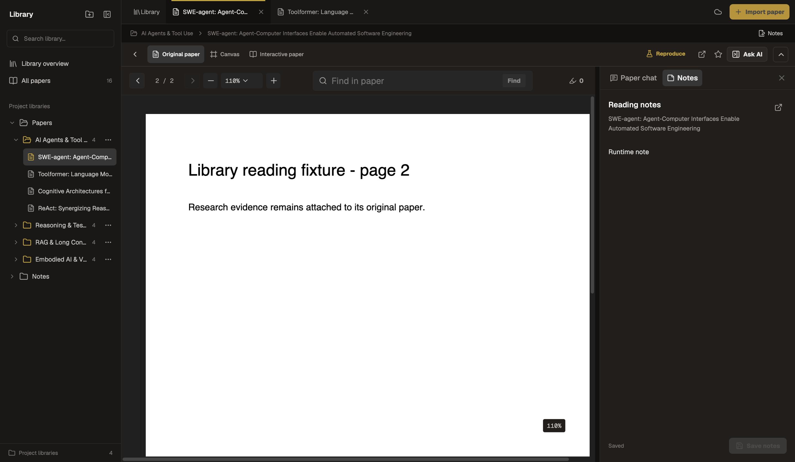 |

Reader comparisons use the same two-page fixture, page 2, 110% zoom and open side panel (previous Paper chat; new Notes tab).

## Boundaries

Folders are one level of existing project libraries. Arbitrary filesystem nesting, moving files between directories and new harness selection inside Paper chat are not introduced. Daily Papers keeps its discovery/import flow. Unsaved drafts and document positions are retained within the project session; saved notes and chat history continue using existing persistence.
