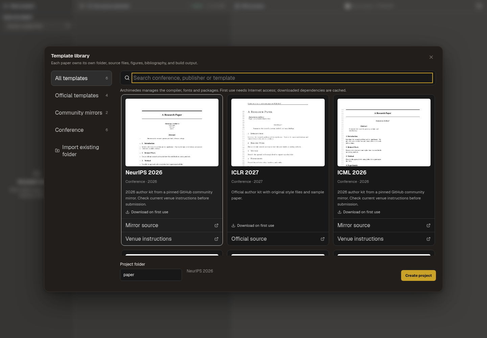
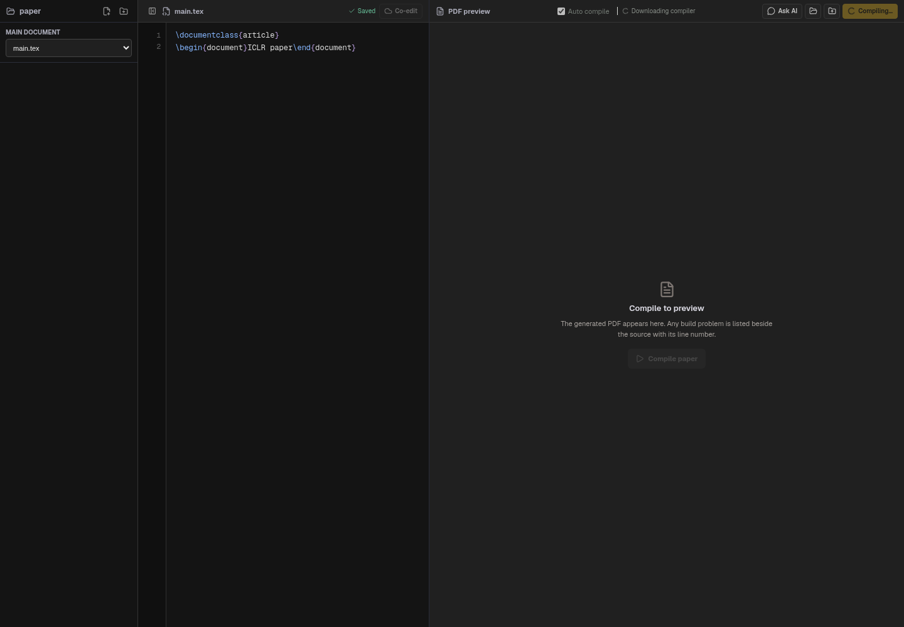

# Managed local LaTeX compilation

Paper Writing uses Archimedes' managed Tectonic 0.17.0 engine. Users do not need
to install MacTeX, TeX Live, MiKTeX, or font packages manually. The paper remains
on the user's machine. Network requests download the engine (development only,
or when absent from app resources) and the TeX resource files it needs.

## Installation and cache

- Release builds run `scripts/prepare-latex-engine.cjs` in electron-builder's
  `beforePack` hook. The correct official archive and its license are copied into
  `resources/latex-engine`, outside ASAR. Keeping the archive unchanged prevents
  macOS/Windows code signing from invalidating the upstream executable hash.
  The verified executable is unpacked into userData on first use. Packaging fails on download/checksum
  errors. The normal native-module rebuild remains enabled.
- Development and installations without that resource download the pinned
  release executable on first use into Electron's `userData/latex-runtime`.
- Official publisher archive digests and executable digests are recorded in
  `shared/latex-engine.json`. Both are verified before installation, and the
  executable is verified before reuse. Invalid bundled archives fail verification
  before extraction; invalid executables are never run.
- TeX fonts, macros, bibliography resources and generated formats are managed by
  Tectonic in `userData/latex-runtime/tex-cache`. The first build needs Internet
  access. Subsequent builds can work offline if all their dependencies are cached;
  a new template or package can require another download.
- Builds are serialized to protect the shared format/dependency cache. Repeated
  queued autosave builds of the same document are coalesced. A failed build does
  not block the queue. The engine runs with `--untrusted`, without shell escape.
- The UI displays compiler preparation/download and dependency/compile progress.
  Network failures retain the build log and explain how to retry. Failed builds
  do not show a leftover PDF.

Supported release assets: macOS arm64/x64, Linux arm64/x64 (musl), Windows x64.
These are separate architecture-specific installers; a universal macOS package
is not configured. Local system TeX tools remain usable by development tests,
but the Paper Writing IPC always selects the managed engine.

## Network destinations

Engine installation: `github.com` and its `release-assets.githubusercontent.com`
redirect. Default TeX bundle: `relay.fullyjustified.net` and its
`data1.fullyjustified.net` redirect. TLS and artifact verification remain enabled.
No dependency download requires administrator privileges.

The current cloud environment blocks the public TeX bundle hosts. Domain
additions were saved in its environment configuration draft; saving the draft
does not apply runtime network access. Public first-use downloads and the exact
current public bundle remain unverified until that access is saved and retested.

## Evidence and validation limits

- All five platform archives were downloaded from the official release and
  checked against the SHA-256 values published on its GitHub asset page. Our
  archive reader extracted and verified each expected executable. Only the Linux
  x64 binary was executed; macOS/Windows execution and signing were not tested.
- ICLR 2026/2027, CVPR 2026, NeurIPS 2026 and ICML 2026 examples compiled with the
  real managed engine against a local validation bundle built from installed TeX
  files. The local bundle lacks ACL's inconsolata package; the complete ACL sample
  was not validated against the public managed bundle.
- A real ICLR 2027 build fetched 173 resources from a controlled local HTTP bundle
  endpoint. Closing that server and rebuilding succeeded with no additional HTTP
  requests. This tests the real download/cache path, not the public host's access.
- `electron/managed-latex-engine.live.test.cjs` independently tests the real engine
  fetching Helvetica/font dependencies, reusing them offline, coalescing queued
  builds, and recovering after a rejected build. It is opt-in: supply a flat local
  bundle with a SHA256SUM via `ARCHIMEDES_TEX_TEST_BUNDLE` and, optionally, packaged
  resources via `ARCHIMEDES_TEX_TEST_RESOURCES`. It is skipped in ordinary suites.
- Unit tests cover concurrent installation, offline executable reuse, corrupt
  cached artifacts, archive/executable checksum rejection, safe archive extraction,
  bundled archive validation, unsupported platforms, size limits and failed retry.
- A Linux directory package was built with `npmRebuild=false` solely to validate
  the new resource hook and paths independently of the existing cloud native-module
  rebuild blocker. Its bundled archive was unpacked by the managed runtime and
  the resulting executable reports version 0.17.0.
  This is not a verified release installer or a full Electron startup test.
- Browser fixture checks cover progress messages and preview state. Screenshots
  below are of the real React view with an IPC fixture, not a running Electron app.

